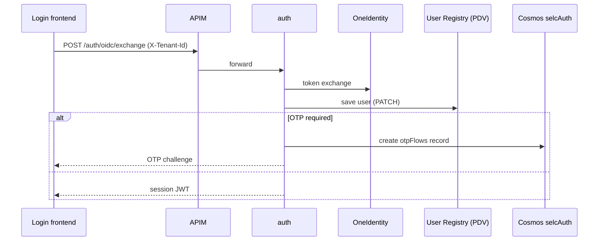

# auth

> Authentication microservice: completes the OneIdentity (OIDC) and SAML login flows, manages the optional OTP second factor and issues the SelfCare session JWT.

| | |
|---|---|
| Path | `apps/auth` |
| Stack | Quarkus 3.31.2, Java 17, reactive (Mutiny `Uni`, reactive Mongo Panache) |
| Type | REST microservice (application API behind APIM) |
| Tenants | AR login; per-tenant M2M issuance also supports PNPG with login disabled |
| Infra | `infra/resources/auth/` (`dev-ar`, `uat-ar`, `prod-ar`) |

## Responsibilities

- Exchange an OneIdentity OIDC authorization code for a SelfCare session token (`OidcServiceImpl`).
- Validate SAML responses posted to the Assertion Consumer Service (`SAMLServiceImpl`, `util/SamlValidator`).
- Run the OTP flow (create, verify, resend), send OTP e-mails through OneMail and enforce attempts/daily limits (`OtpFlowServiceImpl`, `OtpNotificationServiceImpl`).
- Sign the session JWT with the per-tenant private key and `kid` (`JwtServiceImpl`, `conf/TenantSessionKeyProvider`).
- Issue short-lived technical `PAGOPA` tokens through the opt-in `/token/service` endpoint, after Entra verification and an explicit M2M grant.
- Resolve and enforce the tenant on every login entry point (`filter/TenantResolutionFilter`).

## Architecture

Package root: `apps/auth/src/main/java/it/pagopa/selfcare/auth/`.

| Package | Key classes |
|---|---|
| `controller` | `OidcController` (`/oidc`), `OtpController` (`/otp`), `SamlCallbackController` (`/saml`) |
| `service` | `OidcService`, `SAMLService`, `OtpFlowService`, `OtpNotificationService`, `SessionService`, `JwtService`, `UserService` (interface + `Impl`) |
| `client` | Wrappers around generated clients: `TenantUserRegistryApi` (+ `TenantUserRegistryApiKeyFilter`), `IamMsApi`, `InternalUserMsApi`, `ExternalInternalUserApi`, `OneMailEmailsApi` and their header factories |
| `conf` | `TenantRegistry`, `TenantDefinition`, `TenantSessionKeyProvider`, `TenantOutboundMailConfig`, `FeatureFlagConfig`, `MongoConfig` |
| `context` | `AuthTenantContext` (request-scoped verified tenant), `TokenContext` |
| `entity` | `OtpFlow` (reactive Panache entity) |
| `filter` | `TenantResolutionFilter`, request/response logging filters, `MDCUtils` |
| `exception/handler` | `ExceptionHandler` (central mapper, `Problem` responses) |
| `health` | `AuthMongoReadinessCheck` |



## API

- No `@Authenticated` annotation: these endpoints are the pre-login entry points; protection relies on the tenant filter, request validation and the flow state.
- Specs: `apps/auth/src/main/docs/openapi.json` / `openapi.yaml` (full surface, generated by the build) and `apps/auth/src/main/docs/openapi-apim.json` (hand-maintained, APIM subset). See `apps/auth/src/main/docs/README.md`.

| Method | Path | Operation | In `openapi-apim.json` |
|---|---|---|---|
| POST | `/oidc/exchange` | `oidcExchange` | yes |
| POST | `/otp/verify` | `verifyOtp` | yes |
| POST | `/otp/resend` | `resendOtp` | yes |
| GET | `/otp/mail-info/{mailRequestId}` | `getOtpMailInfo` (tag `support`) | no |
| GET | `/otp/info` | OTP info by `userId`/`status` (tag `support`) | no |
| POST | `/saml/acs` | SAML ACS callback | yes |
| POST | `/token/service` | `issueMachineToken` | no |

APIM exposure:

- Application API `selc-<env>-api-auth`, base path `auth`, module `infra/resources/_modules/apim_api`, built from `openapi-apim.json`, with tenant enforcement enabled and JWT-based tenant resolution disabled (`infra/resources/auth/dev-ar/auth.tf`).
- Operations tagged `support` are merged into the external support API (`infra/resources/_modules/apim_external_api/api/selfcare_support_service/v1/openapi_merge/openapi_merge.json`, input `selfcare-auth-ms`).

## Data and messaging

- MongoDB (Cosmos DB) database `selcAuth`, collection `otpFlows` (`entity/OtpFlow.java`, Terraform modules `cosmosdb_auth` and `collection_auth_otp_flows`).
- The default Quarkus Mongo client is disabled (`quarkus.mongodb.active=false`); the client and database are selected per tenant by `selfcare-sdk-tenant-mongodb` from the `mongo` entry of `TENANT_REGISTRY_JSON` (configured only for AR).
- No Event Hub, queue or blob storage usage.

## Integrations

Generated clients (Quarkus OpenAPI generator, specs in `apps/auth/src/main/openapi/`):

| Spec copy | Target | URL property / env var |
|---|---|---|
| `one_identity.json` | OneIdentity | `ONE_IDENTITY_URL` |
| `user_registry.json` | PDV User Registry (per-tenant `x-api-key`) | `USER_REGISTRY_URL` |
| `iam.json` | [iam](iam.md) | `IAM_API_URL` |
| `internal_ms_user.json` | user-ms internal API | `INTERNAL_MS_USER_API_URL`, `INTERNAL_MS_USER_API_KEY` |
| `internal.json` | external-api internal API | `INTERNAL_API_URL`, `INTERNAL_API_KEY` |
| `one_mail.json` | OneMail (OTP e-mails) | `ONE_MAIL_URL`, `TENANT_AR_ONE_MAIL_API_KEY` |

## Configuration

Names only, from `apps/auth/src/main/resources/application.properties` and `infra/resources/auth/*/auth.tf`.

| Group | Variables |
|---|---|
| Tenant | `TENANT_REGISTRY_JSON`, `TENANT_SUPPORTED_TENANTS` (default `AR`), `SELFCARE_TENANT_STRICT_DATA_ISOLATION` |
| Mongo | `MONGODB_CONNECTION_STRING_AR` (referenced from the registry) |
| Session JWT | `TENANT_AR_JWT_SESSION_PRIVATE_KEY`, `TENANT_AR_JWT_SESSION_KEY_ID`, `JWT_PUBLIC_KEY_AR`, `SESSION_TOKEN_DURATION_HOURS`, `SESSION_TOKEN_AUDIENCE`, `SESSION_TOKEN_TENANT_AUDIENCE_ENABLED` |
| OneIdentity / PDV | `ONE_IDENTITY_URL`, `TENANT_AR_ONE_IDENTITY_CLIENT_ID`, `TENANT_AR_ONE_IDENTITY_CLIENT_SECRET`, `USER_REGISTRY_URL`, `USER_REGISTRY_API_KEY_AR` |
| OTP | `FEATURE_FLAG_OTP_ENABLED`, `FEATURE_FLAG_OTP_BETA_USERS`, `OTP_DURATION_MINS`, `OTP_MAX_ATTEMPTS`, `OTP_DAILY_LIMIT` |
| Mail | `ONE_MAIL_URL`, `TENANT_AR_ONE_MAIL_API_KEY`, `TENANT_AR_MAIL_SENDER` |
| SAML | `SAML_IDP_ENTITY_ID`, `SAML_IDP_CERT`, `SAML_IDP_METADATA`, `SAML_SP_ENTITY_ID`, `SAML_SP_ACS_URL`, `SAML_TIME_INTERVAL` |
| Outbound | `IAM_API_URL`, `INTERNAL_API_URL`, `INTERNAL_API_KEY`, `INTERNAL_MS_USER_API_URL`, `INTERNAL_MS_USER_API_KEY`, `AUTH_MS_RETRY`, `AUTH_MS_RETRY_MIN_BACKOFF`, `AUTH_MS_RETRY_MAX_BACKOFF` |
| Observability | `APPLICATIONINSIGHTS_CONNECTION_STRING` |

Secrets are injected from Key Vault (`secrets_names` map in `auth.tf`).

Signing keys are referenced per tenant through `jwt.session.privateKeyEnvVar`
and `jwt.session.keyIdEnvVar` in `TENANT_REGISTRY_JSON`; actual key material
stays in secret-backed environment variables. A PNPG entry may declare these
references with `auth_enabled=false`, without login credentials or resources.
Signing-key loading is independent of login enablement; user-session generation
still requires `auth_enabled=true`. M2M issuance additionally requires the global
feature flag and exact identity/tenant/destination/scope grants.
See the [M2M configuration guide](../../libs/selfcare-sdk-m2m/README.md) for a
two-tenant example, audience settings and the `PAGOPA`/`SUPPORT` trust implications.

## Multitenancy

- `TenantResolutionFilter` requires the `X-Tenant-Id` header on `/oidc`, `/otp` and `/saml` paths, resolves it against `TenantRegistry` (only tenants with authentication enabled are accepted) and copies it into both `AuthTenantContext` and the shared `TenantContext`. Missing/unknown tenant returns 400, a disabled tenant returns 403; rejections are logged on the `AUDIT_TENANT` logger.
- The validated tenant selects the Mongo route, User Registry API key, OneIdentity credentials, OneMail key/sender and session signing key. OTP queries include `tenantId`; strict isolation is driven by `selfcare.tenant.strict-data-isolation`.
- Status and open work: [Auth_implementation.md](../specs/MULTITENANT/Step_2/Auth_implementation.md), [JWT_Key_Resolution.md](../specs/MULTITENANT/Step_2/JWT_Key_Resolution.md). Overview: [multitenancy.md](../multitenancy.md).

## Build, run and test

```bash
mvn --projects :auth --also-make package -DskipTests        # build + regenerate src/main/docs/openapi.*
mvn -f apps/auth/pom.xml test                               # unit tests (CucumberSuite excluded)
mvn -f apps/auth/pom.xml quarkus:dev
mvn --projects :auth --also-make test -Dtest=CucumberSuite -Dsurefire.failIfNoSpecifiedTests=false   # Cucumber (Docker)
```

- Cucumber runner: `it.pagopa.selfcare.auth.integration_test.CucumberSuite`; features in `apps/auth/src/test/resources/features/` (`oidc*.feature`, `otp.feature`, `saml.feature`); stack in `apps/auth/src/test/resources/docker-compose.yml`.
- Code style: `spotless-maven-plugin` with Google Java Format.

## Deployment

- Terraform: `infra/resources/auth/{dev,uat,prod}-ar/auth.tf` creates the APIM API, the `selcAuth` database and `otpFlows` collection, and the Container App `selc-<env>-auth-ms` (image `selfcare-auth-ms`).
- Workflows: `pr_auth.yml` (code review), `pr_auth_infra.yml` (Terraform plan), `integration_tests_auth_ms.yml` (Cucumber on PRs), `trigger_release_auth.yml` (manual, `env` dev/uat/prod, target `ar`, via `call_release_app.yml`), and the generic `release_app.yml`. `trigger_deploy_after_merge.yml` triggers the DEV release on push to `main`; `create_release_branch.yml` creates `releases/<domain>_vX.Y.Z` and triggers the UAT release. See [ci-cd.md](../ci-cd.md).

## References

- `apps/auth/src/main/docs/README.md` (openapi vs openapi-apim)
- [MULTITENANT Step 2 – Auth implementation](../specs/MULTITENANT/Step_2/Auth_implementation.md)
- [MULTITENANT Step 2 – Architecture](../specs/MULTITENANT/Step_2/ARCHITECTURE.md)
- [selfcare-sdk-tenant](../libs/selfcare-sdk-tenant.md), [selfcare-sdk-tenant-mongodb](../libs/selfcare-sdk-tenant-mongodb.md), [selfcare-sdk-health](../libs/selfcare-sdk-health.md)
- [architecture.md](../architecture.md), [infrastructure.md](../infrastructure.md), [testing.md](../testing.md)
