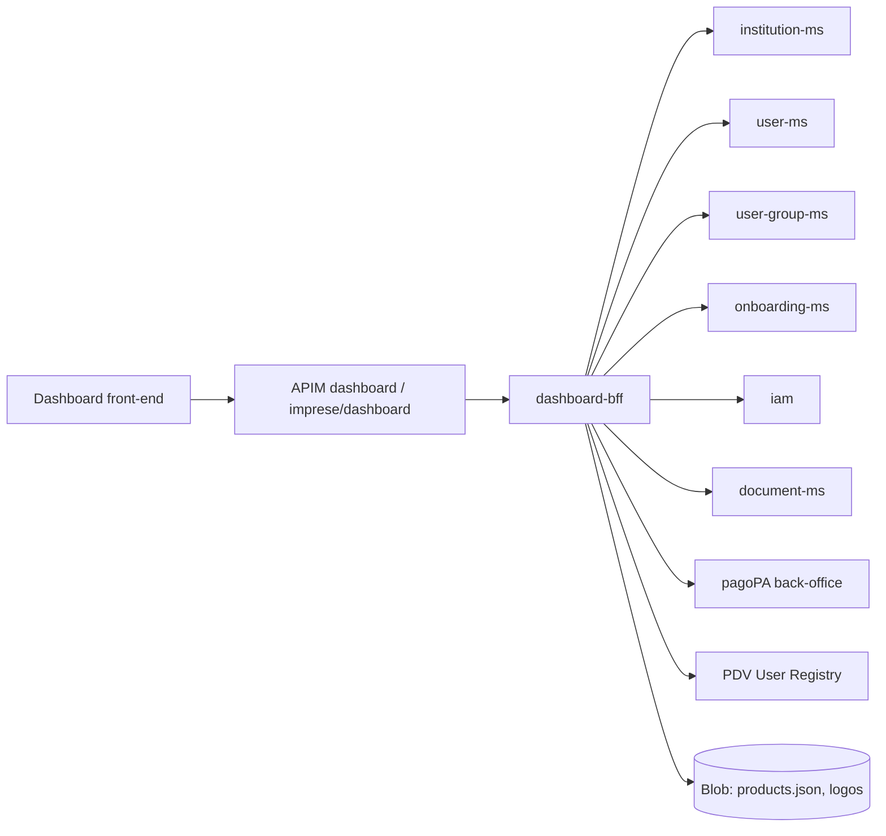

# dashboard-bff

> Spring Boot backend-for-frontend of the SelfCare dashboard (Area Riservata and PNPG "imprese"): institution, user, group, product, delegation, document and token-exchange APIs for the logged-in user.

| | |
|---|---|
| Path | `apps/dashboard-bff` |
| Stack | Spring Boot (parent `selc-starter-parent` 0.3.2-SNAPSHOT), Java 17, blocking (Spring MVC + OpenFeign) |
| Type | BFF |
| Tenants | Both: separate `-ar` and `-pnpg` deployments (AR under `dashboard`, PNPG under `imprese/dashboard`) |
| Infra | `infra/resources/dashboard-bff/` |

## Responsibilities

- Serve the dashboard front-end: institution details and updates (logo, geographic taxonomies), onboarded products, partners and delegations.
- User management on an institution: list, search, add, update, suspend/activate/delete users and product roles; user groups CRUD and membership.
- Product information (roles, brokers, back-office URL) from the product catalogue (`products.json` on blob storage).
- Token exchange: mint short-lived JWTs to enter product back-offices, the admin back-office and the billing portal (`/v2/token/exchange*`).
- Documents/contracts download and Zendesk support requests.
- Fine-grained authorization on every endpoint through IAM permissions and user/group membership.

## Architecture

Single Maven module, package `it.pagopa.selfcare.dashboard` (`apps/dashboard-bff/src/main/java`):

| Package | Content |
|---|---|
| `controller` | `InstitutionController`, `InstitutionV2Controller`, `UserV2Controller`, `UserGroupV2Controller`, `ProductController`, `ProductV2Controller`, `DelegationController`, `DocumentController`, `SupportController`, `TokenV2Controller` |
| `service` | Interface + `Impl` per domain (`InstitutionService`, `InstitutionV2Service`, `UserV2Service`, `UserGroupV2Service`, `ProductService`, `DelegationService`, `DocumentService`, `BrokerService`, `SupportService`, `FileStorageService`) |
| `client` | Feign clients (core, onboarding, user, user group, IAM, document, pagoPA back-office, user registry, `azure_storage`) |
| `security` | `SelfCarePermissionEvaluatorV2`, `ExchangeTokenServiceV2`, `FilterAuthorityDomain` |
| `interceptor` | `TenantHeaderInterceptor`, `BackOfficeAuthorizationInterceptor` |
| `config` | Security, method security, Feign, Swagger, exchange-token, Azure storage configuration |
| `aspect` | `@ApiFeatureFlag` (endpoints enabled by property, e.g. `feature.viewcontract.enabled`) |
| `health` | `ProductBlobStorageReadinessIndicator`, `InstitutionLogoBlobStorageReadinessIndicator` |

Main dependencies (`apps/dashboard-bff/pom.xml`): `selc-commons-base`, `selc-commons-web`, `selc-commons-connector-rest` 2.10.0; [selfcare-onboarding-sdk-common](../libs/selfcare-onboarding-sdk-common.md) and [selfcare-onboarding-sdk-product](../libs/selfcare-onboarding-sdk-product.md) 0.18.2; [selfcare-sdk-health-spring](../libs/selfcare-sdk-health-spring.md) 0.1.0; `azure-identity`, `azure-storage-blob`.



## API

Application API published through `infra/resources/_modules/apim_api` (module `apim_api_bff_dashboard`): AR `selc-<env>-api-bff-dashboard` ("BFF Dashboard API", base path `dashboard`), PNPG `selc-<env>-pnpg-api-bff-dashboard` ("BFF PNPG Dashboard API", base path `imprese/dashboard`); `tenant_enforcement_enabled = true`, `jwt_tenant_resolution_enabled = false`.

| Base path | Main operations |
|---|---|
| `/v1/institutions` | `GET /{institutionId}`, `PUT /{institutionId}`, `PUT /{institutionId}/logo`, `PUT /{institutionId}/geographic-taxonomy`, `GET /products`, `/{institutionId}/partners`, `/{institutionId}/institutions` |
| `/v2/institutions` | Institution list and details, users per institution/product (list, add, update, count), contract and onboardings info, pending onboardings, contract update |
| `/v2/users` | `GET /{id}`, `PUT /{id}`, `POST /search`, suspend/activate/delete, users by institution, `/otp-info` |
| `/v2/user-groups` | Create, update, delete, activate/suspend, members add/remove, `/me` |
| `/v1/products`, `/v2/products` | Product roles, brokers by institution type, `my-permissions`, back-office URL |
| `/v1/delegations` | Create delegation |
| `/v1/documents` | `/status`, institution/product documents and download |
| `/v1/support` | Zendesk support request |
| `/v2/token` | `exchange`, `exchange/back-office/admin`, `exchange/fatturazione` |

Spec: `apps/dashboard-bff/src/main/resources/swagger/api-docs.json`, generated by `SwaggerConfigTest` from `/v3/api-docs` and used as APIM `openapi_path` (descriptions in `swagger_en.properties` / `swagger_it.properties`).

## Data and messaging

- No own database, topic or queue.
- Blob storage: product catalogue `products.json` (`PRODUCT_AZURE_STORAGE_ACCOUNT_NAME`, `PRODUCT_STORAGE_CONTAINER`) and institution logos in the web storage (`WEB_AZURE_STORAGE_ACCOUNT_NAME`, `BLOB_CONTAINER_REF`, default `$web`), accessed with managed identity (`*_AZURE_CLIENT_ID`) or connection strings.

## Integrations

Feign clients (`client/`) and the committed spec copies in `apps/dashboard-bff/docs/openapi/` used by the OpenAPI generator (`pom.xml`):

| Spec copy | Clients | Target (env var) |
|---|---|---|
| `api-selfcare-core-docs.json` | `CoreInstitutionApiRestClient`, `CoreDelegationApiRestClient`, `CoreOnboardingApiRestClient`, `CoreManagementApiRestClient` | [institution-ms](institution-ms.md) (`MS_CORE_URL`) |
| `selfcare-onboarding-openapi.json` | `OnboardingRestClient` | [onboarding-ms](onboarding-ms.md) (`ONBOARDING_URL`) |
| `selfcare-user-docs.json` | `UserApiRestClient`, `UserInstitutionApiRestClient`, `UserPermissionRestClient` | [user-ms](user-ms.md) (`SELFCARE_USER_URL`) |
| `user-group-docs.json` | `UserGroupRestClient` | [user-group-ms](user-group-ms.md) (`MS_USER_GROUP_URL`) |
| `api-iam-docs.json` | `IamRestClient`, `IamExternalRestClient` | [iam](iam.md) (`IAM_URL`) |
| `api-document-docs.json` | `DocumentRestClient`, `DocumentContentRestClient` | [document-ms](document-ms.md) (`DOCUMENT_URL`) |
| `api-selfcare-backoffice-docs.json` | `MsBackOfficeChannelApiClient`, `MsBackOfficeStationApiClient` | pagoPA back-office (`PAGO_PA_BACKOFFICE_URL`, `BACKOFFICE_PAGO_PA_API_KEY`) |
| (none) | `UserRegistryRestClient` | PDV User Registry (`USERVICE_USER_REGISTRY_URL`, `USERVICE_USER_REGISTRY_API_KEY`) |

## Configuration

From `apps/dashboard-bff/src/main/resources/config/*` and `infra/resources/dashboard-bff/*`:

| Group | Variables |
|---|---|
| Server / logging | `B4F_DASHBOARD_SERVER_PORT`, `B4F_DASHBOARD_LOG_LEVEL`, `B4F_DASHBOARD_SECURITY_CONNECTOR`, `MULTIPART_MAX_FILE_SIZE` |
| Security | `JWT_TOKEN_PUBLIC_KEY` (JWT validation, `selc-commons-web`) |
| Token exchange | `JWT_TOKEN_EXCHANGE_PRIVATE_KEY`, `JWT_TOKEN_EXCHANGE_KID`, `JWT_TOKEN_EXCHANGE_ISSUER`, `JWT_TOKEN_EXCHANGE_DURATION`, `TOKEN_EXCHANGE_BILLING_URL`, `TOKEN_EXCHANGE_BILLING_AUDIENCE` |
| Clients | URLs and keys in [Integrations](#integrations); `REST_CLIENT_*`, `IAM_REST_CLIENT_*`, `SELFCARE_USER_REST_CLIENT_*`, `USERVICE_MS_CORE_REST_CLIENT_*`, `PAGO_PA_BACKOFFICE_REST_CLIENT_*` timeouts and logger levels |
| Storage | `PRODUCT_AZURE_STORAGE_ACCOUNT_NAME`, `PRODUCT_AZURE_CLIENT_ID`, `PRODUCT_STORAGE_CONTAINER`, `BLOB_STORAGE_PRODUCT_CONNECTION_STRING`, `WEB_AZURE_STORAGE_ACCOUNT_NAME`, `WEB_AZURE_CLIENT_ID`, `BLOB_STORAGE_WEB_CONNECTION_STRING`, `BLOB_CONTAINER_REF`, `PUBLIC_FILE_STORAGE_BASE_URL`, `INSTITUTION_LOGO_ALLOWED_EXTENSIONS`, `INSTITUTION_LOGO_ALLOWED_MIME_TYPES` |
| Support / features | `SUPPORT_API_KEY`, `SUPPORT_API_ZENDESK_REDIRECT_URI`, `SUPPORT_API_ZENDESK_ORGANIZATION`, `SUPPORT_API_ZENDESK_ACTION_URI`, `FEATURE_VIEWCONTRACT_ENABLED`, `USER_STATES_FILTER`, `DOCUMENTS_ALLOWED_ATTACHMENTS` |

Secrets injected by Terraform from Key Vault: `APPLICATIONINSIGHTS_CONNECTION_STRING`, `BACKOFFICE_PAGO_PA_API_KEY`, `JWT_TOKEN_EXCHANGE_KID`, `JWT_TOKEN_EXCHANGE_PRIVATE_KEY`, `JWT_TOKEN_PUBLIC_KEY`, `SUPPORT_API_KEY`, `USER_REGISTRY_API_KEY`, `USERVICE_USER_REGISTRY_API_KEY`. Application Insights role name `b4f-dashboard`.

## Multitenancy

- APIM resolves the tenant from the host and sets/enforces `X-Tenant-Id`; the BFF does not resolve it from the JWT (`jwt_tenant_resolution_enabled = false`).
- `interceptor/TenantHeaderInterceptor` copies the incoming `X-Tenant-Id` onto every Feign call, so downstream services apply their own tenant isolation.
- One deployment per tenant (`selc-<env>-dashboard-backend`, `selc-<env>-pnpg-dashboard-backend`).

See [multitenancy](../multitenancy.md) and [MULTITENANT Step 2 ingress unification](../specs/MULTITENANT/Step_2/Ingress_unification.md).

## Build, run and test

```bash
mvn -f apps/dashboard-bff/pom.xml clean package     # build (generates clients from docs/openapi/)
mvn -f apps/dashboard-bff/pom.xml test              # unit tests
# regenerate src/main/resources/swagger/api-docs.json
mvn -f apps/dashboard-bff/pom.xml test -Dtest=SwaggerConfigTest -Dsurefire.failIfNoSpecifiedTests=false
# Cucumber (needs Docker; as in CI, from the repo root)
mvn test -Dtest=it.pagopa.selfcare.dashboard.integration_test.CucumberSuite -Dsurefire.failIfNoSpecifiedTests=false
```

- Cucumber runner `it.pagopa.selfcare.dashboard.integration_test.CucumberSuite`; features `Delegation`, `Document`, `Institution`, `Product`, `Support`, `Token`, `User`, `UserGroup` in `src/test/resources/features/`; the runner starts `apps/dashboard-bff/docker-compose.yml` via Testcontainers (supporting files in `integration-test-config/`).
- `InstitutionV2ControllerSecurityTest` loads the production `MethodSecurityConfig` and permission evaluator to verify managed-institution access with and without a product filter. Unlike standalone MockMvc controller tests, it enforces `@PreAuthorize`: only `Selc:ViewManagedInstitutions` grants access; `Selc:ViewDelegations` alone does not.
- CI: `.github/workflows/integration_tests_dashboard_bff.yml`. See [testing](../testing.md).

## Deployment

- Container App `selc-<env>-dashboard-backend` (PNPG `selc-<env>-pnpg-dashboard-backend`), image `selfcare-dashboard-backend`; stacks `infra/resources/dashboard-bff/{dev,uat,prod}-{ar,pnpg}`.
- PR checks: `pr_dashboard_bff.yml` (`call_code_review.yml`), `pr_dashboard_bff_infra.yml` (`pagopa/dx` `infra_plan.yaml` on `infra/resources/dashboard-bff`).
- Release: `trigger_release_dashboard_bff.yml` calls `release_app.yml` (app `dashboard-bff`) for AR and PNPG, then updates the GitHub variable for domain `dashboard-bff`.
- See [CI/CD](../ci-cd.md) and [infrastructure](../infrastructure.md).

## References

- No `README.md` in `apps/dashboard-bff`; see [architecture](../architecture.md) and [selfcare-starter-parent](../libs/selfcare-starter-parent.md).
- [user-ms](user-ms.md), [user-group-ms](user-group-ms.md), [institution-ms](institution-ms.md), [iam](iam.md), [onboarding-ms](onboarding-ms.md)
- [MULTITENANT specs](../specs/MULTITENANT/DESIGN_REVIEW.md), [multitenancy](../multitenancy.md), [specs index](../specs/README.md)
