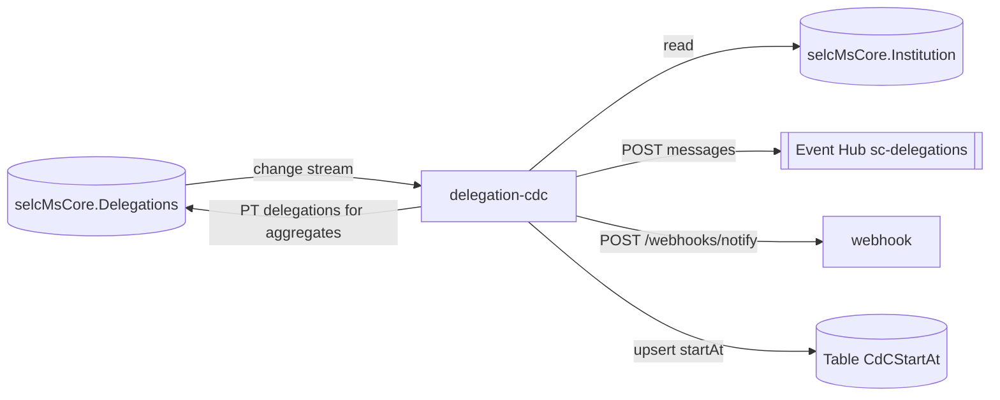

# delegation-cdc

> Change Data Capture consumer that watches the `Delegations` collection, creates the derived PT delegations for aggregator institutions and publishes delegation notifications to the `sc-delegations` Event Hub (and, optionally, to the webhook service).

| | |
|---|---|
| Path | `apps/delegation-cdc` |
| Stack | Quarkus 3.36.2 (`apps/delegation-cdc/pom.xml`), Java 17, reactive (Mutiny, reactive Panache MongoDB) |
| Type | CDC consumer (no business REST API) |
| Tenants | AR only (deployed only as `-ar`; webhook tenant defaults to `AR`) |
| Infra | `infra/resources/delegation-cdc/` |

## Responsibilities

From `apps/delegation-cdc/README.md` and `DelegationCdcService`:

- Watch the `Delegations` collection of `selcMsCore` (written by [institution-ms](institution-ms.md)) for `insert`, `update`, `replace`.
- **Aggregates propagation**: when the changed delegation is of type `PT` and its `productId` is in `delegation-cdc.products.available` (default `prod-pagopa`), look up the delegating institution (`from`); if its latest active onboarding for that product has `isAggregator = true`, copy every active `EA` delegation towards the aggregator into new `PT` delegations towards the technology partner, skipping institutions already delegated to it.
- **Notifications** (when `DELEGATION_CDC_SEND_EVENTS_WATCH_ENABLED=true`): map the delegation to `DelegationNotificationToSend` (`eventType` `ADD` or `UPDATE`) and `POST` it to the Event Hub REST endpoint `<EVENT_HUB_BASE_PATH>sc-delegations/messages`.
- **Webhook forwarding** (when `DELEGATION_CDC_WEBHOOK_ENABLED=true`): after a successful Event Hub send, forward the same payload (best effort) to the webhook service `POST /webhooks/notify` with the configured tenant (`AR`) and topic (`SC-Delegations`).
- Retry each step with exponential backoff, track Application Insights events (`DELEGATION_CDC`) and, when both steps succeed, upsert the resume token into the `CdCStartAt` table (partition `Delegations`, row `0001`).

## Architecture

Single module, package `it.pagopa.selfcare.delegation.event`:

| Class | Role |
|---|---|
| `DelegationCdcService` | `@Startup` change stream consumer, aggregates logic, notifications, resume-token upsert. Stream failure triggers `Quarkus.asyncExit()`. |
| `DelegationCdcLifecycle`, `config/DelegationCdcConfig` | Create the resume-token table and the `TableClient` (connection string or managed identity). |
| `repository/DelegationRepository`, `repository/InstitutionRepository` | Panache queries on `Delegations` and `Institution`. |
| `entity/DelegationsEntity`, `entity/Institution`, `entity/OnboardingEntity` | Mongo projections. |
| `mapper/DelegationMapper` | `toDelegationAggregatePT`, `toDelegationNotificationToSend`. |
| `client/EventHubRestClient` + `auth/EventhubTokenAuthorization` | REST client (`configKey = event-hub`) authenticated with an Entra ID bearer token from the managed identity, or a SAS token when no managed identity client id is set. |
| `health/*ReadinessCheck` | MongoDB and Table Storage readiness ([selfcare-sdk-health](../libs/selfcare-sdk-health.md)). |



## API

No application endpoints; only SmallRye Health. Not exposed in APIM.

## Data and messaging

| Resource | Usage |
|---|---|
| MongoDB `selcMsCore.Delegations` | Change stream + insert of derived PT delegations |
| MongoDB `selcMsCore.Institution` | Read (onboardings, `isAggregator`) |
| Azure Table `CdCStartAt` | Resume token read/upsert |
| Event Hub namespace `selc-{d,u,p}-eventhub-ns`, hub `sc-delegations` | Delegation notifications |

## Integrations

| Target | Client | Spec copy |
|---|---|---|
| [webhook](webhook.md) | `org.openapi.quarkus.webhook_ms_json.api.WebhookApi` (quarkus-openapi-generator, Mutiny) | `apps/delegation-cdc/src/main/openapi/webhook_ms.json` |
| Event Hub REST | `EventHubRestClient` (hand-written) | n/a |

Library: `selfcare-onboarding-sdk-common`, `selfcare-sdk-health`.

## Configuration

From `apps/delegation-cdc/src/main/resources/application.properties` (see also the table in the app README):

| Group | Env vars |
|---|---|
| MongoDB | `MONGODB-CONNECTION-STRING` (database `selcMsCore`) |
| Resume-token table | `START_AT_TABLE_NAME`, `STORAGE_CONNECTION_STRING`, `AZURE_STORAGE_ACCOUNT_NAME`, `AZURE_CLIENT_ID` |
| Retry | `DELEGATION-CDC-RETRY-MIN-BACKOFF`, `DELEGATION-CDC-RETRY-MAX-BACKOFF`, `DELEGATION-CDC-RETRY` |
| Aggregates | `PRODUCTS-AVAILABLE` (default `prod-pagopa`) |
| Event Hub | `DELEGATION_CDC_SEND_EVENTS_WATCH_ENABLED`, `EVENT_HUB_BASE_PATH`, `EVENT_HUB_SC_DELEGATIONS_TOPIC`, `SHARED_ACCESS_KEY_NAME`, `EVENTHUB-SC-DELEGATIONS-SELFCARE-WO-KEY-LC`, `EVENTHUB_SENDER_MANAGED_IDENTITY_CLIENT_ID` |
| Webhook | `DELEGATION_CDC_WEBHOOK_ENABLED`, `DELEGATION_CDC_WEBHOOK_TENANT_ID`, `DELEGATION_CDC_WEBHOOK_TOPIC`, `WEBHOOK_URL` |
| Telemetry | `APPLICATIONINSIGHTS_CONNECTION_STRING` |

In all three Terraform stacks both Event Hub sending and webhook forwarding are enabled and `WEBHOOK_URL` points to the internal `selc-<env>-webhook-ms-ca` Container App.

## Multitenancy

Not tenant-aware in the data layer: it reads/writes the single `selcMsCore` database and the only tenant information is the static `delegation-cdc.webhook.tenant-id` (default `AR`) sent to the webhook service. Deployed only for AR. See [../multitenancy.md](../multitenancy.md) and [Step 2 database identification](../specs/MULTITENANT/Step_2/Database_identification.md).

## Build, run and test

```bash
mvn -f apps/delegation-cdc/pom.xml clean package
mvn -f apps/delegation-cdc/pom.xml test
mvn --projects :test-coverage --also-make verify -Pdelegation-cdc,report
```

Unit tests only (`DelegationCdcServiceTest`, `DelegationCdcServiceWebhookTest`, repository, auth and readiness tests); no Cucumber suite.

## Deployment

- Container App `selc-<env>-delegation-cdc`, image `selfcare-delegation-cdc`, stacks `dev-ar`, `uat-ar`, `prod-ar`.
- PR: `.github/workflows/pr_delegation_cdc.yml`, `.github/workflows/pr_delegation_cdc_infra.yml`.
- Release: `.github/workflows/trigger_release_delegation_cdc.yml` → `release_app.yml` (`target=ar`); DEV auto-release from `trigger_deploy_after_merge.yml`.

## References

- `apps/delegation-cdc/README.md` ([link](../../apps/delegation-cdc/README.md))
- [institution-ms](institution-ms.md), [webhook](webhook.md), [institution-cdc](institution-cdc.md)
- [Architecture](../architecture.md), [CI/CD](../ci-cd.md)
