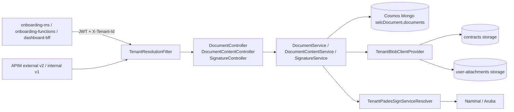

# document-ms

> Manages the documents of SelfCare onboardings: metadata, contract and attachment generation, PagoPA signing, signature verification, upload and download from Blob Storage.

| | |
|---|---|
| Path | `apps/document-ms` |
| Stack | Quarkus 3.31.2, Java 17, reactive (Mutiny, reactive Mongo Panache) |
| Type | Microservice (REST API) |
| Tenants | AR today (`TENANT_SUPPORTED_TENANTS=AR`); PNPG enablement is planned (story SELC-DMS-11) |
| Infra | `infra/resources/document-ms/` (`dev-ar`, `uat-ar`, `prod-ar`) |

## Responsibilities

- Persist document metadata (`INSTITUTION` contracts, `USER` documents, `ATTACHMENT`s) grouped by `onboardingId` / `rootOnboardingId`.
- Generate contract and attachment PDFs from templates stored in the contracts storage (`PdfGenerationService`, `PdfBuilder`, `contract-template.html`).
- Sign generated files with the PagoPA PAdES signature (source per tenant: `aruba`, `namirial` or `disabled`).
- Verify uploaded signed contracts with DSS and the EU trusted lists (`SignatureService`).
- Upload, download and delete contracts, attachments, Visura documents and aggregates CSV files.
- Expose the dossier view (available documents, attachments detail) used by onboarding and the dashboard.

Details and examples in [`apps/document-ms/Readme.md`](../../apps/document-ms/Readme.md).

## Architecture



- Packages under `it.pagopa.selfcare.document`: `controller`, `service` (+ `impl`), `repository`, `model` (`entity`, `dto`), `mapper`, `storage`, `filter`, `health`, `config`, `exception` (+ `handler`), `util`.
- `TenantResolutionFilter` (`@Priority(AUTHENTICATION)`) resolves the tenant from `X-Tenant-Id` before the controllers; `TenantMdcCleanupFilter` clears the logging context.
- Storage access goes through `TenantBlobClientProvider` and `PrefixingAzureBlobClient` (path-safety rules); templates are read by `TemplateStorage` from the `contracts` binding.
- Readiness checks: `DocumentMongoReadinessCheck`, `TenantBlobStorageReadinessCheck`. `TenantRegistryStartupValidator` validates the registry at boot.
- Telemetry: `DocumentMsTelemetryService` sends custom events through the Application Insights `TelemetryClient`.

## API

OpenAPI: [`apps/document-ms/src/main/docs/openapi.json`](../../apps/document-ms/src/main/docs/openapi.json) (also `openapi.yaml`), `operationId` strategy `METHOD`. All controllers are `@Authenticated`.

| Base path | Controller | Main operations |
|---|---|---|
| `/v1/documents` | `DocumentController` | Save/import metadata, get by id or onboarding, update signed contract, `updated-at`, `activate`, attachment list/status, `available-documents`, `attachments-detail`, `contract-report` |
| `/v1/document-content` | `DocumentContentController` | Generate contract/attachment, upload signed contract and attachments, download contract/signed contract/attachment/template, delete contract and user attachments, Visura, aggregates CSV |
| `/v1/signature` | `SignatureController` | `POST /verify` |

APIM exposure (via `infra/resources/_modules/apim_external_api`):

| APIM API | Selected tag | document-ms operations |
|---|---|---|
| `api/ms_external_api/v2` | `external-v2` | `GET /v1/document-content/{onboardingId}/contract-signed` |
| `api/ms_internal_api/v1` | `internal-v1` | `PUT /v1/documents/{onboardingId}/activate`, `PUT /v1/documents/{onboardingId}/contract-signed`, `GET /v1/documents/contract-report` |
| `api/selfcare_support_service/v1` | `support` | none at the moment (the merge input exists, no operation carries the tag) |

The README endpoint tables do not list `PUT /v1/documents/{onboardingId}/activate`; the OpenAPI spec does.

## Data and messaging

- Cosmos DB (Mongo API) database `selcDocument`, collection `documents` (`Document` entity: `tenantId`, `type`, `onboardingId`, `rootOnboardingId`, `productId`, attachment fields, `contractTemplate`, `contractSigned`, `contractFilename`, `checksum`, `storageOrigin` `SYSTEM`/`USER`, `signingStep`, timestamps). Terraform creates indexes on `onboardingId`, `rootOnboardingId`, `productId`, `type`, `attachmentName`, `createdAt` and `(rootOnboardingId, type, createdAt)`.
- Blob Storage bindings (from the tenant registry, managed identity auth):
  - `contracts`: account `sc<env>weuardocumentsst01`, container `sc-<env>-documents-blob`; paths `parties/docs/`, `parties/deleted/`, `parties/csv/aggregates/`.
  - `user-attachments`: account `sc<env>weuarusrattachst01`, container `sc-<env>-usrattach-blob`.
- No queues or events.

## Integrations

- Inbound: [onboarding-ms](onboarding-ms.md) (`MS_DOCUMENT_URL`, generated `document_json` clients), [onboarding-functions](onboarding-functions.md) (`MS_DOCUMENT_URL`, machine JWT), [dashboard-bff](dashboard-bff.md) (Feign clients with `TenantHeaderInterceptor`), APIM.
- Outbound: Namirial sign service (`selc-<env>-namirial-sws-ca`) or Aruba for PAdES signing; EU LOTL / Official Journal URLs for DSS trust anchors.
- No generated REST clients: the `quarkus-openapi-generator` dependency and the `core_json` properties in `application.properties` have no spec in `src/main/openapi`.
- Libraries: [selfcare-sdk-security](../libs/selfcare-sdk-security.md), [selfcare-sdk-tenant](../libs/selfcare-sdk-tenant.md), [selfcare-sdk-tenant-mongodb](../libs/selfcare-sdk-tenant-mongodb.md), [selfcare-sdk-health](../libs/selfcare-sdk-health.md), [selfcare-onboarding-sdk-crypto](../libs/selfcare-onboarding-sdk-crypto.md), [selfcare-onboarding-sdk-common](../libs/selfcare-onboarding-sdk-common.md), [selfcare-onboarding-sdk-product](../libs/selfcare-onboarding-sdk-product.md), [selfcare-cucumber-sdk](../libs/selfcare-cucumber-sdk.md) (tests).

## Configuration

From `src/main/resources/application.properties` and `infra/resources/document-ms/dev-ar/main.tf`.

| Variable | Default / value | Purpose |
|---|---|---|
| `TENANT_REGISTRY_JSON` | `tenant.registry.json` in properties | Per-tenant Mongo, JWT key, signature and storage bindings |
| `TENANT_SUPPORTED_TENANTS` | `AR` | Enabled tenants |
| `TENANT_ENFORCEMENT_ENABLED` / `TENANT_DEFAULT` | `true` / `AR` | Fail-closed `X-Tenant-Id` requirement; default only when enforcement is off |
| `SELFCARE_TENANT_STRICT_DATA_ISOLATION` | `false` | Strict `tenantId` filtering; set in Terraform from the shared `strict_tenant_data_isolation` flag |
| `MONGODB_CONNECTION_STRING_AR` (and legacy `MONGODB_CONNECTION_STRING`) | Key Vault `mongodb-connection-string` | Mongo connection |
| `JWT_PUBLIC_KEY_AR` (fallback `JWT_PUBLIC_KEY`) | Key Vault `jwt-public-key` | JWT verification |
| `PAGOPA_SIGNATURE_SOURCE` | `disabled` (Terraform: `namirial`) | PagoPA signing source for AR |
| `NAMIRIAL_BASE_URL_AR`, `NAMIRIAL_SIGN_SERVICE_IDENTITY_USER_AR` / `_PASSWORD_AR` | Container App URL / Key Vault | Namirial credentials |
| `SIGNATURE_VALIDATION_ENABLED` | `true` (Terraform: `false` in dev, `true` in uat/prod) | DSS verification of uploaded contracts |
| `AZURE_STORAGE_ACCOUNT_NAME_CONTRACTS` / `_USER`, `STORAGE_CONTAINER_CONTRACT` / `_USER` | storage accounts and containers above | Storage bindings |
| `AZURE_CLIENT_ID_AR_DOCUMENTS` (and `AZURE_CLIENT_ID`) | `documents-storage-blob-managed-identity` | Managed identity for Blob access |
| `DOCUMENT_MS_UPLOAD_MAX_BODY_SIZE` | `1M` (Terraform: `10M`) | Max HTTP body |
| `APPLICATIONINSIGHTS_CONNECTION_STRING` | Key Vault | Telemetry |

The default Quarkus Mongo client is disabled (`quarkus.mongodb.active=false`): `TenantMongoClientProducer` from `selfcare-sdk-tenant-mongodb` provides the tenant-aware client.

## Multitenancy

- Every business request must carry a valid `X-Tenant-Id`; SPID tokens must also have a matching `tenant_id` claim (`JwtTenantValidationFilter` from `selfcare-sdk-security`, indexed via `quarkus.index-dependency`).
- Mongo database, JWT key, signature provider and storage accounts are resolved per tenant from the registry; documents carry a `tenantId` discriminator.
- Only AR is configured. The implementation plan, gap analysis and pending stories (SELC-DMS-07 infra, 09 migration/strict mode, 10 E2E, 11 PNPG) are in [DocumentMs_implementation.md](../specs/MULTITENANT/Step_2/DocumentMs_implementation.md).
- See [multitenancy.md](../multitenancy.md), [Step 2 architecture](../specs/MULTITENANT/Step_2/ARCHITECTURE.md), [Storage identification](../specs/MULTITENANT/Step_2/Storage_identification.md), [Database identification](../specs/MULTITENANT/Step_2/Database_identification.md), [JWT key resolution](../specs/MULTITENANT/Step_2/JWT_Key_Resolution.md).

## Build, run and test

```bash
mvn --projects :document-ms --also-make clean package
mvn -f apps/document-ms/pom.xml quarkus:dev
mvn -f apps/document-ms/pom.xml test
mvn --projects :document-ms --also-make test -Dtest=CucumberSuiteTest -Dsurefire.failIfNoSpecifiedTests=false
```

- Unit tests under `src/test/java` (`@QuarkusTest`, `%test` profile disables tenant enforcement and eager storage init).
- Cucumber: `integrationTest/CucumberSuiteTest` (excluded from Surefire by default), features `available_documents`, `current_signed_contract`, `document_content`, `document_endpoints_validation`, `document_signature`, `health`; stack in `src/test/resources/docker-compose.yml` (Mongo, Azurite). Needs Docker.
- See [testing.md](../testing.md).

## Deployment

- Terraform: `infra/resources/document-ms/{dev,uat,prod}-ar/main.tf` creates the `selcDocument` database and `documents` collection, the role assignment on the user-attachments storage and the Container App `selc-<env>-document-ms` (image `selfcare-document-ms`). Storage accounts and the user-attachments private endpoint are managed in `infra/core/<env>-ar/commons.tf`. A portal dashboard `monitoring-document-ms` is defined in `infra/core/dev-ar/dashboard.tf`.
- Workflows: `pr_document_ms.yml` (code review), `pr_document_ms_infra.yml` (Terraform plan), `integration_tests_document_ms.yml` (Cucumber on `apps/document-ms/**`), `trigger_release_document_ms.yml` (target `ar`, via `release_app.yml`), `trigger_deploy_after_merge.yml` (DEV on push to `main`), `create_release_branch.yml` (UAT). See [ci-cd.md](../ci-cd.md).

## References

- [`apps/document-ms/Readme.md`](../../apps/document-ms/Readme.md)
- [DocumentMs_implementation.md](../specs/MULTITENANT/Step_2/DocumentMs_implementation.md), [MULTITENANT specs](../specs/README.md)
- [onboarding-ms](onboarding-ms.md), [onboarding-functions](onboarding-functions.md), [dashboard-bff](dashboard-bff.md)
- [architecture.md](../architecture.md), [infrastructure.md](../infrastructure.md)
