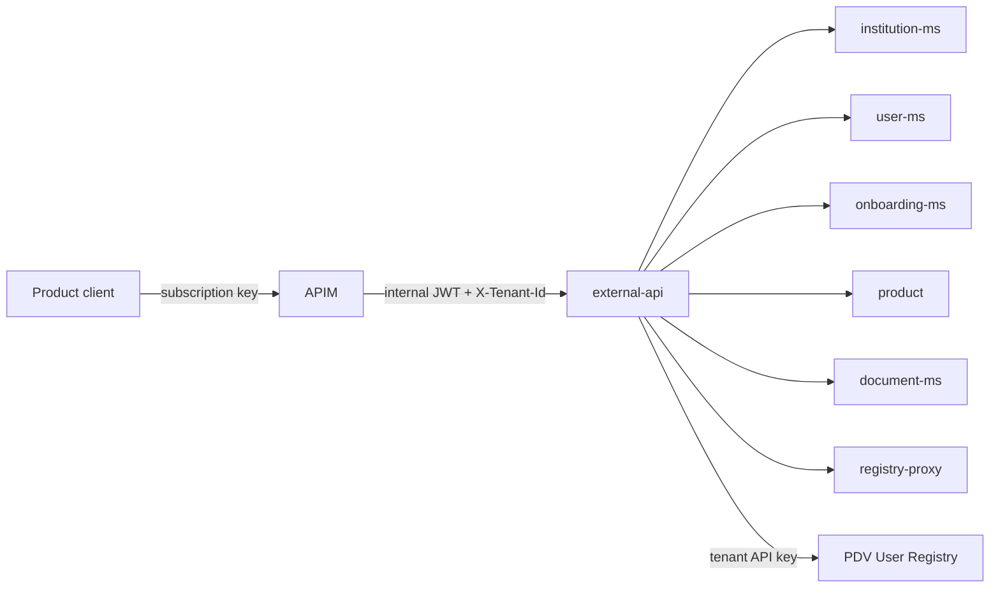

# external-api

> Stateless Spring Boot facade that exposes SelfCare data (institutions, users, onboardings, tokens, contracts, national registries) to adhering products through the APIM external APIs, delegating every operation to the internal microservices.

| | |
|---|---|
| Path | `apps/external-api` |
| Stack | Spring Boot 3.3.0 (parent `selc-starter-parent` 0.3.3 from `libs/selfcare-starter-parent`), Spring Cloud OpenFeign, Java 17, blocking |
| Type | REST microservice (external API backend, `selc-<env>-ext-api-backend-ca` / `selc-<env>-pnpg-ext-api-backend-ca`) |
| Tenants | Both: one deployment per tenant (AR and PNPG stacks), each single-tenant |
| Infra | `infra/resources/external-api/` (`{dev,uat,prod}-{ar,pnpg}`), APIM in `infra/resources/api/{dev,uat,prod}-ar` + `infra/resources/_modules/apim_external_api` |

## Responsibilities

- Serve the `/v2/institutions`, `/v2/users`, `/v2/onboarding`, `/v1/tokens`, `/v1/pn-pg` and `/v2/national-registries` endpoints consumed by products through APIM subscriptions.
- Aggregate and map data from `institution-ms` (ms-core), `user-ms`, `onboarding-ms`, `product`, `document-ms`, `registry-proxy` and the PDV User Registry.
- Stream institution contracts (via `document-ms`).
- Validate onboarding requests against an allow-list of institutions/products (`strategy/ConfigMapAllowedListOnboardingValidationStrategy`).
- Enforce tenant isolation (Multitenant Step 2) and propagate the authenticated bearer and validated tenant to internal services.

## Architecture

Single Maven module (`selc-external-api`), package root `apps/external-api/src/main/java/it/pagopa/selfcare/external_api/`.

| Package | Key classes |
|---|---|
| `controller` | `InstitutionV2Controller`, `UserV2Controller`, `OnboardingV2Controller`, `TokenController`, `PnPgController`, `NationalRegistryController` |
| `service` | `InstitutionService`, `UserService`, `OnboardingService`, `TokenService`, `ContractService`, `ProductMsService` (interface + `Impl`) |
| `client` | Feign clients: `MsCoreRestClient`, `MsCoreInstitutionApiClient`, `MsUserApiRestClient`, `MsOnboardingControllerApi`, `MsProductApiClient`, `MsDocumentApiClient`, `MsDocumentContentApiClient`, `MsPartyRegistryProxyRestClient`, `MsRegistryProxyNationalRegistryRestClient`, `UserRegistryRestClient`, `AzureBlobClient`; `client/config`, `client/decoder`, `client/interceptor/UserRegistryAuthInterceptor` |
| `config` | `ExternalAPISecurityConfig` (imports the shared `SecurityConfig`, fails startup on invalid tenant setup), `SwaggerConfig`, `WebConfig`, `CoreConfig`, `AzureStorageConfig` |
| `handler` | `ExternalApiExceptionHandler` |
| `mapper`, `model`, `strategy`, `validator`, `utils`, `connector` | MapStruct mappers, DTOs, onboarding validation strategy, response validator, `FileStorageConnector` |



## API

- No context path; controllers are mounted at `/v1/...` and `/v2/...` (see table).
- Spec generated by `SwaggerConfigTest` into `apps/external-api/src/main/resources/swagger/api-docs.json` (also used by the release workflow as `path_openapi_docs`).

| Controller | Base path | Main operations |
|---|---|---|
| `InstitutionV2Controller` | `/v2/institutions` | list institutions, `/{institutionId}/contract`, `/{institutionId}/products`, `/{institutionId}/users` |
| `UserV2Controller` | `/v2/users` | user info, `/{id}/onboarded-product`, list users |
| `OnboardingV2Controller` | `/v2/onboarding` | create, `/import`, `/users`, `/aggregation/{taxCode}` |
| `TokenController` | `/v1/tokens` | `/products/{productId}` |
| `PnPgController` | `/v1/pn-pg` | `/institutions/add` |
| `NationalRegistryController` | `/v2/national-registries` | `/legal-tax/verification` |

Operations carry OpenAPI tags (`external-v2`, `external-pnpg`, `internal-v1`, `support`, `support-pnpg`, `contract`) that indicate which external API family exposes them.

### APIM exposure (external APIs)

APIM APIs are defined in `infra/resources/_modules/apim_external_api` (`apim.tf` for AR, `apim_pnpg.tf` for PNPG) and instantiated by `infra/resources/api/{dev,uat,prod}-ar`. Each API has per-environment OpenAPI files (`openapi.{dev,uat,prod}.json`). APIM validates the subscription key and mints an internal JWT (`jwt_base_policy*.xml.tpl`).

| APIM path | Spec folder (`_modules/apim_external_api/...`) | Default backend |
|---|---|---|
| `external` (v2) | `api/ms_external_api/v2` | `ext-api-backend` |
| `external/internal` | `api/ms_internal_api/v1` | `ext-api-backend` |
| `external/support` | `api/selfcare_support_service/v1` | `ext-api-backend` |
| `external/pdnd` | `api/pdnd_infocamere_api/v1` | `ext-api-backend` |
| `external/onboarding-auto`, `external/onboarding-io` | `api/external-api-onboarding-{auto,io}/v1` | `ext-api-backend` |
| `external/contract`, `external/contracts` | `api/external_api_contract/v1` | `ext-api-backend` |
| `external/data-vault` (PNPG) | `api_pnpg/external_api_data_vault/v1` | `pnpg-ext-api-backend` |
| `external/pn-pg` (PNPG) | `api_pnpg/external_api_for_pnpg/v2` | `pnpg-ext-api-backend` |
| `external/pn-pg/support` (PNPG) | `api_pnpg/pnpg_support_service/v1` | `pnpg-ext-api-backend` |
| `external/internal/pn-pg` (PNPG) | `api_pnpg/internal_api_for_pnpg/v1` | `pnpg-ext-api-backend` |

The default `service_url` is the external-api Container App, but operation policies (`MS_BACKEND_URL`) reroute several operations directly to other services (for example `party-reg-proxy`, i.e. [registry-proxy](registry-proxy.md)). Changes to `api/ms_external_api/v2/openapi.*.json` are checked by `pr_detect_openapi_selc_external.yml`; other `pr_detect_openapi_*` workflows cover the contract, onboarding-auto/io and PNPG specs. APIM is released by `release_apim.yml` (`infra/resources/api/<env>-ar`).

## Data and messaging

- No database: `tenant.mongodb.required=false` (`config/tenant-config.properties`).
- Azure Blob Storage: `AzureBlobClient` resolves the tenant `contracts` binding through `TenantBlobClientProvider` (`tenant.storage.enabled=true`). The app README notes it has no current business caller; contract APIs go through `document-ms`.
- No Event Hub / queue consumers or producers.

## Integrations

Feign clients are generated with `openapi-generator-maven-plugin` 6.3.0 (`spring-cloud` library) from committed spec copies in `apps/external-api/src/main/docs/openapi/`:

| Execution id | Spec copy | Target service | Base URL env var |
|---|---|---|---|
| `selfcare-ms-core` | `api-selfcare-core-docs.json` | `institution-ms` | `MS_CORE_URL` |
| `user-ms` | `api-selfcare-user-docs.json` | `user-ms` | `SELFCARE_USER_URL` |
| `selfcare-ms-onboarding` | `api-selfcare-onboarding-docs.json` | `onboarding-ms` | `MS_ONBOARDING_URL` |
| `selfcare-ms-product` | `api-selfcare-product-docs.json` | `product` | `MS_PRODUCT_URL` |
| `selfcare-ms-document` | `api-selfcare-document-docs.json` | `document-ms` | `MS_DOCUMENT_URL` |
| `registry-proxy-ms` | `api-selfcare-registry-proxy-docs.json` | `registry-proxy` | `USERVICE_PARTY_REGISTRY_PROXY_URL` |

`UserRegistryRestClient` (hand-written) calls the PDV User Registry at `USERVICE_USER_REGISTRY_URL` with the tenant's API key. Callers: APIM external APIs only (no internal service points to `ext-api-backend` in `infra/resources`).

## Configuration

Files under `apps/external-api/src/main/resources/config/`.

| Group | Properties / env vars |
|---|---|
| Server, logging | `EXT_API_SERVER_PORT`, `APP_LOG_LEVEL` (`application.yml`) |
| Tenant / JWT | `SELFCARE_TENANT_DATA_ISOLATION`, `TENANT_SUPPORTED_TENANTS`, `JWT_TENANT_CLAIM_REQUIRED`, `JWT_EXPECTED_ISSUER`, `JWT_EXPECTED_AUDIENCE`; secret-backed names referenced by the registry (e.g. `JWT_PUBLIC_KEY_AR`, `USER_REGISTRY_API_KEY_AR`, `CONTRACTS_STORAGE_CONNECTION_STRING_AR`) |
| Downstream URLs | `MS_CORE_URL`, `SELFCARE_USER_URL`, `MS_ONBOARDING_URL`, `MS_PRODUCT_URL`, `MS_DOCUMENT_URL`, `USERVICE_PARTY_REGISTRY_PROXY_URL`, `USERVICE_USER_REGISTRY_URL` |
| Feign | `REST_CLIENT_CONNECT_TIMEOUT`, `REST_CLIENT_READ_TIMEOUT`, `REST_CLIENT_LOGGER_LEVEL`, `REST_CLIENT_MAX_CONNECTION*`, per-client `*_CONNECT_TIMEOUT` / `*_READ_TIMEOUT` / `*_LOGGER_LEVEL` |
| Business | `ONBOARDING_ALLOWED_INSTITUTIONS_PRODUCTS`, `ALLOWED_SERVICE_TYPES` (`core-config.properties`) |

Terraform values and Key Vault secret names are in `infra/resources/external-api/<env>-<tenant>/locals.tf`.

## Multitenancy

- Libraries: `selc-commons-tenant`, `selc-commons-web`, `selc-commons-connector-rest` 2.23.0 (`libs/selfcare-commons`, see [selfcare-commons](../libs/selfcare-commons.md)).
- Audience-based resolution is mandatory (`jwt.tenant-audience-resolution-enabled=true`): each request needs one `X-Tenant-Id` and a JWT whose `aud` maps to exactly one tenant; the verified tenant must match the header. No default tenant. `ExternalAPISecurityConfig` refuses to start if no tenant is supported or audience resolution is disabled.
- Feign clients propagate the bearer and validated `TenantContext`; the User Registry client sends only the tenant API key.
- Each stack defines its own `SELFCARE_TENANT_DATA_ISOLATION` JSON in `locals.tf`; current stacks are single-tenant (`TENANT_SUPPORTED_TENANTS=AR` or `PNPG`).
- Details and rollout prerequisites: [apps/external-api/README.md](../../apps/external-api/README.md). Overview: [multitenancy.md](../multitenancy.md), [Step 2 architecture](../specs/MULTITENANT/Step_2/ARCHITECTURE.md), [JWT key resolution](../specs/MULTITENANT/Step_2/JWT_Key_Resolution.md).

## Build, run and test

```bash
mvn --projects :selc-external-api --also-make clean package -DskipTests   # same as the Dockerfile (from repo root)
mvn -f apps/external-api/pom.xml test                                    # unit tests (JUnit 5 + Mockito, WireMock)
mvn -f apps/external-api/pom.xml test -Dtest=SwaggerConfigTest -Dsurefire.failIfNoSpecifiedTests=false   # regenerate swagger/api-docs.json
```

- Tests: controller (`*ControllerTest`, `*ControllerV2Test`), service, client (WireMock via `spring-cloud-contract-wiremock`), mapper and model tests in `src/test/java`. No Cucumber suite.
- Coverage: `test-coverage/pom.xml` has no `external-api` profile, although `pr_external_api_ms.yml` passes `module: external-api` to `call_code_review.yml`.

### Bruno contract tests

Collection `Selfcare-External-Integration` in `apps/external-api/integration-test/bruno/`, run against a deployed environment through APIM (`{{apiBaseUrl}}/external/...`, `Ocp-Apim-Subscription-Key` header from environment variables):

| Folder | Covers |
|---|---|
| `External`, `InstitutionV2` | `/external/v2/institutions/{id}/contract`, `/products`, `/users` |
| `UserV2` | `/external/v2/users` |
| `Pnpg` | `/external/data-vault/v1/pn-pg/institutions/add` |
| `Internal` | `/external/internal/v1/...` (institutions, users, tokens contract report, InfoCamere PDND) |
| `Support` | `/external/support/v1/...` (delegations, contracts, onboardings, notifications count, tokens, users, user groups, resend notification) |

- CI: `integration_test_external_api.yml` (push on `main` → dev, `releases/*` → uat, or manual) calls `call_integration_test_bruno_external_api.yml`, which runs `bru run . -r --env-file Selfcare-External-Integration-Environment.json` (environment decoded from a CI secret) and posts results to Slack via `convert_bruno.js`.
- A legacy Postman/Newman collection (`integration-test/newman/`) is run by `call_integration_test_external_api.yml`.
- Never commit real subscription keys in `environments/`. See [testing.md](../testing.md).

## Deployment

- Container App `selc-<env>-ext-api-backend` (AR) / `selc-<env>-pnpg-ext-api-backend` (PNPG), module `_modules/container_app_microservice`, image `selfcare-external-api-ms`.
- Workflows: `pr_external_api_ms.yml` (code review), `pr_external_api_infra.yml` (Terraform plan for `external-api/*-ar` and `api/*-ar`), `trigger_release_external_api.yml` (manual, runs `release_app.yml` for `ar` and `pnpg`), `release_apim.yml` (APIM). See [ci-cd.md](../ci-cd.md).
- `apps/external-api/.github/workflows/pr_update_openapi_auto.yml` is an app-local file (not under the root `.github/workflows`).

## References

- [apps/external-api/README.md](../../apps/external-api/README.md)
- [infra/resources/_modules/apim_external_api/README.md](../../infra/resources/_modules/apim_external_api/README.md)
- [registry-proxy](registry-proxy.md), [architecture.md](../architecture.md), [infrastructure.md](../infrastructure.md), [testing.md](../testing.md), [multitenancy.md](../multitenancy.md)
