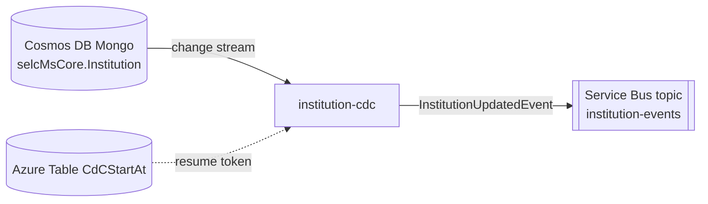

# institution-cdc

> Change Data Capture consumer that watches the `Institution` collection and publishes an `InstitutionUpdatedEvent` on the internal events Service Bus.

| | |
|---|---|
| Path | `apps/institution-cdc` |
| Stack | Quarkus 3.30.8 (`apps/institution-cdc/pom.xml`), Java 17, reactive (Mutiny, reactive Mongo client) |
| Type | CDC consumer (no business REST API) |
| Tenants | AR only (deployed only as `-ar`; events are stamped `eventTenant = "AR"`) |
| Infra | `infra/resources/institution-cdc/` |

## Responsibilities

- Open a MongoDB change stream on the `Institution` collection of the `selcMsCore` database (owned by [institution-ms](institution-ms.md)).
- For every `insert`, `update` or `replace` operation, map the full document to an `InstitutionUpdatedEvent` and publish it to the `institution-events` Service Bus topic through [selfcare-internal-events-sdk](../libs/selfcare-internal-events-sdk.md).
- Create the `CdCStartAt` Azure Table at startup and read a stored resume token from it, if present.

## Architecture

Single module, package `it.pagopa.selfcare.institution.event`:

| Class | Role |
|---|---|
| `InstitutionCdcService` | `@Startup` bean: builds the change stream (`FullDocument.UPDATE_LOOKUP`, match on `operationType` in `update/replace/insert`), reads the resume token (partition `Institution`, row `0001`, property `startAt`) and calls `InternalEvents`. On stream failure it calls `Quarkus.asyncExit()` so the container is restarted. |
| `InstitutionCdcLifecycle` | On `StartupEvent` (non-test profiles) creates the table `institution-cdc.table.name` if missing. |
| `config/InstitutionCdcConfig` | Produces the `TableClient`: connection string if set, otherwise `https://<account>.table.core.windows.net` with managed identity (`DefaultAzureCredential`). |
| `entity/InstitutionEntity` | Minimal projection of `Institution` (`_id`, `description`, `parentDescription`). |
| `internalevents/InternalEvents` | Creates an `AzureServiceBusEventSender` for `institution-events` (connection string, or namespace + managed identity client id). Disabled when `INTERNALEVENTS_ENABLED=false`. |
| `internalevents/InternalEventsMapper` | MapStruct mapper to `InstitutionUpdatedEvent` (`eventTenant = AR`, `eventSource = institution-cdc`, `institutionId = id`). |
| `health/*ReadinessCheck` | Readiness checks for MongoDB (`ping`) and Table Storage, built on [selfcare-sdk-health](../libs/selfcare-sdk-health.md). |



Note: the service reads the resume token but does not write it back (no `upsertEntity` call in `InstitutionCdcService`), unlike [delegation-cdc](delegation-cdc.md).

## API

No application endpoints. Only the Quarkus SmallRye Health endpoints are exposed (used by the Container App probes `module.local.config.quarkus_health_probes`). Not exposed in APIM.

## Data and messaging

| Resource | Usage |
|---|---|
| MongoDB `selcMsCore.Institution` | Read via change stream |
| Azure Table `CdCStartAt` (default name) | Resume token (read only) |
| Service Bus `selc-<env>-ar-internal-events` namespace, topic `institution-events` | Publishes `InstitutionUpdatedEvent` |

## Integrations

- Producer of the `Institution` documents: [institution-ms](institution-ms.md).
- No generated REST clients (`quarkus-rest-client-jackson` is on the classpath but no client interface exists).
- Libraries: `selfcare-internal-events-sdk`, `selfcare-sdk-health`.

## Configuration

From `apps/institution-cdc/src/main/resources/application.properties`:

| Group | Env vars |
|---|---|
| MongoDB | `MONGODB-CONNECTION-STRING` (database fixed to `selcMsCore`) |
| Resume-token table | `START_AT_TABLE_NAME` (default `CdCStartAt`), `STORAGE_CONNECTION_STRING`, `AZURE_STORAGE_ACCOUNT_NAME`, `AZURE_CLIENT_ID` |
| Internal events | `INTERNALEVENTS_ENABLED` (default `false`), `INTERNALEVENTS_CONNECTION_STRING`, `INTERNALEVENTS_NAMESPACE`, `INTERNALEVENTS_CLIENT_ID` |

In Terraform (`infra/resources/institution-cdc/*/main.tf`) internal events are enabled, Table Storage uses the `archeckoutst01` storage account with the `product-storage-table` managed identity, and Service Bus uses the `internal-events` managed identity. `MONGODB-CONNECTION-STRING` comes from Key Vault secret `mongodb-connection-string`.

## Multitenancy

Not tenant-aware in code: it watches the single `selcMsCore` database and hard-codes `eventTenant = "AR"` in `InternalEventsMapper`. The app has only `-ar` stacks. See [../multitenancy.md](../multitenancy.md) and [Step 2 database identification](../specs/MULTITENANT/Step_2/Database_identification.md).

## Build, run and test

```bash
mvn -f apps/institution-cdc/pom.xml clean package
mvn -f apps/institution-cdc/pom.xml test
mvn --projects :test-coverage --also-make verify -Pinstitution-cdc,report
```

Tests: only `InstitutionCdcReadinessChecksTest` (no Cucumber suite). Docker image: `apps/institution-cdc/Dockerfile`, built from the repository root.

## Deployment

- Container App `selc-<env>-institution-cdc`, image `selfcare-institution-cdc`, environments `dev-ar`, `uat-ar`, `prod-ar` (`infra/resources/institution-cdc/`).
- PR checks: `.github/workflows/pr_institution_cdc.yml` (code review + Sonar via `call_code_review.yml`), `.github/workflows/pr_institution_cdc_infra.yml` (Terraform plan).
- Release: `.github/workflows/trigger_release_institution_cdc.yml` calls `release_app.yml` with `target=ar`; pushes on `main` touching `apps/institution-cdc/**` trigger a DEV release via `trigger_deploy_after_merge.yml`.

## References

- [institution-ms](institution-ms.md), [delegation-cdc](delegation-cdc.md)
- [selfcare-internal-events-sdk](../libs/selfcare-internal-events-sdk.md)
- [Architecture](../architecture.md), [CI/CD](../ci-cd.md), [Infrastructure](../infrastructure.md)
