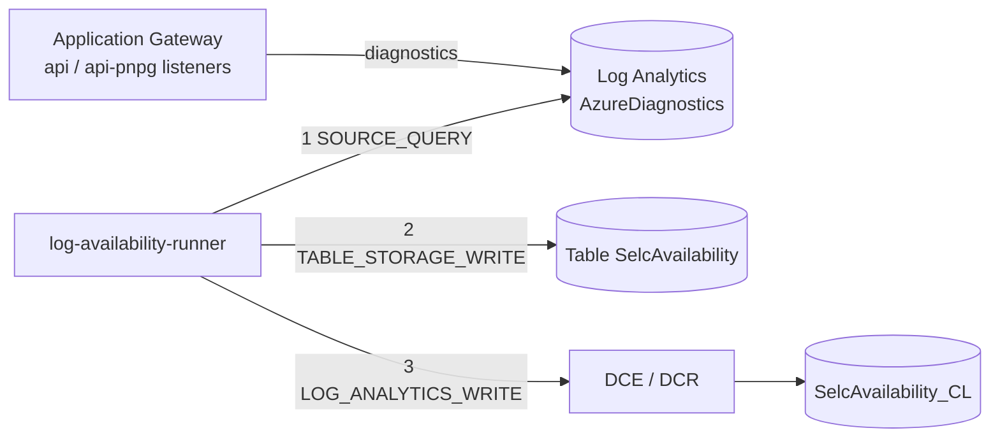

# log-availability-runner

> Quarkus command-mode job that computes the daily SelfCare API availability from Application Gateway access logs and stores one record per day in Azure Table Storage and in the Log Analytics custom table `SelcAvailability_CL`.

| | |
|---|---|
| Path | `apps/log-availability-runner` |
| Stack | Quarkus 3.31.2, Java 17, blocking (Azure Identity, Azure Data Tables, JDK HTTP client) |
| Type | Batch job (`@QuarkusMain`, Azure Container App Job), no inbound HTTP |
| Tenants | Platform-wide: one AR deployment measures both the `api` and `api-pnpg` listeners of the shared Application Gateway |
| Infra | `infra/resources/log-availability-runner/` (`{dev,uat,prod}-ar`) + module `infra/resources/_modules/log_availability_runner`; prerequisites in `infra/core/<env>-ar` |

## Responsibilities

- Query the Application Gateway access logs in Log Analytics for one UTC reference day.
- Classify each request: valid HTTP status `< 300` or `404` counts as available, any other status (including other 4xx) as unavailable.
- Upsert the daily record (`ReferenceDate`, `Environment`, `CountLt500`, `CountGte500`, `Total`, `Availability`, `GenerationTimestamp`) in the Storage Table `SelcAvailability` (PartitionKey = year, RowKey = date).
- Send the same record to the Logs Ingestion API (stream `Custom-SelcAvailability_CL`) for the Workbook and alerts.
- Support single-date reruns and a one-off `--backfill` of all complete retained days.

Full requirements and design: [LOG_AVAILABILITY_DAILY requirements](../specs/LOG_AVAILABILITY_DAILY/REQUIREMENTS.md) and [architecture](../specs/LOG_AVAILABILITY_DAILY/ARCHITECTURE.md).

## Architecture

Package root: `apps/log-availability-runner/src/main/java/it/pagopa/selfcare/logavailability/`.

| Package | Key classes |
|---|---|
| (root) | `Application` (`@QuarkusMain`): parses arguments, applies the 03:00 Europe/Rome gate, runs each reference date, maps outcomes to exit codes |
| `service` | `RunOptions` (argument parsing and retention window), `AvailabilityKqlQuery` (KQL builder), `AvailabilityRunService` (stages), `AvailabilityRunException` |
| `client` | `AzureMonitorLogsClient` (Log Analytics query), `AzureTableAvailabilityWriter`, `LogAnalyticsAvailabilityWriter` (Logs Ingestion API), `AzureMonitorHttpClient` |
| `config` | `AzureIdentityProducer` (managed identity credential) |
| `model` | `DailyAvailabilityRecord`, `RequestCounts` |



Run modes (`RunOptions`):

| Arguments | Behaviour |
|---|---|
| none (scheduled) | Runs only if the local Europe/Rome hour is 03, for the previous UTC day; otherwise exits `0` without work |
| `yyyy-MM-dd` | Reruns one date; must be before today (UTC) and inside the complete-day retention window |
| `--backfill` | Processes every complete retained day up to yesterday (UTC) |

Exit codes: `0` success or skipped, `1` failure in a stage, `2` invalid arguments.

## API

None. The job exposes no HTTP endpoints and has no OpenAPI spec.

## Data and messaging

- Source: `AzureDiagnostics`, category `ApplicationGatewayAccessLog`, filtered by `APPLICATION_GATEWAY_RESOURCE_ID` and listeners `api-listener` / `api-pnpg-listener`; `/spid/v1/metadata` and `dummy` URIs are excluded (`AvailabilityKqlQuery`).
- Sinks: Storage Table `SelcAvailability` (created by the module) and Log Analytics table `SelcAvailability_CL` (created in `infra/core`) through the data collection endpoint/rule `<project>-availability-dce` / `<project>-availability-dcr`.
- No database, no queues. Re-running a date overwrites the same row (upsert with `REPLACE`).

## Integrations

- Azure Monitor Logs query API (Log Analytics workspace `LOG_ANALYTICS_WORKSPACE_ID`).
- Azure Table Storage (account `AVAILABILITY_STORAGE_ACCOUNT_NAME`, reached through a private endpoint provisioned in `infra/core`).
- Azure Monitor Logs Ingestion API (`LOGS_INGESTION_ENDPOINT`, `DCR_IMMUTABLE_ID`).
- Authentication uses the job's system-assigned managed identity, with roles granted by the module: `Log Analytics Reader` (workspace), `Storage Table Data Contributor` (only the `SelcAvailability` table), `Monitoring Metrics Publisher` (DCR). See [SECURITY](../specs/LOG_AVAILABILITY_DAILY/SECURITY.md).

## Configuration

Source: `apps/log-availability-runner/src/main/resources/application.properties`; values are set by `infra/resources/_modules/log_availability_runner/main.tf`.

| Env var | Purpose |
|---|---|
| `AVAILABILITY_ENVIRONMENT` | Environment label written in the record (`DEV`/`UAT`/`PROD`) |
| `AVAILABILITY_SOURCE_RETENTION_DAYS` | Source log retention used to compute the valid date window (default `90`, minimum 2) |
| `LOG_ANALYTICS_WORKSPACE_ID` | Workspace queried for the access logs |
| `APPLICATION_GATEWAY_RESOURCE_ID` | Gateway resource id used in the KQL filter (validated format) |
| `AVAILABILITY_STORAGE_ACCOUNT_NAME` | Storage account hosting the `SelcAvailability` table |
| `LOGS_INGESTION_ENDPOINT`, `DCR_IMMUTABLE_ID` | Logs Ingestion API target |

No secrets are used (`secrets_names = {}`).

## Multitenancy

The job is tenant-agnostic: it does not use the tenant SDKs. PNPG traffic shares the AR Application Gateway (`api-pnpg-listener`), so a single AR stack per environment covers both tenants and there is no PNPG stack. See [multitenancy.md](../multitenancy.md).

## Build, run and test

```bash
mvn -f apps/log-availability-runner/pom.xml clean package        # build + unit tests (the Dockerfile adds -DskipTests)
mvn --projects :test-coverage --also-make verify -Plog-availability-runner,report   # coverage, as in CI
apps/log-availability-runner/scripts/run-job.sh dev 2026-01-31   # start a manual execution for one date
DRY_RUN=1 apps/log-availability-runner/scripts/run-job.sh uat --backfill   # print the az command only
```

- Tests (`src/test/java`): `ApplicationTest`, `RunOptionsTest`, `AvailabilityKqlQueryTest`, `AvailabilityRunServiceTest`, client tests (`AzureMonitorLogsClientTest`, `AzureMonitorHttpClientTest`, `AzureTableAvailabilityWriterTest`, `LogAnalyticsAvailabilityWriterTest`), `AzureIdentityProducerTest`, `DailyAvailabilityRecordTest`. No Cucumber suite.
- The Terraform module has its own tests in `infra/resources/_modules/log_availability_runner/tests`.

## Deployment

- Container App Job `selc-<env>-availability-daily-job` in `selc-<env>-container-app-002-rg` (module `_modules/container_app_job`, image `selfcare-log-availability-runner`), cron `0 1,2 * * *` UTC so that exactly one trigger falls at 03:00 Europe/Rome across DST; `replica_timeout_in_seconds = 28800`, `replica_retry_limit = 1`.
- A metric alert `<project>-availability-job-failure` fires on failed executions and notifies the environment action group.
- Order: apply `infra/core/<env>-ar` first (gateway diagnostics, source retention, `SelcAvailability_CL`, Workbook/alert, Table private endpoint/DNS), then `infra/resources/log-availability-runner/<env>-ar`, then run `--backfill` once ([infra README](../../infra/resources/log-availability-runner/README.md)).
- Workflows: `pr_log_availability_runner.yml` (code review), `pr_log_availability_runner_infra.yml` (Terraform plan, including the related `infra/core` modules), `trigger_release_log_availability_runner.yml` (manual, `release_app.yml` with target `ar`, image `pagopa/selfcare-log-availability-runner`). See [ci-cd.md](../ci-cd.md).

## References

- [LOG_AVAILABILITY_DAILY – Requirements](../specs/LOG_AVAILABILITY_DAILY/REQUIREMENTS.md)
- [LOG_AVAILABILITY_DAILY – Architecture](../specs/LOG_AVAILABILITY_DAILY/ARCHITECTURE.md)
- [LOG_AVAILABILITY_DAILY – Security](../specs/LOG_AVAILABILITY_DAILY/SECURITY.md)
- [infra/resources/log-availability-runner/README.md](../../infra/resources/log-availability-runner/README.md)
- [infrastructure.md](../infrastructure.md), [ci-cd.md](../ci-cd.md)
