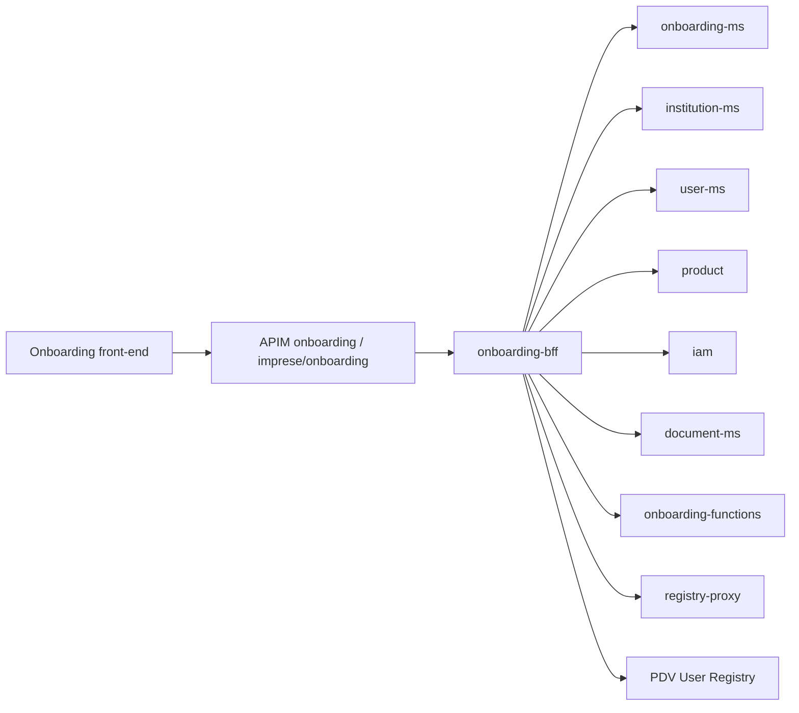

# onboarding-bff

> Spring Boot backend-for-frontend of the onboarding web application: it authorizes the user and orchestrates calls to onboarding-ms, institution-ms, user-ms, product, registries, document-ms and onboarding-functions.

| | |
|---|---|
| Path | `apps/onboarding-bff` |
| Stack | Spring Boot (parent `selc-starter-parent` 0.3.1-SNAPSHOT), Java 17, blocking (Spring MVC + OpenFeign) |
| Type | BFF |
| Tenants | Both: separate `-ar` and `-pnpg` deployments (AR under `onboarding`, PNPG under `imprese/onboarding`) |
| Infra | `infra/resources/onboarding-bff/` |

## Responsibilities

- Serve the onboarding front-end: product catalogue, institution lookup (IPA, Infocamere, registries), onboarding submission for institutions, companies (PG) and aggregators, users onboarding.
- Manage the contract token lifecycle from the UI: verify, complete, approve/reject, delete, download contracts and attachments, upload signed documents, aggregates CSV.
- Enforce authorization with IAM permissions before forwarding to back-end services.
- Propagate the tenant (`X-Tenant-Id`) and the caller JWT to downstream services.

## Architecture

Multi-module Maven project (`apps/onboarding-bff/pom.xml`, artifact `onboarding-bff-parent` 1.0.0-SNAPSHOT), based on `selc-commons` 2.10.0 (`selc-commons-web`, `selc-commons-connector-rest`):

| Module | Content |
|---|---|
| `connector-api` | Connector interfaces and domain models |
| `connector/rest` | Feign clients (`client/`), generated DTOs from `connector/rest/docs/openapi/*`, `TenantHeaderInterceptor`, client config in `src/main/resources/config/*.properties` |
| `core` | Business services |
| `web` | Controllers (`web/.../controller`), request/response models, `AuthorizationService` |
| `app` | Spring Boot application, `application.yml`, generated spec, Cucumber suite |



## API

Application API published by APIM through `infra/resources/_modules/apim_api` (module `apim_api_bff_onboarding`): AR `selc-<env>-api-bff-onboarding` with base path `onboarding`, PNPG `selc-<env>-pnpg-api-bff-onboarding` with base path `imprese/onboarding`; `tenant_enforcement_enabled = true`, `jwt_tenant_resolution_enabled = false`.

| Controller | Base path | Main operations |
|---|---|---|
| `ProductV1Controller` | `/v1` | `/product/{id}`, `/products`, `/products/admin` |
| `ProductV2Controller` | `/v2/product` | product, `/{productId}/required-documents`, `/{productId}/required-documents/enabled` |
| `InstitutionController` | `/v1/institutions` | onboarding, company onboarding, geographic taxonomies, `HEAD` checks, `/onboarding/verify`, from-infocamere, verification match/legal-address, onboarded institution info |
| `InstitutionV2Controller` | `/v2/institutions` | `ipa`, `ipa/{taxCode}`, onboarding, company onboarding, aggregation verification, company verify-manager, active onboardings, recipient-code verification, `onboarding/users/pg`, `PUT /{onboardingId}`, `/onboardings` |
| `TokenV2Controller` | `/v2/tokens` | complete, complete-onboarding-users, verify, approve, reject, delete, contract and backstage contract, template attachment, attachments (status, upload), available documents, download, aggregates CSV |
| `UserController` | `/v1/users` | validate, onboarding, onboarding aggregator, check-manager, onboarding manager, search-user |

Specs:
- `apps/onboarding-bff/app/src/main/resources/swagger/api-docs.json`: generated by `SwaggerConfigTest`, used as APIM `openapi_path`.
- `apps/onboarding-bff/app/src/main/docs/openapi.json`: committed spec checked by `call_openapi_verification.yml`.

## Data and messaging

No own database, topic or queue: all state lives in the called services (mainly [onboarding-ms](onboarding-ms.md) `selcOnboarding`).

## Integrations

Feign clients in `apps/onboarding-bff/connector/rest/src/main/java/.../client`, generated from spec copies in `apps/onboarding-bff/connector/rest/docs/openapi/`:

| Spec copy | Target (env var) |
|---|---|
| `api-selfcare-onboarding-docs` | [onboarding-ms](onboarding-ms.md) (`MS_ONBOARDING_URL`) |
| `api-selfcare-core-docs` | [institution-ms](institution-ms.md) (`MS_CORE_URL`) |
| `api-selfcare-user-docs` | [user-ms](user-ms.md) (`MS_USER_URL`, `MS_USER_INSTITUTION_URL`) |
| `api-selfcare-ms-product-docs` | [product](product.md) (`MS_PRODUCT_URL`) |
| `api-iam-docs` | [iam](iam.md) (`MS_IAM_URL`) |
| `api-selfcare-document-docs` | [document-ms](document-ms.md) (`MS_DOCUMENT_URL`) |
| `api-selfcare-onboarding-functions-docs` | [onboarding-functions](onboarding-functions.md) (`ONBOARDING_FUNCTIONS_URL`, `ONBOARDING-FUNCTIONS-API-KEY`) |
| `api-user-registry-docs` | PDV User Registry (`USERVICE_USER_REGISTRY_URL`, `USERVICE_USER_REGISTRY_API_KEY`) |
| (no generated spec) | `PartyProcessRestClient` (`USERVICE_PARTY_PROCESS_URL`), `PartyRegistryProxyRestClient` (`USERVICE_PARTY_REGISTRY_PROXY_URL`, [registry-proxy](registry-proxy.md)) |

The onboarding-functions client also sends the bearer token and the `x-functions-key` header (`apps/onboarding-bff/README.md`). Retries are configured with resilience4j in `app/src/main/resources/config/application.yml`.

## Configuration

| Group | Variables |
|---|---|
| Server | `B4F_ONBOARDING_SERVER_PORT`, `B4F_ONBOARDING_LOG_LEVEL` |
| Security | `JWT_TOKEN_PUBLIC_KEY` (JWT validation from `selc-commons-web`) |
| Clients | the URLs and keys listed in [Integrations](#integrations), `REST_CLIENT_*` timeouts and logger level |
| Observability | `APPLICATIONINSIGHTS_CONNECTION_STRING` (role name `bff-onboarding`) |

Secrets injected by Terraform from Key Vault: `USERVICE_USER_REGISTRY_API_KEY`, `APPLICATIONINSIGHTS_CONNECTION_STRING`, `JWT_TOKEN_PUBLIC_KEY`, `ONBOARDING-FUNCTIONS-API-KEY`.

Authorization: controllers use `@PreAuthorize` backed by `AuthorizationService`, which checks IAM permissions (`SELC_VIEW_ACCOUNT_PAGE`, `SELC_MANAGE_ACCOUNT_PAGE`, `SELC_VIEW_ACCOUNT_DOCUMENTS`); view permissions fall back to the user's onboarding membership.

## Multitenancy

- APIM sets and enforces `X-Tenant-Id` (tenant from the host: AR or PNPG); the BFF does not resolve the tenant from the JWT.
- `TenantHeaderInterceptor` (`connector/rest`) copies the incoming `X-Tenant-Id` onto every Feign call, so downstream services apply tenant isolation.
- Each Terraform stack deploys a dedicated instance per tenant.

See [multitenancy](../multitenancy.md) and [MULTITENANT Step 2 ingress unification](../specs/MULTITENANT/Step_2/Ingress_unification.md).

## Build, run and test

```bash
mvn -f apps/onboarding-bff/pom.xml clean package               # build all modules
mvn -f apps/onboarding-bff/pom.xml test                        # unit tests
# regenerate app/src/main/resources/swagger/api-docs.json
(cd apps/onboarding-bff && mvn install -DskipTests) && \
(cd apps/onboarding-bff/app && mvn test -Dtest=SwaggerConfigTest -Dsurefire.failIfNoSpecifiedTests=false)
# Cucumber (needs Docker; run from apps/onboarding-bff/app after installing the modules)
(cd apps/onboarding-bff && mvn install -DskipTests) && \
(cd apps/onboarding-bff/app && mvn test -Dtest=it.pagopa.selfcare.onboarding.CucumberSuite -Dsurefire.failIfNoSpecifiedTests=false)
```

- Cucumber runner `it.pagopa.selfcare.onboarding.CucumberSuite`; features for institutions (v1/v2), products (v1/v2), tokens and users; stack in `app/src/test/resources/docker-compose.yml`.
- See [testing](../testing.md).

## Deployment

- Container App `selc-<env>-onboarding-bff`, image `selfcare-onboarding-bff`; stacks `infra/resources/onboarding-bff/{dev,uat,prod}-{ar,pnpg}`. `apps/onboarding-bff/infra/repository` holds repository settings.
- PR checks: `pr_onboarding_bff.yml` (`call_code_review.yml` + `call_openapi_verification.yml` on `apps/onboarding-bff/app/src/main/docs/openapi.json`), `pr_onboarding_infra_bff.yml`.
- Release: `trigger_release_onboarding_bff.yml` calls `release_app.yml` for AR and PNPG, then updates the GitHub variable for domain `onboarding-bff`.
- Related: `trigger_onboarding_frontend_openapi_sync.yml`. See [CI/CD](../ci-cd.md) and [infrastructure](../infrastructure.md).

## References

- [apps/onboarding-bff/README.md](../../apps/onboarding-bff/README.md)
- [onboarding-ms](onboarding-ms.md), [onboarding-functions](onboarding-functions.md), [iam](iam.md)
- [FN_VPN architecture](../specs/FN_VPN/ARCHITECTURE.md) (onboarding-bff as a caller of the Function App)
- [MULTITENANT specs](../specs/MULTITENANT/DESIGN_REVIEW.md), [multitenancy](../multitenancy.md)
- [selfcare-starter-parent](../libs/selfcare-starter-parent.md), [architecture](../architecture.md)
