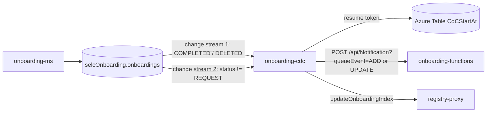

# onboarding-cdc

> Quarkus change-data-capture consumer that watches the `selcOnboarding.onboardings` collection and turns onboarding changes into notifications (via onboarding-functions) and registry index updates (via registry-proxy).

| | |
|---|---|
| Path | `apps/onboarding-cdc` |
| Stack | Quarkus 3.36.2, Java 17, reactive (Mutiny + reactive MongoDB client) |
| Type | CDC consumer |
| Tenants | Both stacks exist; the watch is enabled only on `*-ar` and releases ship AR only |
| Infra | `infra/resources/onboarding-cdc/` |

## Responsibilities

- Watch MongoDB change streams on `onboardings` (database `selcOnboarding`).
- When an onboarding becomes `COMPLETED` or `DELETED`, call the onboarding-functions `Notification` HTTP function, which publishes the event to the notification topics (see [onboarding-functions](onboarding-functions.md#data-and-messaging)).
- Keep the onboarding search index of [registry-proxy](registry-proxy.md) up to date.
- Persist the last processed resume token so that the notification stream restarts where it stopped.

## Architecture

Single Maven module, package `it.pagopa.selfcare.onboarding` (`apps/onboarding-cdc/src/main/java`):

| Class / package | Role |
|---|---|
| `event/CdcLifecycle` | Starts the streams on `StartupEvent` |
| `event/OnboardingCdcService` | Opens the two change streams, filters events, stores the resume token, exits the app on stream failure (`Quarkus.asyncExit`) |
| `event/NotificationService` | Calls `NotificationsApi.apiNotificationPost` on onboarding-functions with retry/backoff |
| `event/RegistryIndexService` | Calls `OnboardingApi.updateOnboardingIndex` on registry-proxy |
| `event/{config,constant,entity,mapper}` | Table client config, constants, `Onboarding` entity, mappers |
| `context/TenantContext`, `client/auth` | Tenant resolution and outgoing auth/tenant headers |

Depends on [selfcare-onboarding-sdk-product](../libs/selfcare-onboarding-sdk-product.md) (`apps/onboarding-cdc/pom.xml`).



## API

No REST API of its own (only Quarkus health endpoints). Not exposed through APIM.

## Data and messaging

Two change streams on `selcOnboarding.onboardings` (`event/OnboardingCdcService`), both on `insert`, `update` and `replace` with full document lookup:

| Stream | Filter | Action | Resume |
|---|---|---|---|
| Notification | `fullDocument.status` in `COMPLETED`, `DELETED` | `Notification` function with `queueEvent`: `ADD` for a `COMPLETED` onboarding, `UPDATE` when `updatedAt` is more than `ONBOARDING-CDC-MINUTES-THRESHOLD-FOR-UPDATE-NOTIFICATION` minutes after `activatedAt` or the status is `DELETED`. Updates that only set `contractUpdateRequiredAt` are skipped (the resume token is still saved). | Token stored in Azure Table `CdCStartAt` (`START_AT_TABLE_NAME`) after each successful call |
| Registry index | `status != REQUEST` and `workflowType` not in `USERS`, `CONTRACT_UPDATE` | `updateOnboardingIndex` on registry-proxy | None (starts from the current position) |

If a stream fails the application exits (`Quarkus.asyncExit`); on restart the notification stream resumes from the stored token. Calls are skipped when `ONBOARDING-CDC-MONGODB-WATCH-ENABLED` is `false` (default).

## Integrations

Generated clients from spec copies in `apps/onboarding-cdc/src/main/openapi/`:

| Spec copy | Client | Target (env var) |
|---|---|---|
| `onboarding_functions.json` | `NotificationsApi` | [onboarding-functions](onboarding-functions.md) (`ONBOARDING_FUNCTIONS_URL`) |
| `party_registry_proxy.json` | `OnboardingApi` | [registry-proxy](registry-proxy.md) (`PARTY_REGISTRY_PROXY_URL`) |

Calls to onboarding-functions send the function key, `X-Tenant-Id` and the technical `JWT_BEARER_TOKEN`; no `x-selfcare-uid` is sent, so onboarding-functions derives the caller from the token `uid` claim (`apps/onboarding-cdc/README.md`).

## Configuration

From `apps/onboarding-cdc/src/main/resources/application.properties` and `infra/resources/onboarding-cdc/*`:

| Group | Variables |
|---|---|
| Mongo / watch | `MONGODB-CONNECTION-STRING`, `ONBOARDING-CDC-MONGODB-WATCH-ENABLED` |
| Resume token table | `START_AT_TABLE_NAME`, `STORAGE_CONNECTION_STRING` or `AZURE_STORAGE_ACCOUNT_NAME` + `AZURE_CLIENT_ID` (managed identity) |
| Retry / notification | `ONBOARDING-CDC-RETRY`, `ONBOARDING-CDC-RETRY-MIN-BACKOFF`, `ONBOARDING-CDC-RETRY-MAX-BACKOFF`, `ONBOARDING-CDC-MINUTES-THRESHOLD-FOR-UPDATE-NOTIFICATION` |
| Clients | `ONBOARDING_FUNCTIONS_URL`, `NOTIFICATION-FUNCTIONS-API-KEY` (Key Vault `fn-onboarding-primary-key`), `JWT_BEARER_TOKEN` (Key Vault `jwt-bearer-token-functions`), `PARTY_REGISTRY_PROXY_URL` |
| Tenant | `SUPPORTED_TENANTS` (default `AR,PNPG`), `DEFAULT_TENANT` (default `PNPG`, `AR` on AR stacks) |
| Observability | `APPLICATIONINSIGHTS_CONNECTION_STRING` |

`JWT_BEARER_TOKEN` is an expiring secret: rotate it before `exp` and keep it tenant-specific (`apps/onboarding-cdc/README.md`).

## Multitenancy

- The change stream carries no request, so the outgoing `X-Tenant-Id` falls back to `DEFAULT_TENANT` when no tenant is resolved (FIXME "temporary solution" in `client/auth/AuthenticationPropagationHeadersFactory`).
- onboarding-functions validates that the token `tenant_id` matches `X-Tenant-Id`; a token minted for AR cannot be reused by PNPG.
- The watch is enabled only on `*-ar` stacks (`ONBOARDING-CDC-MONGODB-WATCH-ENABLED=true`), `false` on `*-pnpg`.

See [multitenancy](../multitenancy.md) and [MULTITENANT Step 2](../specs/MULTITENANT/Step_2/ARCHITECTURE.md).

## Build, run and test

```bash
mvn -f apps/onboarding-cdc/pom.xml clean package    # build
mvn -pl apps/onboarding-cdc test                     # unit tests (from repo root)
mvn -f apps/onboarding-cdc/pom.xml quarkus:dev      # dev mode (needs Mongo replica set + storage)
```

No Cucumber suite. See [testing](../testing.md).

## Deployment

- Container App `selc-<env>-onboarding-cdc`, image `selfcare-onboarding-cdc`; stacks `infra/resources/onboarding-cdc/{dev,uat,prod}-{ar,pnpg}`.
- PR checks: `pr_onboarding_cdc.yml` (`call_code_review.yml`), `pr_onboarding_infra_cdc.yml`.
- Release: `trigger_release_onboarding.yml` releases onboarding-cdc on **AR only** (together with onboarding-ms and onboarding-functions) through `call_release_app.yml`.
- See [CI/CD](../ci-cd.md) and [infrastructure](../infrastructure.md).

## References

- [apps/onboarding-cdc/README.md](../../apps/onboarding-cdc/README.md)
- [onboarding-functions](onboarding-functions.md), [onboarding-ms](onboarding-ms.md), [registry-proxy](registry-proxy.md)
- [FN_VPN requirements](../specs/FN_VPN/REQUIREMENTS.md) and [security](../specs/FN_VPN/SECURITY.md) (onboarding-cdc as caller of the Function App)
- [MULTITENANT specs](../specs/MULTITENANT/DESIGN_REVIEW.md), [architecture](../architecture.md)
