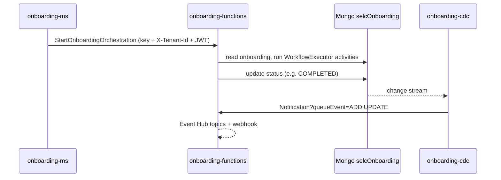

# onboarding-functions

> Azure Function App (Quarkus + Durable Functions) that runs the asynchronous onboarding workflows: contracts, tokens, e-mails, institution/user/delegation creation, notifications to downstream consumers and housekeeping.

| | |
|---|---|
| Path | `apps/onboarding-functions` |
| Stack | Quarkus 3.5.1 (`quarkus-azure-functions`), Java 17, Azure Functions Java library + Durable Task (`durabletask-azure-functions` 1.4.0), blocking |
| Type | Azure Functions |
| Tenants | Both: one Function App per tenant (`selc-<env>-onboarding-fn`, `selc-<env>-pnpg-onboarding-fn`) |
| Infra | `infra/resources/onboarding-functions/` |

## Responsibilities

- Run the `Onboardings` orchestration for each onboarding state change requested by [onboarding-ms](onboarding-ms.md), choosing a workflow by `workflowType`.
- Build contracts and attachments, save tokens, apply the PagoPA signature, send registration/approval/completion/rejection e-mails.
- Create institutions, onboardings, users and delegations on [institution-ms](institution-ms.md) and [user-ms](user-ms.md); handle aggregator onboardings in batches.
- Publish onboarding notifications (called by [onboarding-cdc](onboarding-cdc.md)) to Event Hub topics and to the [webhook](webhook.md) service; resend and count notifications.
- Delete institutions/users, reject pending contract updates, send contract-update campaign mails, purge Durable Task history.

## Architecture

Package `it.pagopa.selfcare.onboarding` (`apps/onboarding-functions/src/main/java`): `functions/` (function entry points), `workflow/` (one `WorkflowExecutor` per workflow type), `service/` (business logic, `HttpFunctionGuard`, `HttpJwtValidator`), `client/` (event hub, webhook, external REST clients), `config/`, `storage/` (`ContractBlobClientProvider`), `context/TenantContext`. Shared libraries: [selfcare-onboarding-sdk-common](../libs/selfcare-onboarding-sdk-common.md), [selfcare-onboarding-sdk-crypto](../libs/selfcare-onboarding-sdk-crypto.md), [selfcare-onboarding-sdk-azure-storage](../libs/selfcare-onboarding-sdk-azure-storage.md) (0.18.1). Host settings in `host.json` (`functionTimeout` 1 minute, Durable hub `JavaTestHub`, `maxConcurrentActivityFunctions` 10).

### Triggers

| Function | Trigger | Purpose |
|---|---|---|
| `StartOnboardingOrchestration` | HTTP GET/POST `?onboardingId=` | Schedules the `Onboardings` orchestration (input: onboarding id + tenant) |
| `TriggerBuildAttachmentsAndSaveTokens` | HTTP POST | Schedules `BuildAttachmentAndSaveTokens` |
| `Notification` | HTTP POST `?queueEvent=ADD\|UPDATE` | Sends the onboarding notification (called by onboarding-cdc) |
| `ResendNotification`, `ResendNotifications`, `CountNotifications` | HTTP POST / POST / GET `onboardings/notifications/count` | Resend one/many notifications (`NotificationsSender` orchestration), count them |
| `TriggerDeleteInstitutionAndUser` | HTTP GET | Schedules `DeleteInstitutionAndUserOnboarding` |
| `SendContractUpdateMail` | HTTP POST | Contract update campaign e-mails |
| `CheckOrganization`, `TestToken`, `messageAcknowledgment`, `webhookTest`, `TestSendEmail` | HTTP HEAD / GET / POST `acknowledgment/{productId}/message/{messageId}/status/{status}` / POST / POST | External (FD) checks, acknowledgments and diagnostics |
| `PurgeInstancesCompleted`, `PurgeInstancesAll` | Timer `0 0 11 * * *`, `0 0 12 * * *` | Purge Durable Task instances (`onboarding-functions.purge.*` windows) |

All HTTP triggers use `authLevel = FUNCTION` and pass through `HttpFunctionGuard.authorize`: function key, `X-Tenant-Id` header (missing/unsupported tenant: 400) and an RS256 JWT verified by `HttpJwtValidator` (invalid: 401).

### Orchestrations

| Orchestrator | Started by | What it does |
|---|---|---|
| `Onboardings` | `StartOnboardingOrchestration` | Loads the onboarding in the tenant scope, picks a `WorkflowExecutor` and runs the step for the current status (`REQUEST`, `TOBEVALIDATED`, `PENDING`, `PENDING_IN_REVIEW`, `REJECTED`), then updates the status. Skips "phantom approvals" (`TOBEVALIDATED` without approver) |
| `OnboardingsAggregate` / `OnboardingsAggregateBatch` | Sub-orchestrations of aggregator workflows | Create aggregate onboardings in batches (`AGGREGATE_BATCH_SIZE`, `MAX_BATCHES_BEFORE_CONTINUE`, `continueAsNew`) |
| `BuildAttachmentAndSaveTokens` | `TriggerBuildAttachmentsAndSaveTokens` | Build attachments and save their tokens |
| `NotificationsSender` | `ResendNotifications` | Page through notifications to resend |
| `DeleteInstitutionAndUserOnboarding` | `TriggerDeleteInstitutionAndUser` | Delete institution and user onboardings, reject pending contract updates |

Workflow types mapped in `functions/OnboardingFunctions.java` to `workflow/WorkflowExecutor*`: `CONTRACT_REGISTRATION`, `CONTRACT_REGISTRATION_AGGREGATOR`, `CONTRACT_WITH_COUNTERSIGNATURE`, `FOR_APPROVE`, `FOR_APPROVE_PT`, `FOR_APPROVE_GPU`, `CONFIRMATION`, `CONFIRMATION_AGGREGATE`, `CONFIRMATION_AGGREGATOR`, `IMPORT`, `IMPORT_AGGREGATION`, `USERS`, `USERS_PG`, `USERS_EA`, `INCREMENT_REGISTRATION_AGGREGATOR`, `CONTRACT_UPDATE`. Activities (names in `functions/utils/ActivityName.java`) include build contract/attachment, save token, send mail (registration, approve, completion, rejection, delete), create institution/onboarding/users/delegation, store `activatedAt`, reject outdated and override pending onboardings, sync product users, activate contract, aggregates CSV and token/attachment deletion. Retries use `RETRY_MAX_ATTEMPTS`, `FIRST_RETRY_INTERVAL`, `BACKOFF_COEFFICIENT`.



## API

Base path `/api/<FunctionName>` on the Function App. Specs in `apps/onboarding-functions/src/main/openapi/`: `openapi.json` (own spec) and `openapi-apim-function.json` (operations published through APIM: `ResendNotification`, `onboardings/notifications/count`, tag `support`). APIM external API modules `apim_external_api_ms_v2`, `apim_selfcare_support_service_v1` and `apim_external_api_contract_public_v1` use `BACKEND_BASE_URL = https://selc-<env>-onboarding-fn.azurewebsites.net` (`infra/resources/_modules/apim_external_api/apim.tf`).

## Data and messaging

- MongoDB database `selcOnboarding` (`MONGODB_CONNECTION_URI`): onboardings and tokens shared with onboarding-ms.
- Contract storage per tenant (`storages.contracts` of the tenant registry, `storage/ContractBlobClientProvider`); tenant filter on queries per `SELFCARE_TENANT_STRICT_DATA_ISOLATION` (`context/TenantDataIsolation`); product configuration from the product storage account.
- Notifications: Event Hub REST (`EVENT_HUB_BASE_PATH`, `{hubName}/messages`) to consumers `standard` (`STANDARD_TOPIC_NAME`, default `SC-Contracts`), `sap` (`SC-Contracts-SAP`, filtered by `SAP_ALLOWED_INSTITUTION_TYPE`/`SAP_ALLOWED_ORIGINS`) and `fd` (`Selfcare-FD`); plus `POST webhooks/notify` on the webhook service (`WEBHOOK_BASE_PATH`).
- E-mail via SMTP (Quarkus mailer) with JSON templates under `contracts/template/mail/` (`MAIL_TEMPLATE_*`).
- Durable Task state in the Function App host storage account (`infra/resources/_modules/functions/function.tf`).

## Integrations

Generated clients from spec copies in `apps/onboarding-functions/src/main/openapi/`: `core` ([institution-ms](institution-ms.md), `MS_CORE_URL`), `user` ([user-ms](user-ms.md), `MS_USER_URL`), `document` ([document-ms](document-ms.md), `MS_DOCUMENT_URL`), `product` ([product](product.md), `MS_PRODUCT_URL`), `party_registry_proxy` ([registry-proxy](registry-proxy.md), `MS_PARTY_REGISTRY_URL`), `user_registry` (PDV, `USER_REGISTRY_URL`), `webhook-openapi` ([webhook](webhook.md)). Hand-written REST clients: `EventHubRestClient`, `WebhookRestClient`, `ExternalRestClient`/`ExternalTokenRestClient` (`PROD_FD_URL`).

Callers: [onboarding-ms](onboarding-ms.md), [onboarding-bff](onboarding-bff.md), [onboarding-cdc](onboarding-cdc.md) and APIM ([FN_VPN requirements](../specs/FN_VPN/REQUIREMENTS.md)).

## Configuration

From `apps/onboarding-functions/src/main/resources/application.properties`, `apps/onboarding-functions/README.md` and `infra/resources/onboarding-functions/*`:

| Group | Variables |
|---|---|
| Tenant / JWT | `TENANT_REGISTRY_JSON` (`selfcare-sdk-tenant`: JWT key, session audience, contracts storage, validated at startup), `TENANT_SUPPORTED_TENANTS` (legacy fallback `SUPPORTED_TENANTS`), `SELFCARE_TENANT_STRICT_DATA_ISOLATION`, `DEFAULT_TENANT`, `JWT_PUBLIC_KEY_<T>` (referenced by the registry), `JWT_ALLOWED_ISSUERS`, `JWT_DEFAULT_TENANT`, `JWT_TENANT_CLAIM_REQUIRED` |
| Token issuing | `JWT_TOKEN_PRIVATE_KEY`, `JWT_TOKEN_KID`, `JWT_TOKEN_ISSUER`, `JWT_TOKEN_DURATION` (audience from the registry `jwt.session.audience`); `JWT_TOKEN_AUDIENCE_*` and `JWT_BEARER_TOKEN` are still set in Terraform but no longer read |
| Mongo / clients | `MONGODB_CONNECTION_URI`, `MS_CORE_URL`, `MS_USER_URL`, `MS_DOCUMENT_URL`, `MS_PRODUCT_URL`, `MS_PARTY_REGISTRY_URL`, `USER_REGISTRY_URL`, `USER_REGISTRY_API_KEY` |
| Storage | `BLOB_STORAGE_ACCOUNT_NAME_PRODUCT`, `BLOB_STORAGE_MANAGED_IDENTITY_CLIENT_ID_PRODUCT`, `STORAGE_CONTAINER_PRODUCT`, `BLOB_STORAGE_MANAGED_IDENTITY_CLIENT_ID_CONTRACT_<T>` (referenced by the registry contracts storage) |
| Notifications | `EVENT_HUB_BASE_PATH`, `STANDARD_TOPIC_NAME`, `SAP_TOPIC_NAME`, `FD_TOPIC_NAME`, `*_SHARED_ACCESS_KEY_NAME`, `EVENTHUB_SC_CONTRACTS_*_WO_KEY_LC`, `STANDARD_NOTIFICATION_RELATED_DOCUMENTS_ENABLED`, `MINUTES_THRESHOLD_FOR_UPDATE_NOTIFICATION`, `WEBHOOK_BASE_PATH` |
| Mail | `MAIL_SERVER_HOST`, `MAIL_SERVER_PORT`, `MAIL_SERVER_USERNAME`, `MAIL_SERVER_PASSWORD`, `MAIL_SERVER_SSL`, `MAIL_SENDER_ADDRESS`, `MAIL_DESTINATION_TEST*`, `MAIL_TEMPLATE_*`, `MAIL_*_LINK`, `SELFCARE_URL`, `EMAIL_SERVICE_AVAILABLE` |
| Signature / FD | `PAGOPA_SIGNATURE_SOURCE` (`disabled`/`local`/`aruba`), `NAMIRIAL_*`, `PROD_FD_URL`, `FD_TOKEN_*`, `BYPASS_CHECK_ORGANIZATION` |
| Workflow tuning | `RETRY_MAX_ATTEMPTS`, `FIRST_RETRY_INTERVAL`, `BACKOFF_COEFFICIENT`, `AGGREGATE_BATCH_SIZE`, `MAX_BATCHES_BEFORE_CONTINUE`, `AGGREGATE_BATCH_DELAY_SECONDS`, `USER_MS_SEND_MAIL`, `FORCE_INSTITUTION_PERSIST` |

## Multitenancy

- Every HTTP call must carry `X-Tenant-Id` (case-insensitive lookup, `context/TenantContext`) that is in `TENANT_SUPPORTED_TENANTS`; the JWT `tenant_id` claim must match it (or `JWT_DEFAULT_TENANT` is assumed when the claim is absent and not required).
- The tenant is passed as orchestration input and reopened in the orchestrator (`TenantContext.open`); a mismatch with the onboarding's `tenantId` fails the orchestration ("Conflicting tenant context").
- Contract storage is selected per tenant; each stack sets `TENANT_SUPPORTED_TENANTS`/`DEFAULT_TENANT` to its own tenant and loads only its tenant public key.
- `SELFCARE_TENANT_STRICT_DATA_ISOLATION` defaults to `false` (documents without `tenantId` are attributed to the current tenant), unlike onboarding-ms which is always strict on the same `onboardings` collection. Enable it only after `backfill_tenant_id.py --verify` (Step 1) is clean on `onboardings`/`tokens` and no pre-migration Durable orchestration is in flight.

See [multitenancy](../multitenancy.md), [MULTITENANT Step 2](../specs/MULTITENANT/Step_2/ARCHITECTURE.md) and [Storage identification](../specs/MULTITENANT/Step_2/Storage_identification.md).

## Build, run and test

```bash
mvn --projects :onboarding-functions --also-make package -DskipTests   # build
mvn -f apps/onboarding-functions/pom.xml test                          # unit tests
mvn -f apps/onboarding-functions/pom.xml package quarkus:run           # local Functions host (needs Azurite, see README)
# Cucumber (needs Docker, from apps/onboarding-functions)
docker compose -f src/test/resources/docker-compose.yml up -d
mvn test -q -Dtest=it.pagopa.selfcare.onboarding.steps.OnboardingFunctionStep \
  -Dsurefire.parallel=none -Dsurefire.threadCount=1 -Dsurefire.failIfNoSpecifiedTests=false
```

- Cucumber runner `it.pagopa.selfcare.onboarding.steps.OnboardingFunctionStep`, feature `onboarding-fn.feature`; the compose stack starts Mongo, Azurite, MockServer, user-ms, institution-ms, document-ms and the function host (port 8090). Test-image config overrides live in `src/test/resources/fn/`; CI downloads `products.json` into `src/test/resources/blobStorageInit/` (`integration_tests_onboarding_functions.yml`).
- See [testing](../testing.md).

## Deployment

- Terraform module `infra/resources/_modules/functions` (Function App, service plan, subnet, private endpoint `<name>-pep`, optional public access via `enable_function_app_public_network_access`, default `false`); stacks `infra/resources/onboarding-functions/{dev,uat,prod}-{ar,pnpg}`. The function key is in Key Vault (`fn-onboarding-primary-key`).
- PR checks: `pr_onboarding_functions.yml` (`call_code_review.yml`), `pr_onboarding_infra_functions.yml`.
- Release: `release_functions.yml` → `call_release_functions.yml` (infra apply, then `mvn ... package` and `quarkus:deploy` to `selc-<env>[-pnpg]-onboarding-fn`); triggered for AR and PNPG by `trigger_release_onboarding.yml`.
- See [CI/CD](../ci-cd.md) and [infrastructure](../infrastructure.md).

## References

- [apps/onboarding-functions/README.md](../../apps/onboarding-functions/README.md)
- [FN_VPN requirements](../specs/FN_VPN/REQUIREMENTS.md), [architecture](../specs/FN_VPN/ARCHITECTURE.md), [security](../specs/FN_VPN/SECURITY.md)
- [MULTITENANT specs](../specs/MULTITENANT/DESIGN_REVIEW.md), [onboarding-ms](onboarding-ms.md), [onboarding-cdc](onboarding-cdc.md)
- [Architecture](../architecture.md), [specs index](../specs/README.md)
