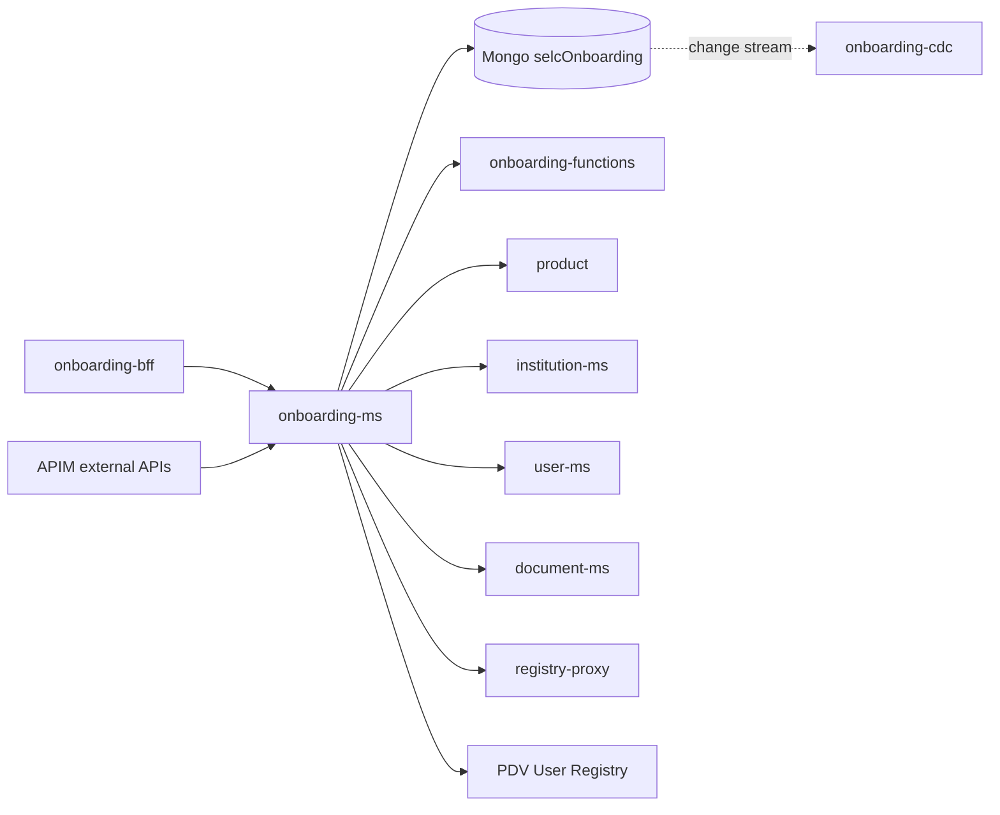

# onboarding-ms

> Quarkus microservice that owns the onboarding requests of institutions to PagoPA products: it validates them, stores them in `selcOnboarding` and drives the asynchronous workflow run by [onboarding-functions](onboarding-functions.md).

| | |
|---|---|
| Path | `apps/onboarding-ms` |
| Stack | Quarkus 3.11.2, Java 17, reactive (RESTEasy Reactive, Mutiny, reactive Panache MongoDB) |
| Type | REST microservice |
| Tenants | Both: separate `-ar` and `-pnpg` deployments, tenant-aware data layer |
| Infra | `infra/resources/onboarding-ms/` |

## Responsibilities

- Accept onboarding requests for every institution type and flow: standard, PA, PSP, PG, aggregators, users-only, contract update, imports and "completion" (already signed) requests.
- Validate requests against the product catalogue, registries (IPA, Infocamere, national registries) and the admission rules owned by `product` (see [ONBOARDING_ADMISSION_RULES](../specs/ONBOARDING_ADMISSION_RULES/REQUIREMENTS.md)).
- Persist onboardings and contract tokens (`onboardings`, `tokens` collections) and expose search, approve/reject, delete and update operations.
- Start the Durable Functions orchestration on onboarding-functions for each state change (unless `ONBOARDING_ORCHESTRATION_ENABLED=false`).
- Handle signed contract upload and verification (`selfcare-onboarding-sdk-crypto`) and PagoPA signature settings.
- Expose the onboarding part of the external APIs published by APIM (external v2, internal, billing portal, support, contracts, PNPG).

## Architecture

Single Maven module, package `it.pagopa.selfcare.onboarding` (`apps/onboarding-ms/src/main/java`):

| Package | Content |
|---|---|
| `controller` (+ `request`, `response`) | `OnboardingController` (`/v1/onboarding`), `InstitutionController` (`/v1/institutions`), `AggregatesController` (`/v1/aggregates`), all `@Authenticated` |
| `service` (+ `impl`, `helper`, `util`) | Onboarding business logic; `helper/OnboardingAdmissionHelper` asks `product` for the admission decision |
| `repository` | `OnboardingRepository`, `TokenRepository` (tenant-scoped queries) |
| `entity` (+ `registry`) | `Onboarding`, `Token` and registry models |
| `mapper` | MapStruct mappers |
| `client/auth` | `AuthenticationPropagationHeadersFactory`, `TenantHeaderClientRequestFilter` |
| `filter`, `exception`, `health`, `conf`, `tracing` | Logging filters, `Problem` handler, readiness checks, configuration, OpenTelemetry context provider |

Shared libraries (`apps/onboarding-ms/pom.xml`): [selfcare-onboarding-sdk-common](../libs/selfcare-onboarding-sdk-common.md) and [selfcare-onboarding-sdk-crypto](../libs/selfcare-onboarding-sdk-crypto.md) 0.18.1, [selfcare-sdk-security](../libs/selfcare-sdk-security.md) 0.8.0, [selfcare-sdk-health](../libs/selfcare-sdk-health.md) 0.2.0, [selfcare-sdk-tenant](../libs/selfcare-sdk-tenant.md) 0.2.0, [selfcare-sdk-tenant-mongodb](../libs/selfcare-sdk-tenant-mongodb.md) 0.1.0.



## API

Spec: `apps/onboarding-ms/src/main/docs/openapi.{json,yaml}` (title "Onboarding API", `operationIdStrategy=METHOD`), regenerated by the build.

| Base path | Main operations |
|---|---|
| `/v1/onboarding` | `POST` per flow (`""`, `/pa`, `/psp`, `/users`, `/users/pg`, `/users/aggregator`, `/contract-update`, `/pa/aggregation`, `/aggregation/increment`, `*/completion`, `*/import`, `/check-manager`); `PUT /{id}/complete`, `/{id}/completeOnboardingUsers`, `/{id}/consume`, `/{id}/approve`, `/{id}/reject`, `/{id}/update`, `/{id}/recipient-code`, `/{id}/upload-contract-signed`, `/{id}`; `GET` list, `/{id}`, `/{id}/withUserInfo`, `/{id}/pending`, `/institutionOnboardings`, `/checkRecipientCode`, `/institutions/{institutionId}`; `HEAD /verify`; `DELETE /{id}`, `/{id}/user/{userId}` |
| `/v1/institutions` | Institution onboarding operations (`POST`) |
| `/v1/aggregates` | `POST /verification/prod-io`, `/verification/prod-pagopa`, `/verification/prod-pn` (aggregates CSV checks) |

APIM exposure (external APIs, `infra/resources/_modules/apim_external_api/apim.tf` and `apim_pnpg.tf`): the spec is merged by tag into `external` (tag `external-v2`), `external/internal` (`internal-v1`), `external/billing-portal` (`billing-portal`), `external/support` (`support`), `external/contracts` and, on PNPG, `external/internal/pn-pg` (`internal-pnpg`) plus the PNPG external and support APIs. Backend URL: `selc-<env>-onboarding-ms-ca.../v1/`.

## Data and messaging

- MongoDB database `selcOnboarding`, collections `onboardings` and `tokens`; indexes (e.g. `createdAt`, `origin`, `originId`, `taxCode`, `subunitCode`, `productId`, `status`, `activatedAt`, `deletedAt`) are declared in Terraform (`infra/resources/onboarding-ms/*`).
- Contract documents are handled through the [document-ms](document-ms.md) clients (`service/impl/DocumentServiceImpl`).
- No direct Event Hub publishing: changes on `onboardings` are consumed by [onboarding-cdc](onboarding-cdc.md), which triggers notifications on onboarding-functions.
- Terraform also creates the Key Vault secrets `onboarding-data-encryption-iv` and `onboarding-data-encryption-key`.

## Integrations

Generated clients (Quarkus OpenAPI generator) from committed spec copies in `apps/onboarding-ms/src/main/openapi/`:

| Spec copy | Client APIs | Target (env var) |
|---|---|---|
| `core.json` | `InstitutionApi`, `OnboardingApi` | [institution-ms](institution-ms.md) (`MS_CORE_URL`) |
| `document.json` | `DocumentControllerApi`, `DocumentContentControllerApi` | [document-ms](document-ms.md) (`MS_DOCUMENT_URL`) |
| `onboarding_functions.json` | `OrchestrationApi`, `NotificationApi` | [onboarding-functions](onboarding-functions.md) (`ONBOARDING_FUNCTIONS_URL`) |
| `party_registry_proxy.json` | `UoApi`, `AooApi`, `InfocamerePdndApi`, `InstitutionApi`, `GeographicTaxonomiesApi`, `InsuranceCompaniesApi`, `InfocamereApi`, `StationsApi`, `NationalRegistriesApi` | [registry-proxy](registry-proxy.md) (`MS_PARTY_REGISTRY_URL`) |
| `product.json` | `ProductApi` | [product](product.md) (`MS_PRODUCT_URL`); keep aligned with `apps/product/src/main/docs/openapi.json` |
| `user.json` | `InstitutionApi` | [user-ms](user-ms.md) (`MS_USER_URL`) |
| `user_registry.json` | `UserApi` | PDV User Registry (`USER_REGISTRY_URL`) |

- Calls to onboarding-functions carry `Authorization` (the caller JWT, or `JWT_BEARER_TOKEN` for background calls), `X-Tenant-Id`, the function key (`ONBOARDING-FUNCTIONS-API-KEY`) and `x-selfcare-uid`.
- Callers: [onboarding-bff](onboarding-bff.md) and APIM external APIs (see [external-api](external-api.md)).

## Configuration

Main env vars (`apps/onboarding-ms/src/main/resources/application.properties`, `infra/resources/onboarding-ms/*`):

| Group | Variables |
|---|---|
| Tenant | `TENANT_REGISTRY_JSON`, `TENANT_SUPPORTED_TENANTS`, `TENANT_ENFORCEMENT_ENABLED`, `TENANT_DEFAULT`, `TENANT_STORAGE_MANDATORY_KEYS` |
| Mongo / JWT | `MONGODB_CONNECTION_STRING_AR`, `MONGODB_CONNECTION_STRING_PNPG`, `JWT_PUBLIC_KEY_AR`, `JWT_PUBLIC_KEY_PNPG`, `JWT-PUBLIC-KEY`, `JWT_BEARER_TOKEN` |
| Clients | `MS_CORE_URL`, `MS_DOCUMENT_URL`, `MS_PARTY_REGISTRY_URL`, `MS_PRODUCT_URL`, `MS_USER_URL`, `USER_REGISTRY_URL`, `USER-REGISTRY-API-KEY`, `ONBOARDING_FUNCTIONS_URL`, `ONBOARDING-FUNCTIONS-API-KEY` |
| Workflow / features | `ONBOARDING_ORCHESTRATION_ENABLED`, `ONBOARDING-UPDATE-USER-REQUESTER`, `ONBOARDING-REQUIRED-DOCUMENTS-ENABLED`, `ISTAT_CACHE_DURATION_MIN` |
| Signature | `PAGOPA_SIGNATURE_SOURCE`, `PAGOPA_SIGNATURE_SIGNER`, `PAGOPA_SIGNATURE_LOCATION`, `PAGOPA_SIGNATURE_ONBOARDING_REASON_TEMPLATE`, `NAMIRIAL_BASE_URL`, `NAMIRIAL_SIGN_SERVICE_IDENTITY_USER`, `NAMIRIAL_SIGN_SERVICE_IDENTITY_PASSWORD` |
| Runtime (some set only in Terraform) | `STORAGE_CONTAINER_PRODUCT`, `AZURE_STORAGE_ACCOUNT_NAME`, `AZURE_CLIENT_ID`, `HTTP_IDLE_TIMEOUT`, `HTTP_READ_TIMEOUT`, `APPLICATIONINSIGHTS_CONNECTION_STRING`, `APPLICATIONINSIGHTS_ROLE_NAME` |

## Multitenancy

- The [selfcare-sdk-tenant](../libs/selfcare-sdk-tenant.md) resolution filter resolves the tenant from `X-Tenant-Id` (query-param resolution disabled); [selfcare-sdk-tenant-mongodb](../libs/selfcare-sdk-tenant-mongodb.md) selects the per-tenant Mongo connection.
- Repositories read `TenantContext`, scope queries by `tenantId` and filter `findById` results by tenant.
- Outgoing calls propagate `X-Tenant-Id`; the product client also passes `tenantId` as a query parameter.
- Each stack enables a single tenant: `TENANT_SUPPORTED_TENANTS=AR` on `*-ar`, `PNPG` on `*-pnpg`.

See [multitenancy](../multitenancy.md) and [MULTITENANT Step 2](../specs/MULTITENANT/Step_2/ARCHITECTURE.md) ([Database identification](../specs/MULTITENANT/Step_2/Database_identification.md)).

## Build, run and test

```bash
mvn --projects :onboarding-ms --also-make package -DskipTests   # build + regenerate src/main/docs/openapi.*
mvn -pl apps/onboarding-ms test                                 # unit tests
mvn -f apps/onboarding-ms/pom.xml quarkus:dev                   # dev mode
# Cucumber (needs Docker; starts src/test/resources/docker-compose.yml)
mvn --projects :onboarding-ms --also-make test \
  -Dtest=it.pagopa.selfcare.onboarding.steps.OnboardingStep -Dsurefire.failIfNoSpecifiedTests=false
```

- Cucumber runner: `it.pagopa.selfcare.onboarding.steps.OnboardingStep` with `IntegrationProfile`; features `onboarding`, `product-catalog`, `health` in `src/test/resources/features/`. The README prefixes the command with `APP_SERVER_PORT=8082`.
- CI: `.github/workflows/integration_tests_onboarding_ms.yml`. See [testing](../testing.md).

## Deployment

- Container App `selc-<env>-onboarding-ms`, image `selfcare-onboarding-ms`; Terraform stacks `infra/resources/onboarding-ms/{dev,uat,prod}-{ar,pnpg}`.
- PR checks: `pr_onboarding_ms.yml` (`call_code_review.yml` + `call_openapi_verification.yml` on `apps/onboarding-ms/src/main/docs/openapi.json`), `pr_onboarding_infra_ms.yml`.
- Release: `trigger_release_onboarding.yml` releases onboarding-ms on AR and PNPG together with onboarding-functions and onboarding-cdc (also reached via `release_app.yml` with app `onboarding`), through `call_release_app.yml`.
- See [CI/CD](../ci-cd.md) and [infrastructure](../infrastructure.md).

## References

- [apps/onboarding-ms/README.md](../../apps/onboarding-ms/README.md)
- [ONBOARDING_ADMISSION_RULES requirements](../specs/ONBOARDING_ADMISSION_RULES/REQUIREMENTS.md) and [architecture](../specs/ONBOARDING_ADMISSION_RULES/ARCHITECTURE.md)
- [MULTITENANT specs](../specs/MULTITENANT/DESIGN_REVIEW.md), [FN_VPN architecture](../specs/FN_VPN/ARCHITECTURE.md) (callers of onboarding-functions)
- [Architecture](../architecture.md), [specs index](../specs/README.md)
