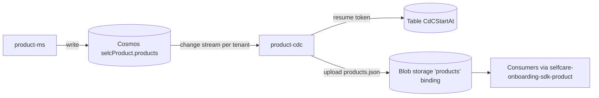

# product-cdc

> Change Data Capture consumer that watches the `products` Mongo collection and republishes the tenant `products.json` file on Blob Storage.

| | |
|---|---|
| Path | `apps/product-cdc` |
| Stack | Quarkus 3.28.3, Java 17, reactive (Mutiny `Multi` over the reactive Mongo client) |
| Type | CDC consumer (no business REST API) |
| Tenants | Both: a single deployment (AR stacks) watches AR and PNPG (`TENANT_SUPPORTED_TENANTS=AR,PNPG`) |
| Infra | `infra/resources/product-cdc/` (`dev-ar`, `uat-ar`, `prod-ar`) |

## Responsibilities

- Open one Mongo change stream per supported tenant on the `products` collection (database `selcProduct`) written by [product](product.md).
- On every `insert`, `update` or `replace` event, rebuild the full product list (current `products.json` minus the changed product, plus its new version) and upload it to the tenant `products` storage binding.
- Persist the last processed resume token in Azure Table Storage so the watcher resumes after a restart.
- Track success/failure events and metrics in Application Insights.

The [`apps/product-cdc/Readme.md`](../../apps/product-cdc/Readme.md) describes the flow; note that the change-stream pipeline in code only matches `update`, `replace` and `insert` (deletes are not propagated).

## Architecture

Package root: `apps/product-cdc/src/main/java/it/pagopa/selfcare/product/`.

| Class | Role |
|---|---|
| `ProductCdcService` | Starts a watcher for each `tenantRegistry.supportedTenantIds()`, reads/writes the resume token, consumes events, uploads the JSON, tracks telemetry |
| `TenantProductCdcResourceProvider` / `TenantProductCdcResources` | Per-tenant Mongo client and database, `products` storage binding, `ProductServiceCacheable` and `AzureBlobClient` (connection string or managed identity) |
| `CdcLifecycle` | On startup (non-test profiles) creates the resume-token table if missing |
| `mapper/ProductMapper` | Maps the Mongo `Product` document to the SDK product resource |
| `model` | Mongo product document model (`Product`, roles, signing/visual configuration, ...) |
| `conf` | `ProductConf`, `JacksonConfiguration` |



## API

No application endpoints: `apps/product-cdc/src/main/docs/openapi.json` has no paths. Only Quarkus health endpoints are used for container probes (`quarkus_health_probes` in Terraform). Not exposed through APIM.

## Data and messaging

| Resource | Details |
|---|---|
| Mongo | Database `selcProduct`, collection from `MONGODB_COLLECTION_NAME` (`products`); full document lookup on updates |
| Blob | Storage key `products` in the tenant registry; file `PRODUCT_STORAGE_FILE_NAME` (default `products.json`), optional `pathPrefix` |
| Table | `START_AT_TABLE_NAME` (default `CdCStartAt`) in the storage account of `STORAGE_CONNECTION_STRING`; tenant-qualified partition keys |

## Integrations

- Libraries: `selfcare-onboarding-sdk-product` (`ProductServiceCacheable`), `selfcare-onboarding-sdk-azure-storage` (`AzureBlobClient`), `selfcare-onboarding-sdk-common`, `selfcare-onboarding-sdk-crypto`, `selfcare-sdk-tenant`, `selfcare-sdk-tenant-mongodb` (`apps/product-cdc/pom.xml`).
- No outbound REST clients and no inbound callers; the produced `products.json` is read by services using `selfcare-onboarding-sdk-product`.

## Configuration

From `apps/product-cdc/src/main/resources/application.properties` and `infra/resources/product-cdc/*/main.tf` (names only):

| Group | Variables |
|---|---|
| Tenant | `TENANT_REGISTRY_JSON`, `TENANT_SUPPORTED_TENANTS` |
| Mongo | `MONGODB_CONNECTION_STRING_AR`, `MONGODB_CONNECTION_STRING_PNPG`, `MONGODB_DATABASE_NAME`, `MONGODB_COLLECTION_NAME`, `PRODUCT-CDC-MONGODB-WATCH-ENABLED` |
| Storage | `BLOB_STORAGE_CONN_STRING_PRODUCT_AR`, `BLOB_STORAGE_CONN_STRING_PRODUCT_PNPG`, `STORAGE_CONNECTION_STRING` (resume-token table), `START_AT_TABLE_NAME`, `PRODUCT_STORAGE_FILE_NAME`, `STORAGE_CONTAINER_PRODUCT` |
| Retry | `PRODUCT-CDC-RETRY`, `PRODUCT-CDC-RETRY-MIN-BACKOFF`, `PRODUCT-CDC-RETRY-MAX-BACKOFF`, `PRODUCT-CDC-MINUTES-THRESHOLD-FOR-UPDATE-NOTIFICATION` |
| Observability | `APPLICATIONINSIGHTS_CONNECTION_STRING` |

The README environment-variable table (`MONGODB_CONNECTION_STRING`, `BLOB_STORAGE_CONN_STRING`, ...) predates the tenant registry; the per-tenant names above are the ones set in Terraform.

## Multitenancy

- No request context: the tenant is the loop variable of the watcher. `ProductCdcService` starts one stream per supported tenant; Mongo client, database and storage binding are resolved from `TENANT_REGISTRY_JSON` via `selfcare-sdk-tenant` / `selfcare-sdk-tenant-mongodb`.
- If a product document carries a `tenantId` different from the watcher tenant, the event fails (`Product tenant does not match CDC tenant`).
- Resume tokens are stored per tenant (`ProductConstant.partitionKey(tenantId)`).
- See [multitenancy.md](../multitenancy.md), [Step 2 Storage identification](../specs/MULTITENANT/Step_2/Storage_identification.md).

## Build, run and test

```bash
mvn --projects :product-cdc --also-make package -DskipTests
mvn -f apps/product-cdc/pom.xml test        # ProductCdcServiceTest, ProductMapperTest
mvn -f apps/product-cdc/pom.xml quarkus:dev
```

No Cucumber suite. `apps/product-cdc/src/test/resources/` also contains a `docker-compose.yml` (Mongo, Azurite, mockserver) that is not referenced by the Java tests.

## Deployment

- Terraform: `infra/resources/product-cdc/{dev,uat,prod}-ar/main.tf` creates the Container App `selc-<env>-product-cdc` (image `selfcare-product-cdc`) with secrets from Key Vault.
- Workflows: `pr_product_cdc_infra.yml` (Terraform plan), `trigger_release_product_cdc.yml` (target `ar`), `trigger_deploy_after_merge.yml` (DEV release on push to `main` when `apps/product-cdc/**` changes), `create_release_branch.yml` (UAT), `release_app.yml`. There is no dedicated `pr_product_cdc.yml`; the generic `pr_app.yml` can be dispatched manually. OpenAPI upload is skipped for `-cdc` apps in `call_release_app.yml`. See [ci-cd.md](../ci-cd.md).

## References

- [`apps/product-cdc/Readme.md`](../../apps/product-cdc/Readme.md)
- [product](product.md)
- [selfcare-onboarding-sdk-product](../libs/selfcare-onboarding-sdk-product.md), [selfcare-onboarding-sdk-azure-storage](../libs/selfcare-onboarding-sdk-azure-storage.md), [selfcare-sdk-tenant](../libs/selfcare-sdk-tenant.md), [selfcare-sdk-tenant-mongodb](../libs/selfcare-sdk-tenant-mongodb.md)
- [architecture.md](../architecture.md), [infrastructure.md](../infrastructure.md)
