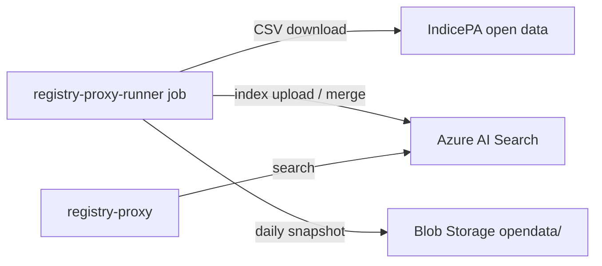

# registry-proxy-runner

> Quarkus command-mode batch job that downloads IPA open data, rewrites the Azure AI Search indexes used by [registry-proxy](registry-proxy.md), archives daily CSV snapshots and expires stale pending onboardings.

| | |
|---|---|
| Path | `apps/registry-proxy-runner` |
| Stack | Quarkus 3.35.1, Java 17, blocking (Quarkus REST Client Jackson, OpenCSV, Azure Storage Blob, Azure Identity) |
| Type | Batch job (`@QuarkusMain`, Azure Container App Job), no inbound HTTP |
| Tenants | AR only (Terraform stacks `dev-ar`, `uat-ar`, `prod-ar`; index names default to `*-index-ar`) |
| Infra | `infra/resources/registry-proxy-runner/` (`{dev,uat,prod}-ar`) |

## Responsibilities

- Fetch IPA institutions, AOO, categories, UO and UO with SFE from the IndicePA open data dump and upload them to the matching AI Search indexes.
- Save a daily CSV snapshot of each source to Blob Storage (`opendata/<prefix>/<yyyy-MM-dd>.csv`, prefixes `ipa-institution`, `ipa-aoo`, `ipa-category`, `ipa-uo`, `ipa-uo-sfe`); snapshot failures are logged and do not stop indexing.
- Mark expired onboardings in the onboarding index: `OnboardingStatusUpdateService` queries documents with `status eq 'PENDING'` and an `expiringDate` in the past and merges `status=EXPIRED`.
- ANAC stations and IVASS insurance companies are implemented (`AnacDataService`, `IvassDataService`, `StationIndexWriterService`, `InsuranceCompanyIndexWriterService`) but their tasks are commented out in `RegistryProxyMain`.

## Architecture

Package root: `apps/registry-proxy-runner/src/main/java/it/pagopa/selfcare/registry/proxy/runner/`.

| Package | Key classes |
|---|---|
| (root) | `RegistryProxyMain`: runs the tasks sequentially, logs each failure and always exits with `0` |
| `client` | `IpaInstitutionOpenDataRestClient`, `IpaAOOOpenDataRestClient`, `IpaCategoriesOpenDataRestClient`, `IpaUOOpenDataRestClient`, `IpaUOSfeOpenDataRestClient`, `AnacRestClient`, `IvassRestClient`, `AzureSearchRestClient` (+ `AzureSearchHeadersFactory` for the API key) |
| `service` | `AbstractIpaOpenDataService` and IPA implementations, `AbstractIndexWriterService` and index writers, `AzureBlobStorageService`, `OnboardingStatusUpdateService` |
| `model` | Source rows (`IpaInstitution`, `IpaAoo`, `IpaUo`, `IpaCategory`, `AnacStation`, `IvassInsuranceCompany`), index documents (`*Index`), `OnboardingSearchDocument`, search request/response |
| `scheduler` | `*RegistryProxyScheduler` classes; inactive because `quarkus.scheduler.enabled=false` (scheduling is done by the Container App Job) |



Task order in `RegistryProxyMain.run`: IPA institutions → IPA AOO → IPA categories → IPA UO (incl. SFE) → onboarding expiration update.

## API

None. The job exposes no HTTP endpoints and has no OpenAPI spec.

## Data and messaging

- Azure AI Search indexes (`azure-ai-search.*.index-name`): `ipa-institution-index-ar`, `ipa-aoo-index-ar`, `ipa-uo-index-ar`, `ipa-category-index-ar`, `onboarding-index-ar`, `station-index-ar`, `insurance-company-index-ar` (defaults; overridable by env var). API version default `2023-11-01`.
- Azure Blob Storage container `selc-opendata` (default of `BLOB_CONTAINER_REF`). `AzureBlobStorageService` uses the connection string when set (local), otherwise the account name with a managed identity (`AZURE_CLIENT_ID`).
- No database and no messaging.

## Integrations

- IndicePA open data (`IPA_OPEN_DATA_URL` + per-dataset endpoints).
- ANAC and IVASS open data (clients configured, tasks disabled).
- Azure AI Search service `selc-<env>-<location>-ar-srch` (set in Terraform as `AZURE_SEARCH_BASE_URL`).
- Consumers of the produced indexes: [registry-proxy](registry-proxy.md) (search endpoints) and other services reading the onboarding index.

## Configuration

Source: `apps/registry-proxy-runner/src/main/resources/application.properties`.

| Group | Env vars (names only) |
|---|---|
| IPA open data | `IPA_OPEN_DATA_URL`, `IPA_OPEN_DATA_INSTITUTION_ENDPOINT`, `IPA_OPEN_DATA_CATEGORY_ENDPOINT`, `IPA_OPEN_DATA_AOO_ENDPOINT`, `IPA_OPEN_DATA_UO_ENDPOINT`, `IPA_OPEN_DATA_UO_SFE_ENDPOINT`, `IPA_OPEN_DATA_CONNECT_TIMEOUT`, `IPA_OPEN_DATA_READ_TIMEOUT` |
| ANAC / IVASS | `ANAC_BASE_URL`, `ANAC_DATA_PATH`, `ANAC_*_TIMEOUT`, `IVASS_BASE_URL`, `IVASS_DATA_PATH`, `IVASS_*_TIMEOUT`, `IVASS_REGISTRY_TYPES`, `IVASS_WORK_TYPES` |
| AI Search | `AZURE_SEARCH_BASE_URL`, `AZURE_SEARCH_API_KEY`, `AZURE_SEARCH_API_VERSION`, `AZURE_SEARCH_CONNECT_TIMEOUT`, `AZURE_SEARCH_READ_TIMEOUT`, `AZURE_SEARCH_IPA_INSTITUTION_INDEX`, `AZURE_SEARCH_IPA_AOO_INDEX`, `AZURE_SEARCH_IPA_UO_INDEX`, `AZURE_SEARCH_IPA_CATEGORY_INDEX`, `AZURE_SEARCH_ONBOARDING_INDEX`, `AZURE_SEARCH_STATION_INDEX`, `AZURE_SEARCH_INSURANCE_COMPANY_INDEX` |
| Blob Storage | `BLOB_STORAGE_CONN_STRING`, `AZURE_STORAGE_ACCOUNT_NAME`, `BLOB_CONTAINER_REF`, `AZURE_CLIENT_ID` |
| Runtime (Terraform) | `JAVA_TOOL_OPTIONS`, `APPLICATIONINSIGHTS_ROLE_NAME`; Key Vault secrets `AZURE_SEARCH_API_KEY`, `APPINSIGHTS_CONNECTION_STRING` |

The `scheduler.*.cron` properties are kept but unused.

## Multitenancy

The job is single-tenant (AR): it does not use the tenant SDKs and writes the `*-ar` indexes. There is no PNPG stack. See [multitenancy.md](../multitenancy.md) for the platform model.

## Build, run and test

```bash
mvn -f apps/registry-proxy-runner/pom.xml clean package          # build + unit tests
java -jar apps/registry-proxy-runner/target/quarkus-app/quarkus-run.jar   # run once locally (needs the env vars above)
mvn --projects :test-coverage --also-make verify -Pregistry-proxy-runner,report   # coverage, as in CI
```

- The Dockerfile builds with `--projects :registry-proxy-runner --also-make`.
- Tests (`src/test/java`): `service` (`OnboardingStatusUpdateServiceTest`, `InstitutionIndexWriterServiceTest`, `CategoryIndexWriterServiceTest`, `IpaOpenDataServiceTest`, `AnacDataServiceTest`, `IvassDataServiceTest`), `scheduler` tests, `client/AzureSearchHeadersFactoryTest`, `model/ModelTest`. No Cucumber suite.

## Deployment

- Container App Job `selc-<env>-reg-proxy-runner` (module `_modules/container_app_job`), image `selfcare-registry-proxy-runner-ms`, cron `0 */6 * * *`, `replica_timeout_in_seconds = 28800`; dev uses 1.25 CPU / 2.5Gi.
- Uses the Container App Environment user-assigned identity (`AZURE_CLIENT_ID`) and storage account `selc<env><location>archeckoutst01`.
- Workflows: `pr_registry_proxy_runner.yml` (code review), `pr_registry_proxy_runner_infra.yml` (Terraform plan). There is no `trigger_release_*` workflow: release with the generic `release_app.yml` (app `registry-proxy-runner`, target `ar`). See [ci-cd.md](../ci-cd.md).

## References

- [apps/registry-proxy-runner/README.md](../../apps/registry-proxy-runner/README.md) (partly outdated: it still describes the internal scheduler and only the institution index)
- [registry-proxy](registry-proxy.md), [infrastructure.md](../infrastructure.md), [architecture.md](../architecture.md)
