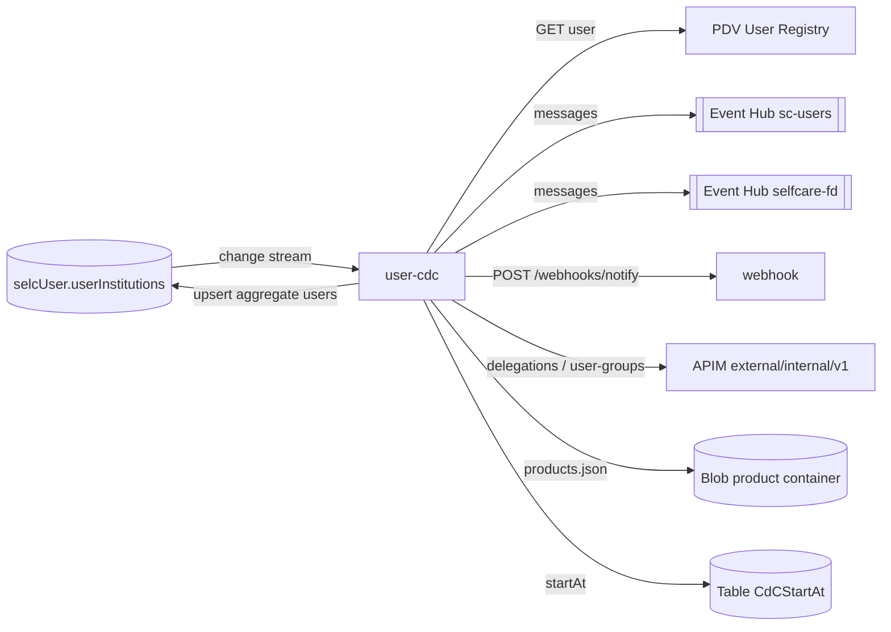

# user-cdc

> Change Data Capture consumer that watches the `userInstitutions` collection of `user-ms` and fans changes out to Event Hubs (`sc-users`, `selfcare-fd`), the webhook service and the "add-on aggregates" propagation.

| | |
|---|---|
| Path | `apps/user-cdc` |
| Stack | Quarkus 3.36.2 (`apps/user-cdc/pom.xml`), Java 17, reactive (Mutiny, reactive Panache MongoDB) |
| Type | CDC consumer (no business REST API) |
| Tenants | Both: deployed as `-ar` and `-pnpg`; in PNPG all consumers are disabled by configuration |
| Infra | `infra/resources/user-cdc/` |

## Responsibilities

`UserInstitutionCdcService` opens a change stream on `selcUser.userInstitutions` (`insert`, `update`, `replace`, `FullDocument.UPDATE_LOOKUP`) and, for every document, invokes up to three consumers depending on feature flags:

| Consumer | Flag | Behaviour |
|---|---|---|
| `consumerToSendScUserEvent` | `USER_CDC_SEND_EVENTS_WATCH_ENABLED` | Reads the user from PDV User Registry (`name,familyName,email,workContacts`), builds one `UserNotificationToSend` per product (grouped by role, minimum state) and sends it to Event Hub `sc-users`; then, if `USER_CDC_WEBHOOK_ENABLED`, forwards it best effort to webhook `POST /webhooks/notify` (tenant `USER_CDC_WEBHOOK_TENANT_ID`, topic `SC-Users`). On success upserts the resume token in `CdCStartAt` (partition `User`). |
| `consumerToSendUserEventForFD` | `USER_CDC_SEND_EVENTS_FD_WATCH_ENABLED` (and the document contains `prod-fd` or `prod-fd-garantito`) | Sends `FdUserNotificationToSend` to Event Hub `selfcare-fd` (`ACTIVE_USER`, `SUSPEND_USER`, `DELETE_USER`); on an e-mail change sends `DELETE_USER` followed by `ACTIVE_USER`. |
| `consumerToAddOnAggregates` | `USER_CDC_ADD_ON_AGGREGATES_WATCH_ENABLED` | For products with `toAddOnAggregates = true` and a `roleId`, pages active `EA` delegations of the aggregator through the internal API, upserts the user on each aggregate (`OPERATOR` stays `OPERATOR`, any other role becomes `ADMIN_EA` with the product role taken from the product catalogue), then adds/removes the user from the aggregator group via the internal user-group API for products in `USER_CDC_ADD_ON_AGGREGATES_GROUP_PRODUCTS` (default `prod-io`). |

All remote calls use retry with backoff (`USER-CDC-RETRY*`); User Registry calls are retried only on timeouts and HTTP 429. Stream failures call `Quarkus.asyncExit()`.

## Architecture



| Package / class | Role |
|---|---|
| `event.UserInstitutionCdcService` | Change stream and the three consumers |
| `event.CdcLifecycle`, `event.config.UserCdcConfig` | Table creation, `TableClient`, `TelemetryClient`, `ProductService` (cached, from blob) |
| `event.repository.UserInstitutionRepository` | `propagateUserToAggregate` on `userInstitutions` |
| `event.client.Internal{Delegation,User,UserGroup}ApiClient` + `InternalApiHeadersFactory` | Clients of the internal API, authenticated with `Ocp-Apim-Subscription-Key` |
| `event.mapper.NotificationMapper`, `CloningMapper` | Payload mapping and product cloning |
| `client.auth.AuthenticationPropagationHeadersFactory` | Propagates `Authorization` on the webhook client |
| `event.health.*` | Readiness for MongoDB, Table Storage and product blob storage |

## API

No application endpoints; only SmallRye Health. Not exposed in APIM.

## Data and messaging

| Resource | Usage |
|---|---|
| MongoDB `selcUser.userInstitutions` | Change stream; writes for aggregate propagation |
| Azure Table `CdCStartAt` | Resume token (read, upsert after `sc-users` processing) |
| Blob container `STORAGE_CONTAINER_PRODUCT` (`products.json`) | Product catalogue for role mapping |
| Event Hub `selc-{d,u,p}-eventhub-ns` / `sc-users`, `selfcare-fd` | User notifications |

Clients `EventHubRestClient` / `EventHubFdRestClient` and payload models come from [selfcare-user-sdk-event](../libs/selfcare-user-sdk-event.md) and [selfcare-user-sdk-model](../libs/selfcare-user-sdk-model.md).

## Integrations

| Target | Generated client | Spec copy |
|---|---|---|
| PDV User Registry | `org.openapi.quarkus.user_registry_json.api.UserApi` | `apps/user-cdc/src/main/openapi/user_registry.json` |
| Internal API (APIM `…/external/internal/v1`) | `DelegationApi`, `UserApi`, `UserGroupApi` (`internal_json`) | `apps/user-cdc/src/main/openapi/internal.json` |
| [webhook](webhook.md) | `org.openapi.quarkus.webhook_ms_json.api.WebhookApi` | `apps/user-cdc/src/main/openapi/webhook_ms.json` |

Libraries: `selfcare-user-sdk-event`, `selfcare-onboarding-sdk-product`, `selfcare-onboarding-sdk-azure-storage`, `selfcare-sdk-health`.

## Configuration

From `apps/user-cdc/src/main/resources/application.properties`:

| Group | Env vars |
|---|---|
| MongoDB | `MONGODB-CONNECTION-STRING` (database `selcUser`) |
| Feature flags | `USER_CDC_SEND_EVENTS_WATCH_ENABLED`, `USER_CDC_SEND_EVENTS_FD_WATCH_ENABLED`, `USER_CDC_ADD_ON_AGGREGATES_WATCH_ENABLED`, `USER_CDC_ADD_ON_AGGREGATES_GROUP_PRODUCTS` |
| Table | `START_AT_TABLE_NAME`, `TABLE_CONNECTION_STRING`, `TABLE_ACCOUNT_NAME`, `TABLE_MANAGED_IDENTITY_CLIENT_ID` |
| Blob | `STORAGE_CONNECTION_STRING`, `STORAGE_ACCOUNT_NAME`, `STORAGE_MANAGED_IDENTITY_CLIENT_ID`, `STORAGE_CONTAINER_PRODUCT` |
| Retry | `USER-CDC-RETRY-MIN-BACKOFF`, `USER-CDC-RETRY-MAX-BACKOFF`, `USER-CDC-RETRY` |
| User Registry | `USER_REGISTRY_URL`, `USER-REGISTRY-API-KEY` |
| Internal API | `INTERNAL_API_URL`, `INTERNAL_API_KEY` |
| Webhook | `USER_CDC_WEBHOOK_ENABLED`, `USER_CDC_WEBHOOK_TENANT_ID`, `USER_CDC_WEBHOOK_TOPIC`, `WEBHOOK_URL` |
| Event Hub | `EVENT_HUB_BASE_PATH`, `EVENT_HUB_SC_USERS_TOPIC`, `SHARED_ACCESS_KEY_NAME`, `EVENTHUB-SC-USERS-SELFCARE-WO-KEY-LC`, `EVENTHUB_SENDER_MANAGED_IDENTITY_CLIENT_ID`, `EVENT_HUB_SELFCARE_FD_TOPIC`, `FD_SHARED_ACCESS_KEY_NAME`, `EVENTHUB_SELFCARE_FD_EXTERNAL_KEY_LC`, `EVENTHUBFD_SENDER_MANAGED_IDENTITY_CLIENT_ID` |
| Telemetry | `APPLICATIONINSIGHTS_CONNECTION_STRING` |

## Multitenancy

- Tenant isolation is by deployment: the AR and PNPG Container Apps connect to their own `MONGODB-CONNECTION-STRING` (Key Vault of each domain) and watch the same database/collection name.
- In `-ar` stacks all three consumers and the webhook are enabled; in `-pnpg` stacks none of the feature flags is set (defaults `false`, comment in `application.properties`: "False for pnpg use case because we must not send events") and `USER_CDC_WEBHOOK_ENABLED = false`.
- The webhook tenant is static configuration (`USER_CDC_WEBHOOK_TENANT_ID`, default `AR`); no tenant field is read from documents.
- The internal API is reached through APIM with a subscription key (see [Step 0 epic](../specs/MULTITENANT/Step_0/EPIC.md) for the planned conversion). Overview: [../multitenancy.md](../multitenancy.md).

## Build, run and test

```bash
mvn -f apps/user-cdc/pom.xml clean package
mvn -f apps/user-cdc/pom.xml test
mvn -f apps/user-cdc/pom.xml quarkus:dev
mvn --projects :test-coverage --also-make verify -Puser-cdc,report
```

Unit tests (`UserInstitutionCdcServiceTest`, `NotificationMapperTest`, `UserInstitutionRepositoryTest`, readiness tests); no Cucumber suite.

## Deployment

- Container Apps `*-user-cdc` (AR) and `*-pnpg-user-cdc` (PNPG), image built from `apps/user-cdc/Dockerfile`; stacks `dev|uat|prod-ar` and `dev|uat|prod-pnpg` under `infra/resources/user-cdc/`.
- PR: `.github/workflows/pr_user_cdc.yml`, `.github/workflows/pr_user_cdc_infra.yml`.
- Release: `.github/workflows/trigger_release_user_cdc.yml` runs `release_app.yml` for `target=ar` and `target=pnpg`; DEV auto-release via `trigger_deploy_after_merge.yml`.

## References

- [App README](../../apps/user-cdc/README.md)
- [user-ms](user-ms.md), [user-group-ms](user-group-ms.md), [user-group-cdc](user-group-cdc.md), [webhook](webhook.md), [external-api](external-api.md)
- [Architecture](../architecture.md), [CI/CD](../ci-cd.md)
