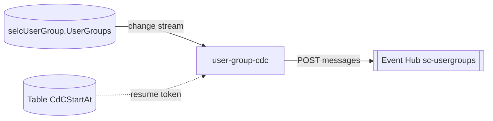

# user-group-cdc

> Change Data Capture consumer that watches the `UserGroups` collection and publishes every change to the `sc-usergroups` Event Hub.

| | |
|---|---|
| Path | `apps/user-group-cdc` |
| Stack | Quarkus 3.36.2 (`apps/user-group-cdc/pom.xml`), Java 17, reactive (Mutiny, reactive Mongo client) |
| Type | CDC consumer (no business REST API) |
| Tenants | AR only (deployed only as `-ar`) |
| Infra | `infra/resources/user-group-cdc/` |

## Responsibilities

- Open a change stream on `selcUserGroup.UserGroups` (the collection owned by [user-group-ms](user-group-ms.md)) for `insert`, `update`, `replace`, with `FullDocument.UPDATE_LOOKUP`.
- When `USER_GROUP_CDC_SEND_EVENTS_WATCH_ENABLED=true`, map each document to `UserGroupNotificationToSend` and send it to the Event Hub REST endpoint `<EVENT_HUB_BASE_PATH>sc-usergroups/messages`, with retry/backoff and Application Insights tracking. If the flag is false the stream is not subscribed.
- Create the `CdCStartAt` table at startup and read the resume token (partition `UserGroup`, row `0001`, property `startAt`). The token is not written back by this service.

## Architecture

Package `it.pagopa.selfcare.user.event`:

| Class | Role |
|---|---|
| `UserGroupCdcService` | `@Startup` change stream consumer; on stream failure tracks the event and calls `Quarkus.asyncExit()`. |
| `UserGroupCdcLifecycle`, `config/UserGroupCdcConfig` | Table creation and `TableClient` (connection string or managed identity). |
| `config/MongoConfig`, `config/DateCodec` | Mongo codec configuration. |
| `entity/UserGroupEntity` | Projection of `UserGroups` (`institutionId`, `productId`, `parentInstitutionId`, `name`, `status`, `members`, audit fields). |
| `mapper/UserGroupNotificationMapper` | MapStruct mapper to `UserGroupNotificationToSend`. |
| `health/*ReadinessCheck` | MongoDB and Table Storage readiness ([selfcare-sdk-health](../libs/selfcare-sdk-health.md)). |

The Event Hub client (`it.pagopa.selfcare.user.client.EventHubRestClient`, `configKey = event-hub`) and the payload model come from [selfcare-user-sdk-event](../libs/selfcare-user-sdk-event.md) / [selfcare-user-sdk-model](../libs/selfcare-user-sdk-model.md), indexed via `quarkus.index-dependency.user-sdk-event.*`.



## API

No application endpoints; only SmallRye Health. Not exposed in APIM.

## Data and messaging

| Resource | Usage |
|---|---|
| MongoDB `selcUserGroup.UserGroups` | Change stream (read only) |
| Azure Table `CdCStartAt` | Resume token (read only) |
| Event Hub `selc-{d,u,p}-eventhub-ns` / `sc-usergroups` | User group notifications |

`application.properties` also configures an `event-hub-fd` client (`selfcare-fd` hub), but `UserGroupCdcService` only calls `EventHubRestClient.sendUserGroupMessage`.

## Integrations

- Source of data: [user-group-ms](user-group-ms.md).
- No OpenAPI-generated clients.

## Configuration

From `apps/user-group-cdc/src/main/resources/application.properties`:

| Group | Env vars |
|---|---|
| MongoDB | `MONGODB-CONNECTION-STRING` (database `selcUserGroup`) |
| Resume-token table | `START_AT_TABLE_NAME`, `STORAGE_CONNECTION_STRING`, `STORAGE_ACCOUNT_NAME`, `STORAGE_CLIENT_ID` |
| Retry | `USER_GROUP_CDC-RETRY-MIN-BACKOFF`, `USER_GROUP_CDC-RETRY-MAX-BACKOFF`, `USER_GROUP_CDC-RETRY` |
| Event Hub | `USER_GROUP_CDC_SEND_EVENTS_WATCH_ENABLED`, `EVENT_HUB_BASE_PATH`, `EVENT_HUB_SC_USERGROUPS_TOPIC`, `SHARED_ACCESS_KEY_NAME`, `EVENTHUB-SC-USER-GROUPS-SELFCARE-WO-KEY-LC`, `EVENTHUB_SENDER_MANAGED_IDENTITY_CLIENT_ID` |
| Event Hub FD (configured, unused) | `EVENT_HUB_SELFCARE_FD_TOPIC`, `FD_SHARED_ACCESS_KEY_NAME`, `EVENTHUB_SELFCARE_FD_EXTERNAL_KEY_LC`, `EVENTHUBFD_SENDER_MANAGED_IDENTITY_CLIENT_ID` |
| Telemetry | `APPLICATIONINSIGHTS_CONNECTION_STRING` |

Terraform enables sending in all stacks and authenticates to Event Hub with the `sc-usergroups-eventhub-sender` managed identity and to Table Storage with the `product-storage-table` identity. Note: the env var names in the app README table are partly outdated; `application.properties` is authoritative.

## Multitenancy

Not tenant-aware in code: single database `selcUserGroup`, no tenant field in `UserGroupEntity` or in the notification mapper. Deployed only for AR. See [../multitenancy.md](../multitenancy.md).

## Build, run and test

```bash
mvn -f apps/user-group-cdc/pom.xml clean package
mvn -f apps/user-group-cdc/pom.xml test
mvn -f apps/user-group-cdc/pom.xml quarkus:dev
mvn --projects :test-coverage --also-make verify -Puser-group-cdc,report
```

Unit tests: `UserGroupCdcServiceTest`, `UserGroupCdcReadinessChecksTest`. No Cucumber suite.

## Deployment

- Container App `selc-{d,u,p}-user-group-cdc`, image `selfcare-user-group-cdc`, stacks `dev-ar`, `uat-ar`, `prod-ar`.
- PR: `.github/workflows/pr_user_group_cdc.yml`, `.github/workflows/pr_user_group_cdc_infra.yml`.
- Release: `.github/workflows/trigger_release_user_group_cdc.yml` → `release_app.yml` (`target=ar`); DEV auto-release via `trigger_deploy_after_merge.yml`.

## References

- [App README](../../apps/user-group-cdc/README.md)
- [user-group-ms](user-group-ms.md), [user-cdc](user-cdc.md)
- [selfcare-user-sdk-event](../libs/selfcare-user-sdk-event.md)
- [Architecture](../architecture.md), [CI/CD](../ci-cd.md)
