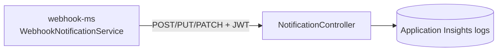

# webhook-consumer

> Test target for the SelfCare [webhook](webhook.md): receives the delivered notifications, logs them and replies `204 No Content`.

| | |
|---|---|
| Path | `apps/webhook-consumer` |
| Stack | Quarkus 3.36.2, Java 17, blocking (`quarkus-rest`), Lombok |
| Type | Test utility service (HTTP receiver) |
| Tenants | Not tenant-aware; deployed only in the AR stacks |
| Infra | `infra/resources/webhook-consumer/` (`dev-ar`, `uat-ar`, `prod-ar`) |

## Responsibilities

- Expose `/notifications` as a URL that can be registered as a webhook endpoint.
- Log, for every request, the HTTP method, the `Authorization` header and the raw body (other headers are not logged).
- Escape `\r` and `\n` in logged values to prevent log forging.
- Always acknowledge with `204 No Content`; there is no persistence and no validation of the incoming JWT.

## Architecture



A single class, `it.pagopa.selfcare.webhookconsumer.controller.NotificationController`, accepts any media type (`@Consumes(MediaType.WILDCARD)`). There are no services, entities or clients.

## API

No committed OpenAPI spec (no `src/main/docs`) and no APIM exposure.

| Method | Path | Notes |
|---|---|---|
| `POST`, `PUT`, `PATCH` | `/notifications` | Logs and returns `204` |
| `GET` | `/q/health/{live,ready,started}` | Quarkus health probes |

To use it, register a webhook with URL `https://selc-<env_short>-webhook-consumer-ca.<container-app-environment-domain>/notifications` (see [`apps/webhook-consumer/README.md`](../../apps/webhook-consumer/README.md)).

## Data and messaging

None. Received payloads only end up in the application logs.

## Integrations

- Inbound: [webhook](webhook.md) deliveries, reachable only from inside the VNet (VPN); the Container App is not published through APIM or the Application Gateway.
- No outbound calls and no `selfcare-*` libraries in `apps/webhook-consumer/pom.xml`.

## Configuration

From `src/main/resources/application.properties` and `infra/resources/webhook-consumer/dev-ar/main.tf`.

| Setting | Value | Purpose |
|---|---|---|
| `quarkus.http.port` | `8080` | HTTP port |
| `quarkus.http.limits.max-body-size` | `1M` | Max accepted payload |
| `quarkus.smallrye-health.root-path` | `/q/health` | Health probes |
| `JAVA_TOOL_OPTIONS` | `-javaagent:applicationinsights-agent.jar` | Application Insights Java agent |
| `APPLICATIONINSIGHTS_ROLE_NAME` | `webhook-consumer` | Telemetry role |
| `APPLICATIONINSIGHTS_CONNECTION_STRING` | Key Vault `appinsights-connection-string` | Telemetry |

## Multitenancy

The app does not read `X-Tenant-Id` or JWT claims. The tenant only appears inside the logged payload. See [multitenancy.md](../multitenancy.md).

## Build, run and test

```bash
mvn --projects :webhook-consumer --also-make clean package
mvn -f apps/webhook-consumer/pom.xml quarkus:dev
mvn -f apps/webhook-consumer/pom.xml test
curl -X POST http://localhost:8080/notifications -H 'Content-Type: application/json' -d '{"tenantId":"AR","productId":"prod-io","topic":"SC-Contracts","payload":{}}'
```

- Unit test: `NotificationControllerTest` (`@QuarkusTest` + RestAssured). No Cucumber suite.
- See [testing.md](../testing.md).

## Deployment

- Terraform: `infra/resources/webhook-consumer/{dev,uat,prod}-ar/main.tf` creates the Container App `selc-<env>-webhook-consumer` (image `selfcare-webhook-consumer-ms`, module `container_app_microservice`, Quarkus health probes) with exactly one replica (min = max = desired = 1) in every environment.
- Workflows: `pr_webhook_consumer.yml` (code review on `apps/webhook-consumer/**`), `pr_webhook_consumer_infra.yml` (Terraform plan via `pagopa/dx` `infra_plan.yaml`), generic `release_app.yml` (OpenAPI upload is skipped for `webhook-consumer` in `call_release_app.yml`).
- There is no `trigger_release_webhook_consumer.yml` and the app is not in `trigger_deploy_after_merge.yml`, so releases are manual through `release_app.yml`. `create_release_branch.yml` lists `webhook-consumer` as a domain but dispatches `trigger_release_webhook_consumer.yml`, which does not exist.
- See [ci-cd.md](../ci-cd.md) and [infrastructure.md](../infrastructure.md).

## References

- [`apps/webhook-consumer/README.md`](../../apps/webhook-consumer/README.md)
- [webhook](webhook.md)
- [architecture.md](../architecture.md)
