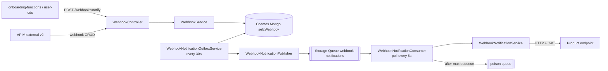

# webhook

> Stores webhook configurations for SelfCare products and delivers HTTP notifications to the configured endpoints, using an outbox and an Azure Storage Queue for retries.

| | |
|---|---|
| Path | `apps/webhook` |
| Stack | Quarkus 3.31.2, Java 17, reactive (Mutiny, reactive Mongo Panache, Vert.x WebClient, Quarkus Scheduler) |
| Type | Microservice (REST API + background delivery worker) |
| Tenants | Both: one deployment (AR stacks) with registry `{"AR":{},"PNPG":{}}` and a shared database |
| Infra | `infra/resources/webhook/` (`dev-ar`, `uat-ar`, `prod-ar`) |

## Responsibilities

- Manage webhook configurations (one per product): create, list, get, update. Delete is exposed but currently returns `501 Not Implemented`.
- Accept notification requests (`productId`, `tenantId`, `topic`, `payload`) from internal services and fan them out to the matching active webhooks. A webhook without a `topics` filter receives every topic.
- Deliver each notification over HTTP with a short-lived JWT signed by SelfCare (`WebhookJwtService`, issuer `PAGOPA`, audience `selfcare-webhook`).
- Retry failed deliveries through the Storage Queue, moving messages to a poison queue after `max-dequeue-count` deliveries.
- Allow operators to resend notifications by id, by status or by date range.
- Encrypt webhook headers at rest (`selfcare-onboarding-sdk-crypto`).

The app README and design documents live in [`apps/webhook/README.md`](../../apps/webhook/README.md) and `apps/webhook/docs/` (`ARCHITECTURE.md`, `REQUIREMENTS.md`, `SECURITY.md`, `design-review.md`, `CODE_SECURITY_REVIEW.md`).

## Architecture



- Packages under `it.pagopa.selfcare.webhook`: `controller`, `service`, `repository`, `entity`, `dto`, `health`, `metrics`, `monitoring`, `util`, `exception`.
- Notification records are written to Mongo first (outbox). `WebhookNotificationOutboxService` publishes unpublished records to the queue; `WebhookNotificationConsumer` polls the queue (`ConcurrentExecution.SKIP`), takes a Mongo processing lock (visibility timeout + margin) and calls `WebhookNotificationService` for the HTTP delivery.
- Each delivery attempt is appended to `webhookNotificationAttempts`.
- Metrics use the OpenTelemetry API only; the exporter comes from the Application Insights Java agent.
- `monitoring/SyntheticMonitoringMain` is the entrypoint of the synthetic-monitoring job deployed by Terraform (module `application_insights_synthetic_monitoring`), which checks `/q/health/group/diagnostics`.

## API

OpenAPI: [`apps/webhook/src/main/docs/openapi.json`](../../apps/webhook/src/main/docs/openapi.json) (also `openapi.yaml`), served at `/openapi`, Swagger UI at `/swagger-ui`.

| Method | Path | Tags | Notes |
|---|---|---|---|
| `POST` | `/webhooks` | `external-v2` | Create a webhook (409 when the product already has one) |
| `GET` | `/webhooks` | `internal-v1` | List, query `tenantId`, `page` (default 0), `size` (1–100, default 20) |
| `GET` | `/webhooks/{productId}` | `external-v2` | Tenant resolved from query `tenantId`, `X-Tenant-Id` or JWT claim |
| `PUT` | `/webhooks/{productId}` | `external-v2` | Update a webhook |
| `DELETE` | `/webhooks/{productId}` | none | Returns `501 Not Implemented` |
| `POST` | `/webhooks/notify` | `internal-v1` | Send a notification to the product webhooks |
| `POST` | `/webhooks/notifications/{notificationId}/resend` | `internal-v1` | Resend one notification |
| `POST` | `/webhooks/notifications/resend` | `internal-v1` | Resend by status |
| `POST` | `/webhooks/notifications/resend/date-range` | `internal-v1` | Resend by creation date range |
| `GET` | `/info/version` | `System` | Application version |

APIM exposure: operations tagged `external-v2` are merged into the shared external API by `infra/resources/_modules/apim_external_api/api/ms_external_api/v2/openapi_merge/openapi_merge.json` (input `selfcare-webhook-ms`). The full spec is not published as a standalone APIM API. The OpenAPI spec is also watched by `opex-dashboards.yml`.

The controllers carry no `@Authenticated` annotation; JWT verification relies on `selfcare-sdk-security` configuration (`mp.jwt.verify.publickey`). The app docs (`apps/webhook/docs/ARCHITECTURE.md`) list endpoint authorization as an open decision.

## Data and messaging

- Cosmos DB (Mongo API) database `selcWebhook`, created by Terraform with collections:
  - `webhooks` (`Webhook`: `tenantId`, `productId`, `url`, `httpMethod`, encrypted `headers`, `products`, `topics`, `status` ACTIVE/INACTIVE/SUSPENDED, `retryPolicy`).
  - `webhookNotifications` (`WebhookNotification`: `webhookId`, `tenantId`, `topic`, `payload`, `status` PENDING/SENDING/DELIVERED/FAILED/RETRY, `attemptCount`, publishing and processing locks).
  - `webhookNotificationAttempts` (delivery history).
- Azure Storage Queue `webhook-notifications` plus a poison queue (module `_modules/azure_storage_queue`); the Container App managed identity only has message-level roles, so `auto-create` stays `false` in the cloud.
- A commented-out Service Bus module remains in `webhook.tf`.

## Integrations

- Inbound: [onboarding-functions](onboarding-functions.md) (`WEBHOOK_BASE_PATH`) and [user-cdc](user-cdc.md) (`WEBHOOK_URL`) call the private Container App URL; external products manage their webhook through APIM.
- Outbound: product HTTP endpoints. [webhook-consumer](webhook-consumer.md) is a test target that logs the received notifications.
- Libraries: [selfcare-sdk-security](../libs/selfcare-sdk-security.md), [selfcare-onboarding-sdk-crypto](../libs/selfcare-onboarding-sdk-crypto.md), [selfcare-sdk-health](../libs/selfcare-sdk-health.md), [selfcare-cucumber-sdk](../libs/selfcare-cucumber-sdk.md) (tests).

## Configuration

From `src/main/resources/application.properties` and `infra/resources/webhook/dev-ar/webhook.tf`.

| Variable | Default / value | Purpose |
|---|---|---|
| `MONGODB_CONNECTION_STRING` | Key Vault `mongodb-connection-string` | Mongo connection |
| `MONGODB_DATABASE_NAME` | `selcWebhook` | Database |
| `JWT_PUBLIC_KEY` | Key Vault `jwt-public-key` | Inbound JWT verification |
| `WEBHOOK_JWT_PRIVATE_KEY` | Key Vault `jwt-private-key-pkcs8` | Signs outbound notification JWTs |
| `WEBHOOK_JWT_ISSUER` / `WEBHOOK_JWT_AUDIENCE` / `WEBHOOK_JWT_DURATION_MINUTES` | `PAGOPA` / `selfcare-webhook` / `5` | Outbound JWT claims |
| `WEBHOOK_DEFAULT_TENANT_ID` | empty (Terraform: `AR`) | Tenant used when a notification has none |
| `SELFCARE_DATA_ENCRIPTION_KEY` / `_IV` | Key Vault | Header encryption |
| `WEBHOOK_STORAGE_QUEUE_ENABLED` | `false` (Terraform: `true`) | Enables outbox publisher and consumer |
| `WEBHOOK_STORAGE_QUEUE_ENDPOINT` / `_NAME` / `_POISON_QUEUE` | from `module.storage_queue` | Queue coordinates |
| `WEBHOOK_STORAGE_QUEUE_POLL_INTERVAL` / `_OUTBOX_INTERVAL` | `5s` / `30s` | Scheduler periods |
| `WEBHOOK_STORAGE_QUEUE_MAX_DEQUEUE_COUNT` | `5` | Deliveries before the poison queue |
| `WEBHOOK_STORAGE_QUEUE_VISIBILITY_TIMEOUT_SECONDS` | `300` | Message invisibility; lock adds `PROCESSING_LOCK_MARGIN_SECONDS` (60) |
| `WEBHOOK_TIMEOUT_CONNECT` / `WEBHOOK_TIMEOUT_READ` | `5000` / `10000` ms | Outbound HTTP timeouts |
| `WEBHOOK_HTTP_MAX_POOL_SIZE` / `_MAX_CONCURRENT_DELIVERIES` | `10` / `10` | Outbound HTTP limits |
| `TENANT_SUPPORTED_TENANTS` | `AR,PNPG` | Tenant registry |
| `AZURE_CLIENT_ID` | Container App Environment identity | Managed identity for the queue |
| `APPLICATIONINSIGHTS_CONNECTION_STRING` | Key Vault | Telemetry (Java agent via `JAVA_TOOL_OPTIONS`) |

The README still lists older names (`MONGODB_DATABASE`, `JWT_ISSUER`) and Quarkus 3.28.3; the code and pom are the source of truth.

## Multitenancy

- Tenant registry `{"AR":{},"PNPG":{}}` with `tenant.mongo.mandatory=false`: both tenants share the `selcWebhook` database; `tenantId` is a field on webhooks and notifications.
- `selfcare.tenant.resolution-filter.enabled=false`: only `GET /webhooks/{productId}` resolves the tenant (`EffectiveTenant`) from query, `X-Tenant-Id` or the JWT `tenant_id` claim; conflicting values return `400`.
- `selfcare.security.tenant-validation.enabled=true`: SPID tokens must carry an `X-Tenant-Id` consistent with the token (otherwise `401`).
- See [multitenancy.md](../multitenancy.md) and [MULTITENANT Step 2 architecture](../specs/MULTITENANT/Step_2/ARCHITECTURE.md).

## Build, run and test

```bash
mvn --projects :webhook --also-make clean package
mvn -f apps/webhook/pom.xml quarkus:dev
mvn -f apps/webhook/pom.xml test
# Cucumber: the runner opens docker-compose.yml relative to the working directory
cd apps/webhook && mvn test -Dtest=CucumberSuiteTest -Dsurefire.failIfNoSpecifiedTests=false
```

- Unit tests: `@QuarkusTest` classes under `src/test/java`.
- Cucumber: `cucumber/CucumberSuiteTest` (excluded from Surefire by default) with `CucumberTestProfile`, feature `src/test/resources/features/webhook.feature`, Testcontainers `ComposeContainer` on `apps/webhook/docker-compose.yml` (Mongo, mockserver, Azurite). No integration-test workflow runs it in CI.
- See [testing.md](../testing.md).

## Deployment

- Terraform: `infra/resources/webhook/{dev,uat,prod}-ar/webhook.tf` creates the Cosmos database and collections, the Storage Queue, the Container App `selc-<env>-webhook-ms` (image `selfcare-webhook-ms`, module `container_app_microservice`) and the synthetic monitoring job.
- Workflows: `trigger_release_webhook.yml` (target `ar`, via `release_app.yml`), `trigger_deploy_after_merge.yml` (DEV release on push to `main` when `apps/webhook/**` changes), `create_release_branch.yml` (UAT). There is no `pr_webhook.yml` nor `pr_webhook_infra.yml`; the generic `pr_app.yml` / `pr_app_infra.yml` can be dispatched manually. See [ci-cd.md](../ci-cd.md).

## References

- [`apps/webhook/README.md`](../../apps/webhook/README.md)
- [webhook-consumer](webhook-consumer.md), [user-cdc](user-cdc.md), [onboarding-functions](onboarding-functions.md)
- [architecture.md](../architecture.md), [infrastructure.md](../infrastructure.md), [multitenancy.md](../multitenancy.md)
