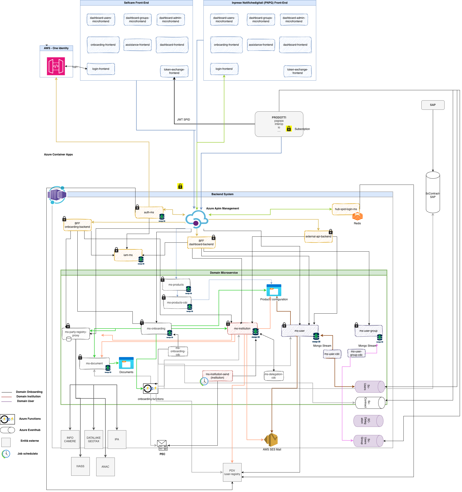
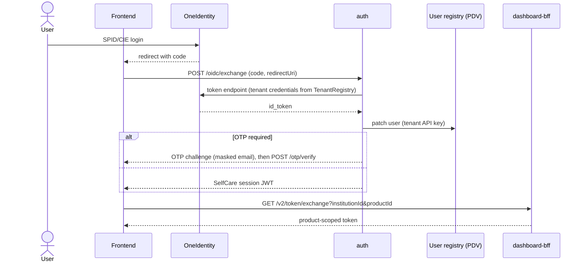
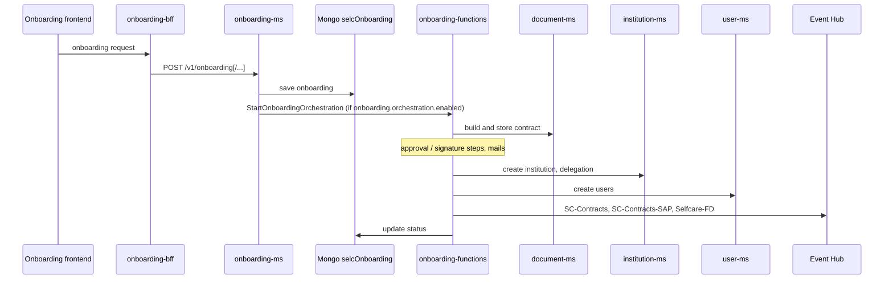
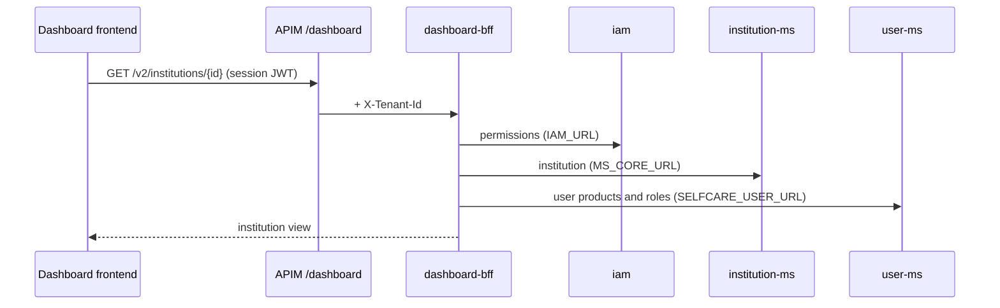
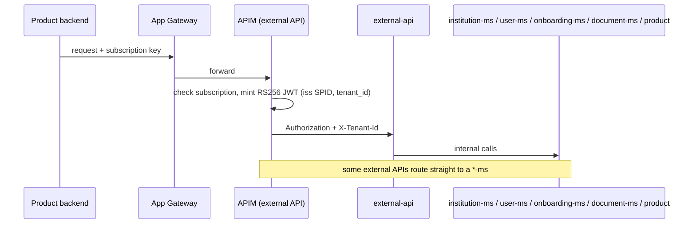
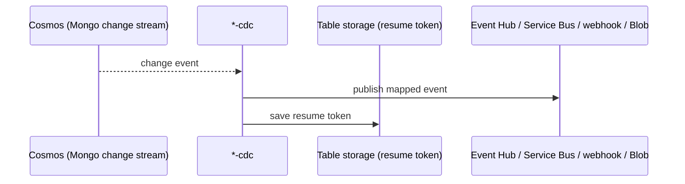

# Architecture

SelfCare is the PagoPA back office where public and private institutions onboard to PagoPA
products and manage their users, institutions, delegations and webhooks. The same backend code is
deployed for two tenants: **AR** (Area Riservata, `selfcare.pagopa.it`) and **PNPG** (Piattaforma
Notifiche PG, `imprese.notifichedigitali.it`). See [multitenancy.md](./multitenancy.md).

The editable source of the diagram is `docs/architectures/selfcare-architecture.drawio`.

## System context

| Element | Role | Source |
|---------|------|--------|
| Frontends | AR and PNPG web apps calling the BFFs | `infra/resources/_modules/local-env/locals.tf` (`frontend_uri`) |
| OneIdentity → `auth` | AR login: OIDC code exchanged for a SelfCare session JWT | `apps/auth` |
| hub-spid-login | PNPG login (`/spid/v1`), external image `hub-spid-login-ms` with Redis | `infra/resources/spid-login/{dev,uat,prod}-pnpg` |
| Application Gateway | Public entrypoint; adds `X-Selfcare-Original-Host` | `infra/core/_modules/appgateway` |
| API Management | Only HTTP entrypoint to the services; app APIs and external (product) APIs | `infra/core/_modules/apim`, `infra/resources/_modules/apim_api`, `apim_external_api` |
| Container Apps | Microservices, CDC workers and jobs | `infra/core/_modules/container_app_environments`, `infra/resources/_modules/container_app_microservice`, `container_app_job` |
| Azure Functions | onboarding-functions (Durable Functions) | `infra/resources/_modules/functions` |
| Cosmos DB (Mongo API) | One database per service (`selcMsCore`, `selcOnboarding`, `selcUser`, ...) | `infra/core/_modules/cosmos_db` |
| Event Hub | Outbound events for products (`SC-Contracts`, `SC-Users`, ...) | `infra/core/_modules/events` |
| Service Bus | Internal events (`institution-events`) | `infra/core/_modules/internal_events` |
| Blob / Table storage | Contracts, product JSON, mail templates, CDC resume tokens | `infra/core/_modules/storage*` |

More on the infrastructure in [infrastructure.md](./infrastructure.md).

## Stack split

- **Quarkus** (parent `it.pagopa.selfcare:apps`, version set per app in its `pom.xml`, from 3.5.1 in
  onboarding-functions to 3.36.2 in the newest CDC services): auth, iam, product, product-cdc,
  webhook, webhook-consumer, institution-cdc, institution-send-mail-scheduler, user-ms, user-cdc,
  user-group-cdc, onboarding-ms, onboarding-cdc, onboarding-functions, document-ms, delegation-cdc,
  registry-proxy-runner, log-availability-runner.
- **Spring Boot 3.3** (parent `selc-starter-parent`, see `libs/selfcare-starter-parent/pom.xml`):
  dashboard-bff, external-api, institution-ms, onboarding-bff, registry-proxy, user-group-ms.

## Service catalogue

| App | Stack | Role |
|-----|-------|------|
| [auth](./apps/auth.md) | Quarkus | OneIdentity/SAML login, OTP, issues the session JWT (AR). |
| [iam](./apps/iam.md) | Quarkus | User roles and permissions (`userClaims`) per product. |
| [product](./apps/product.md) | Quarkus | Product catalogue (products, roles, contract templates). |
| [product-cdc](./apps/product-cdc.md) | Quarkus | Publishes the product catalogue as JSON to blob storage. |
| [webhook](./apps/webhook.md) | Quarkus | Registers product webhooks and delivers notifications. |
| [webhook-consumer](./apps/webhook-consumer.md) | Quarkus | Test receiver for webhook notifications (not exposed through APIM). |
| [institution-ms](./apps/institution-ms.md) | Spring | Institutions and delegations (`selcMsCore`, package `mscore`). |
| [institution-cdc](./apps/institution-cdc.md) | Quarkus | Streams institution changes to the internal Service Bus. |
| [institution-send-mail-scheduler](./apps/institution-send-mail-scheduler.md) | Quarkus | Scheduled mails to institutions about their user lists. |
| [user-ms](./apps/user-ms.md) | Quarkus | User-institution-product bindings (`selcUser`). |
| [user-cdc](./apps/user-cdc.md) | Quarkus | Streams user changes to Event Hub and webhook. |
| [user-group-ms](./apps/user-group-ms.md) | Spring | User groups (`selcUserGroup`). |
| [user-group-cdc](./apps/user-group-cdc.md) | Quarkus | Streams user-group changes to Event Hub. |
| [dashboard-bff](./apps/dashboard-bff.md) | Spring | Backend for the dashboard frontend; product token exchange. |
| [external-api](./apps/external-api.md) | Spring | Public APIs for products, behind APIM subscriptions. |
| [onboarding-ms](./apps/onboarding-ms.md) | Quarkus | Onboarding requests (`selcOnboarding`). |
| [onboarding-bff](./apps/onboarding-bff.md) | Spring | Backend for the onboarding frontend. |
| [onboarding-cdc](./apps/onboarding-cdc.md) | Quarkus | Streams onboarding changes to notifications and the registry index. |
| [onboarding-functions](./apps/onboarding-functions.md) | Quarkus (Azure Functions) | Durable orchestration of onboarding: contracts, institution, users, mails, events. |
| [document-ms](./apps/document-ms.md) | Quarkus | Contracts and attachments, document signing. |
| [delegation-cdc](./apps/delegation-cdc.md) | Quarkus | Streams delegation changes to Event Hub and webhook. |
| [registry-proxy](./apps/registry-proxy.md) | Spring | Proxy to public registries (IPA, ANAC, IVASS, InfoCamere, AdE) and search. |
| [registry-proxy-runner](./apps/registry-proxy-runner.md) | Quarkus | Scheduled job (every 6 hours) feeding Azure AI Search with IndicePA data. |
| [log-availability-runner](./apps/log-availability-runner.md) | Quarkus | Nightly job computing API availability ([spec](./specs/LOG_AVAILABILITY_DAILY/REQUIREMENTS.md)). |

## Login and token exchange (AR)

Source: `apps/auth/.../controller/OidcController`, `service/OidcServiceImpl`,
`apps/dashboard-bff/.../controller/TokenV2Controller`.

PNPG users log in through hub-spid-login instead.

## Onboarding

Source: `apps/onboarding-ms/.../service/impl/OrchestrationServiceDefault.java`,
`apps/onboarding-functions/.../functions/OnboardingFunctions.java`, `application.properties` of both.

Changes on `onboardings` are then picked up by onboarding-cdc (see below).

## Dashboard read path

Source: `apps/dashboard-bff/.../service/InstitutionV2ServiceImpl.java`; client specs are committed in
`apps/dashboard-bff/docs/openapi/`.

dashboard-bff also calls onboarding-ms, document-ms, user-group-ms and the user registry, and forwards
`X-Tenant-Id` on every Feign call (`TenantHeaderInterceptor`).

## External API path

Source: `infra/resources/_modules/apim_external_api/api/jwt_base_policy.xml.tpl`, `apps/external-api`.

## CDC and event propagation

All CDC services are Quarkus apps that read MongoDB change streams and store the resume token in
Azure Table Storage (`START_AT_TABLE_NAME`, default `CdCStartAt`).

| CDC | Reads | Publishes to |
|-----|-------|--------------|
| [onboarding-cdc](./apps/onboarding-cdc.md) | `selcOnboarding.onboardings` | onboarding-functions notifications API, registry-proxy onboarding index |
| [institution-cdc](./apps/institution-cdc.md) | `selcMsCore.Institution` | Service Bus topic `institution-events` (`libs/selfcare-internal-events-sdk`), consumed by user-ms and user-group-ms |
| [user-cdc](./apps/user-cdc.md) | `selcUser.userInstitutions` | Event Hub `SC-Users` and `selfcare-fd`; webhook topic `SC-Users` |
| [user-group-cdc](./apps/user-group-cdc.md) | `selcUserGroup.UserGroups` | Event Hub `sc-usergroups` and `selfcare-fd` |
| [delegation-cdc](./apps/delegation-cdc.md) | `selcMsCore.Delegations` | Event Hub `sc-delegations`; webhook `SC-Delegations` |
| [product-cdc](./apps/product-cdc.md) | product collection | Product JSON in blob storage (binding `products`) |

Related: [infrastructure.md](./infrastructure.md), [ci-cd.md](./ci-cd.md), [testing.md](./testing.md),
[specs/README.md](./specs/README.md).
