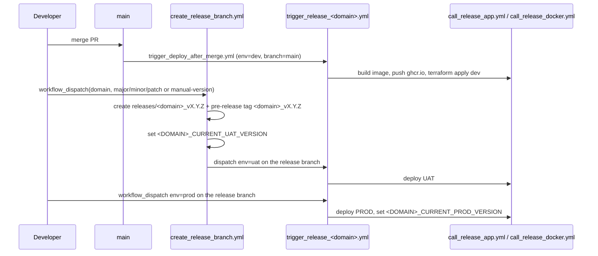

# CI/CD

> GitHub Actions workflows in `.github/workflows/` (159 files): PR checks, releases of apps, infra, APIM and libraries.

See also: [infrastructure.md](infrastructure.md), [testing.md](testing.md), [architecture.md](architecture.md).

## Environments and branches

| Environment | Source branch | How it is deployed |
|-------------|---------------|--------------------|
| DEV | `main` | Automatically after merge (`trigger_deploy_after_merge.yml` -> `trigger_release_<domain>.yml` with `env=dev`) |
| UAT | `releases/<domain>_vX.Y.Z` | Automatically when the release branch is created (`create_release_branch.yml`), or by re-dispatching `trigger_release_<domain>.yml` with `env=uat` |
| PROD | `releases/<domain>_vX.Y.Z` | Only by manual `workflow_dispatch` of `trigger_release_<domain>.yml` (or `release_app.yml`) with `env=prod` |

Deploy jobs run in GitHub environments `<env>-cd` (Docker push) and `<env>` / `<env>-<domain>` (Terraform via the
`pagopa/dx` reusable workflows). Environments, OIDC identities and runners are provisioned by `infra/bootstrap/<env>-ar`
and `infra/repository` (see [infrastructure.md](infrastructure.md)). Terraform jobs use self-hosted runners labelled
with the environment (`use_private_agent: true`, `runs-on: [self-hosted, <env>]`).

## Workflow families

| Family | Trigger | Purpose | Representative files |
|--------|---------|---------|----------------------|
| App code review | `pull_request` on `main`, `releases/**` filtered by `apps/<app>/**`; `workflow_dispatch` | Build + tests + coverage of one module via `call_code_review.yml` | `pr_auth.yml`, `pr_iam.yml`, `pr_user_ms.yml`, `pr_onboarding_ms.yml`, `pr_app.yml` (manual, any app) |
| Lib code review | `pull_request` on `libs/**` | Build/test of SDKs | `pr_libs.yml`, `pr_health_sdk_spring.yml`, `pr_starter_parent.yml` |
| Infra plan (PR) | `pull_request` filtered by `infra/resources/<app>/**` | `terraform plan` for dev (PR to `main`) or uat+prod (release branches) via `pagopa/dx/.github/workflows/infra_plan.yaml` | `pr_auth_infra.yml`, `pr_onboarding_infra_ms.yml`, `pr_core_infra.yml`, `pr_infra_idenitity.yml`, `run_code_review_cert_infra.yml`, `pr_app_infra.yml` |
| SonarCloud | `pull_request` / `push` on `main` touching `apps/**`, `libs/**`, `test-coverage/**`, `pom.xml` | Monorepo analysis, project key `pagopa_selfcare` | `pr_sonar_analysis.yml` |
| Integration tests (Cucumber) | `pull_request` filtered by app path; `workflow_dispatch` | Run the app `CucumberSuite` with Testcontainers | `integration_tests_auth_ms.yml`, `integration_tests_onboarding_ms.yml`, `integration_test_institution_ms.yml` (12 files incl. Bruno) |
| Integration tests (Bruno) | `push` on `main` / `releases/*`; `workflow_dispatch` | External API contract tests against deployed dev/uat | `integration_test_external_api.yml` -> `call_integration_test_bruno_external_api.yml` |
| OpenAPI checks (Optic) | `pull_request` filtered by the merged APIM spec folder | `optic diff <spec> --base origin/<branch> --check` on dev/uat/prod specs | `pr_detect_openapi_selc_external.yml`, `pr_detect_openapi_pnpg_internal.yml` (12 files) -> `call_detect_openapi.yml`; `call_openapi_verification.yml` (used by `pr_onboarding_ms.yml`, `pr_onboarding_bff.yml`) |
| OpenAPI merge | Schedule (weekdays 14:00/14:15/14:30 UTC for dev/uat/prod) or `workflow_dispatch` | Merge app specs into APIM external API specs and open a PR | `create_openapi_merge.yml` -> `call_openapi_merge.yml` |
| Frontend OpenAPI sync | `push` on `main` changing onboarding-bff / registry-proxy swagger | Dispatch `sync_bff_openapi.yml` in `pagopa/selfcare-onboarding-frontend` | `trigger_onboarding_frontend_openapi_sync.yml` |
| Release orchestration | `push` on `main`; `workflow_dispatch` | Create release branches, dispatch per-domain releases | `create_release_branch.yml`, `trigger_deploy_after_merge.yml`, `trigger_release_<domain>.yml` (20 files) |
| App release | `workflow_dispatch` / `workflow_call` | Docker build+push, Terraform plan/apply, OpenAPI upload, Jira sync | `release_app.yml`, `call_release_app.yml`, `call_release_docker.yml`, `release_functions.yml`, `call_release_functions.yml` |
| APIM release | `push` on `main` / `releases/**` touching `infra/resources/api/**`; `workflow_dispatch` | Apply `infra/resources/api/<env>-ar`, update developer docs, Slack notification | `release_apim.yml`, `call_release_infra.yml`, `call_update_docs_and_notification.yml` |
| Infra publish | `push` on paths / `workflow_dispatch` | Apply core, bootstrap, cert and app-specific infra | `publish_infra.yml`, `publish_identity_infra.yml`, `run_release_cert_infra.yml`, `publish_registry_proxy_infra.yml`, `publish_onboarding_namirial_sign_infra.yml`, `publish_onboarding_hub_spid_pnpg_infra.yml` |
| Assets publish | `push` on asset paths / `workflow_dispatch` | Upload static assets, web assets, product logos, contract templates to storage/CDN | `publish_static_assets.yml`, `publish_web_assets.yml`, `publish_product_logo.yml`, `publish_contracts_templates.yml` (+ `call_publish_*.yml`) |
| Lib release | `push` on `main` touching `libs/<lib>/**`; `workflow_dispatch` | `mvn deploy` to GitHub Packages | `release_sdk_pom.yml`, `release-sdk.yml`, `release_security_sdk.yml`, `release_health_sdk.yml`, `release_onboarding_sdk.yml`, `release_selfcare_commons.yml`, `release_starter_parent.yml` |
| Drift detection | Schedule (daily 08:00) / PR / dispatch | Detect Terraform drift | `_cron-terraform-drift-detection.yaml`, `infra_core_drift_detection.yml`, `infra_drift_detection.yml` |
| Certificates | Schedule (Mon/Wed 02:00) / dispatch | Generate TLS certificates | `create_certificates.yml` |
| Observability | `push` / schedule / `workflow_run` | Opex dashboards, status page | `opex-dashboards.yml`, `opex_api_iam.yml`, `opex_api_product.yml`, `publish_status_page.yml` |
| Misc | `pull_request` | PR labels from `.github/labeler.yml` | `pr_labeler.yml` |

`call_*.yml` files are reusable (`workflow_call`) building blocks. No workflow uses Nx (`nx affected`) today; scoping is done
with `paths` filters and `dorny/paths-filter`. `release_open_api.yml` and `publish_custom_openapi.yml` still filter on a root
`src/**` folder (legacy single-repo layout).

## PR checks

- **`call_code_review.yml`**: Java 17 Temurin, Maven 3.9.5, GitHub Packages credentials for server `selfcare`, then
  `mvn -U --projects :test-coverage --also-make verify -P<module>,report` (JaCoCo aggregation, see [testing.md](testing.md)).
- **`pr_sonar_analysis.yml`**: computes changed `apps/<x>` / `libs/<x>` modules (full analysis when `pom.xml`, `test-coverage/` or
  the workflow itself change), runs `mvn clean test` on them, then the Sonar Maven plugin on JDK 21 with
  `sonar.organization=pagopa`, `sonar.projectKey=pagopa_selfcare` and PR decoration.
- **Infra PRs**: `pr_<app>_infra.yml` plans the `infra/resources/<app>` stack per environment with
  `TF_VAR_image_tag=sha-<short sha>`.
- **OpenAPI**: rules in `optic.yml`; run locally with `optic diff <spec> --base origin/main --check`.

## Release process

1. **DEV**: `trigger_deploy_after_merge.yml` runs on every push to `main`, detects changed `apps/<app>/**` with
   `dorny/paths-filter` and dispatches `trigger_release_<domain>.yml` with `env=dev`, `branch=main`
   (`apps/onboarding-ms`, `onboarding-cdc`, `onboarding-functions` map to the `onboarding` domain). Note: `external_api` has a
   filter but no job output in that workflow, so `external-api` is not auto-dispatched from it.
2. **Release branch** (`create_release_branch.yml`, manual): input `domain` (auth, iam, onboarding, user-ms, ...), `version-bump`
   or `manual-version`. It finds the last `releases/<domain>_vX.Y.Z` branch, computes the next version with `semver`, pushes
   `releases/<domain>_v<version>`, creates a GitHub **pre-release** tagged `<domain>_v<version>` with generated notes, updates
   the repo variable `<DOMAIN>_CURRENT_UAT_VERSION` (via `call_update_gh_variable.yml`, domain upper-cased with `-` -> `_`,
   e.g. `USER_MS_CURRENT_UAT_VERSION`) and dispatches `trigger_release_<domain>.yml` with `env=uat`.
3. **UAT/PROD**: `trigger_release_<domain>.yml` (inputs `env`, `branch`) extracts the version from the branch name and calls
   `call_release_app.yml` (AR and, for domains with a PNPG stack, PNPG). With `env=prod` it also sets
   `<DOMAIN>_CURRENT_PROD_VERSION`. `trigger_release_onboarding.yml` additionally dispatches `release_functions.yml` for AR and PNPG.
4. `release_app.yml` is the manual entry point for a single app/target; on `releases/*` branches it updates
   `<DOMAIN>_CURRENT_<ENV>_VERSION` for UAT/PROD.

### What a release does (`call_release_app.yml` -> `call_release_docker.yml`)

| Step | Details |
|------|---------|
| Select environment | `dev` when not on `releases/*` (or `env=dev`), `uat` on `releases/*` (or `env=uat`), `prod` only with `env=prod` |
| Docker image | Built from `apps/<app>/Dockerfile`, pushed to **`ghcr.io/pagopa/selfcare-<...>`** (e.g. `selfcare-auth-ms`, `selfcare-user-ms`, `selfcare-dashboard-backend`, `selfcare-onboarding-bff`) with tags `latest`, branch name and `sha-<7>` (`docker/metadata-action`) |
| Terraform | `pagopa/dx` `infra_plan.yaml` then `infra_apply.yaml` on `infra/resources/<app>` for `<env>-<ar\|pnpg>` with `TF_VAR_image_tag=sha-<7>`; the Container App pulls `ghcr.io/pagopa/<image>:<tag>` |
| OpenAPI upload | For AR REST apps (not `-cdc`, `-scheduler`, `-runner`, `webhook-consumer`): upload the spec to `selc<e>weuarcheckoutst01/selc-openapi/<image>/openapi.json`, input of the APIM OpenAPI merge |
| Jira | `call_jira_release_sync.yml` after a successful deploy |

`onboarding-functions` is released by `release_functions.yml` -> `call_release_functions.yml`: Terraform via
`call_release_infra.yml`, then `mvn ... package install` and `mvn quarkus:deploy` on a self-hosted runner of the target environment.

## APIM and external API specs

1. App release uploads the spec to `selc-openapi` (above).
2. `create_openapi_merge.yml` (scheduled per environment) runs `call_openapi_merge.yml`: downloads specs, runs
   `openapi-merge-cli` and the scripts in `infra/resources/_modules/apim_external_api/openapi_merge/`, opens a PR
   "[Update OpenAPI] Merge openapi <env> using openapi-merge-cli".
3. The PR triggers the matching `pr_detect_openapi_*` Optic check.
4. On merge, `release_apim.yml` applies `infra/resources/api/<env>-ar` (`main` -> dev, `releases/**` -> uat, manual for prod)
   and `call_update_docs_and_notification.yml` uploads developer docs and posts the changes to Slack.

## Library publication

- Libraries declare `distributionManagement` with repository id `selfcare` -> `https://maven.pkg.github.com/pagopa/selfcare`
  (e.g. `libs/selfcare-commons/pom.xml`, `libs/selfcare-sdk-pom/pom.xml`).
- Release workflows run on push to `main` touching the lib folder (or manually) and execute `mvn deploy`, e.g.
  `release_sdk_pom.yml` / `release-sdk.yml` (matrix over `selfcare-sdk-security`, `selfcare-sdk-tenant`, `selfcare-sdk-tenant-mongodb`),
  `release_selfcare_user_sdk_pom.yml`, `release_selfcare_internal_events_sdk.yml`, `release_selfcare_cucumber_sdk.yml`,
  `release_health_sdk_spring.yml`; `release_onboarding_sdk.yml` is manual only.
- Bump the version before publishing: `mvn versions:set -DnewVersion=<x.y.z> --projects :<lib> && mvn versions:commit` (see `AGENTS.md`).
- Docker builds receive `REPO_USERNAME` / `REPO_PASSWORD` build args (GitHub token) to resolve these packages.

## Secrets and variables (names only)

`ARM_CLIENT_ID`, `ARM_SUBSCRIPTION_ID`, `ARM_TENANT_ID` (OIDC login), `GITHUB_TOKEN`, `GH_PAT_VARIABLES` (repo variables, merge PRs,
cross-repo dispatch), `SONAR_TOKEN`, `INTEGRATION_ENVIRONMENT_BRUNO` (Bruno environment), repo variables `<DOMAIN>_CURRENT_<ENV>_VERSION`.
Frontend build variables live in `.github/workflows/env/fe_<env>[_pnpg].env`.

## Adding a new app

Create `pr_<app>.yml` (calls `call_code_review.yml`), `pr_<app>_infra.yml`, `trigger_release_<app>.yml` (calls
`call_release_app.yml` + `call_update_gh_variable.yml`), add the app to `create_release_branch.yml`, `release_app.yml`,
`trigger_deploy_after_merge.yml`, a `test-coverage` profile, and, if it has Cucumber tests, `integration_tests_<app>.yml`.
