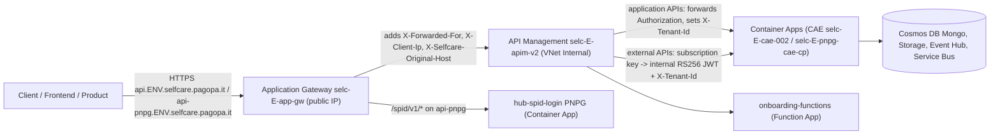

# Infrastructure

> Azure infrastructure of SelfCare, managed with Terraform under `infra/`.

See also: [architecture.md](architecture.md), [multitenancy.md](multitenancy.md), [ci-cd.md](ci-cd.md),
[`infra/core/README.md`](../infra/core/README.md), [Ingress unification spec](specs/MULTITENANT/Step_2/Ingress_unification.md).

## Tooling

| Item | Value | Source |
|------|-------|--------|
| Terraform version | `1.15.6` (use `tfenv install`) | `.terraform-version`, `infra/core/README.md` |
| Providers | `azurerm ~> 4.0`, `azuread`, `pkcs12`, `pagopa-dx/azure` | `infra/core/dev-ar/main.tf` |
| Shared modules | `github.com/pagopa/terraform-azurerm-v4` (e.g. `api_management`, `api_management_api`, `function_app`, `subnet`) | `infra/core/_modules/apim/apim.tf`, `infra/resources/_modules/functions/function.tf` |
| State backend | `azurerm` backend, storage account `selc<e>stinfraterraform`, container `azurermstate`, one key per stack (e.g. `selc.infra.resources.auth.dev-ar.tfstate`) | `infra/resources/auth/dev-ar/providers.tf` |
| Pre-commit | `pagopa/dx` `lock_modules`; `antonbabenko/pre-commit-terraform` `terraform_fmt`, `terraform_docs`, `terraform_validate` | `.pre-commit-config.yaml` |

Manual apply (from `infra/core/README.md`): `export ARM_SUBSCRIPTION_ID=...`, then `terraform init/plan/apply` inside an
`<env>-<domain>` folder. In practice stacks are applied by the GitHub workflows described in [ci-cd.md](ci-cd.md).

## Layout

| Folder | Content |
|--------|---------|
| `infra/bootstrap/` | GitHub/Azure bootstrap per environment (`dev-ar`, `uat-ar`, `prod-ar`): managed identities for CI/CD with OIDC federation, GitHub environments (`<env>-ci`, `<env>-cd`), repository secrets, self-hosted GitHub runners, Key Vault permissions ([README](../infra/bootstrap/README.md)) |
| `infra/cert/` | TLS certificate management in Key Vault, one folder per `<env>-<ar\|pnpg>` using `_modules/cert` |
| `infra/core/` | Shared platform per `<env>-<ar\|pnpg>`: networking, Key Vault, DNS, App Gateway, APIM, Container App Environments, Cosmos DB, Event Hub, storage, Redis, CDN, monitoring, static assets, contract templates |
| `infra/repository/` | GitHub repository settings via `pagopa-dx/github-environment-bootstrap` (environments `dev`, `uat`, `prod`, reviewer teams) |
| `infra/resources/` | Per-app stacks `infra/resources/<app>/<env>-<ar\|pnpg>/` plus shared modules in `infra/resources/_modules/` |
| `infra/resources/api/` | APIM APIs/products for external integrations (`dev-ar`, `uat-ar`, `prod-ar`) using `_modules/apim_external_api` |
| `infra/scripts/` | Operational scripts: `list_container_app_revisions.sh`, `restart_container_apps.sh` |

### Environments and domains

Environments `dev` / `uat` / `prod` (short `d` / `u` / `p`) times domains `ar` (SELC, Area Riservata) and `pnpg`.
Not every app has a `pnpg` stack:

| Stacks | Apps |
|--------|------|
| `ar` + `pnpg` | `dashboard-bff`, `external-api`, `iam`, `institution-ms`, `onboarding-bff`, `onboarding-cdc`, `onboarding-functions`, `onboarding-ms`, `product`, `registry-proxy`, `user-cdc`, `user-group-ms`, `user-ms` |
| `ar` only | `api`, `auth`, `delegation-cdc`, `document-ms`, `institution-cdc`, `institution-send-mail-scheduler`, `log-availability-runner`, `namirial-sign`, `product-cdc`, `registry-proxy-runner`, `user-group-cdc`, `webhook`, `webhook-consumer` |
| `pnpg` only | `spid-login` |

Naming: prefix `selc`, region `westeurope` (`weu`), project `selc-<e>` (e.g. `selc-d`). See `infra/core/dev-ar/locals.tf`
and `infra/resources/_modules/local-env/locals.tf`.

## Shared resource modules (`infra/resources/_modules`)

| Module | Purpose |
|--------|---------|
| `local-env` | Per-environment configuration consumed by every app stack as `module.local.config`: names (APIM, Key Vault, Mongo account, CAE), Quarkus health probes, tags, and the **tenant registry** |
| `local-<env>-<domain>` | Older per-environment config modules (e.g. `local-dev-ar`) |
| `container_app_microservice` | Azure Container App with image `ghcr.io/pagopa/<image_name>:<image_tag>`, ingress on port 8080, Key Vault secret references, probes, optional Dapr, private DNS A record |
| `container_app_job` | Container App Job (scheduled/batch workloads) |
| `apim_api` | One APIM API (application API) from a committed OpenAPI file, CORS, tenant gate policy |
| `apim_external_api` | External APIs, APIM products, JWT minting policies, PNPG APIs, `openapi_merge` scripts |
| `functions` | Function App (`onboarding-functions`) with subnet, NAT association, private endpoint, Key Vault access |
| `cosmosdb_database`, `cosmosdb_collection` | Mongo databases and collections (with indexes) on the shared Cosmos DB account |
| `azure_storage_queue`, `azure_service_bus`, `dapr` | Messaging helpers (e.g. `webhook` uses `storage_queue`) |
| `ai_search*` | Azure AI Search indexes (IPA, geotax, onboarding) |
| `log_availability_runner`, `namirial_sws`, `application_insights_synthetic_monitoring` | App-specific / monitoring modules |

Typical app stack (`infra/resources/auth/dev-ar/auth.tf`): `module "local"` (local-env) -> `apim_api` (if exposed)
-> `cosmosdb_database` + `cosmosdb_collection` -> `container_app_microservice` with `app_settings` and `secrets_names`.
The image tag is passed as `TF_VAR_image_tag` (`sha-<7 chars>`) by the release workflow.

## Request ingress

`ENV` is the DNS environment prefix (`dev.`, `uat.`, none in prod) and `E` the environment short code (`d`, `u`, `p`).
APIM reaches `onboarding-functions` at `https://selc-<e>-onboarding-fn.azurewebsites.net` (`_modules/apim_external_api/apim.tf`).

### Application Gateway (`infra/core/_modules/appgateway`)

- Instantiated only from `infra/core/<env>-ar/commons.tf` (shared by both tenants); SKU `Standard_v2`, WAF disabled by default (`variables.tf`).
- **Listeners**: `api` on `api.<dns_zone_prefix>.pagopa.it` and `api-pnpg` on `api-pnpg.<dns_zone_prefix>.pagopa.it`, certificates from Key Vault.
- **Backends**: `apim` (host `api.<dns_zone_prefix>.pagopa.it`), `hub-spid-pnpg` (PNPG SPID login Container App); others are commented out or unused in path maps.
- **URL path maps**:

| Listener | Paths | Backend | Rewrite set |
|----------|-------|---------|-------------|
| `api` | `/external/*`, `/internal/*`, `/dashboard/*`, `/onboarding/*`, `/party-registry-proxy/*`, `/auth/*` | `apim` | `rewrite-rule-set-apim-headers` |
| `api` | default | `apim` | `rewrite-rule-set-api` |
| `api-pnpg` | `/imprese/dashboard/*`, `/imprese/onboarding/*`, `/external/*`, `/imprese/auth/*` | `apim` | `rewrite-rule-set-apim-headers` |
| `api-pnpg` | `/spid/v1/*` | `hub-spid-pnpg` | `rewrite-rule-set-hub-spid-pnpg` (strips the prefix) |
| `api-pnpg` | default | `apim` | `rewrite-rule-set-api` |

- **Rewrite rules**: all sets add `X-Forwarded-For` and `X-Client-Ip` (client IP) and `X-Selfcare-Original-Host` (original host).
  `rewrite-rule-set-api` additionally rewrites any path not matching `allowedIngressPathRegexps` (`/spid/*`, `/spid-login/*`,
  `/dashboard/*`, `/onboarding/v<n>/...`, `/imprese/onboarding/v<n>/...`, `/ms-notification-manager/*`, `/party-registry-proxy/*`, `/auth/*`) to a dummy path.
- Alerts (compute units, unhealthy backends, latency, failed requests) and diagnostic settings to Log Analytics.

### API Management

Core instance (`infra/core/_modules/apim`): `selc-<e>-apim-v2` in `selc-<e>-api-v2-rg`, `virtual_network_type = "Internal"`,
dedicated subnet `selc-<e>-apim-v2-snet`, custom gateway domain `api.<dns_zone_prefix>.pagopa.it`, Application Insights logger,
JWT certificates `jwt-spid-crt` (AR) and `jwt-pnpg-spid-crt` (PNPG). A single APIM instance serves both tenants.

| Family | Defined in | Notes |
|--------|------------|-------|
| **Application APIs** | `_modules/apim_api`, used by `auth` (`auth`), `dashboard-bff` (`dashboard`, `imprese/dashboard`), `onboarding-bff` (`onboarding`, `imprese/onboarding`), `registry-proxy` (`party-registry-proxy/v1`) | `subscription_required = false`; backend `https://<private_dns_name>`; CORS from `tenant_ids`; APIM does not validate the user JWT, it forwards `Authorization`. `auth` publishes `apps/auth/src/main/docs/openapi-apim.json` |
| **External APIs** | `_modules/apim_external_api` (`api/`, `api_pnpg/`, `api_product/`), applied from `infra/resources/api/<env>-ar` | APIM products per adhering product (`io`, `pn`, `interop`, `idpay`, `pagopa`, ...), subscription keys; policies (`api/jwt_base_policy.xml.tpl`) mint an RS256 JWT signed with the APIM certificate and set `X-Tenant-Id` |

**Tenant registry and tenant gate.** `local-env` holds `tenant_registries` (`AR` with `ONE_IDENTITY`, `PNPG` with
`HUB_SPID_LOGIN`) per environment, with `frontend_uri`, `api_uri`, `allowed_origins`, `jwt_audience`. It exposes:
`tenant_ids` (origin -> tenant, CORS), `tenant_hosts` (APIM hostname -> tenant), `tenant_jwt_audiences` (aud -> tenant + certificate),
`tenant_credential_resources` (env var names only). With `tenant_enforcement_enabled = true` (currently on the `auth`,
`dashboard-bff`, `onboarding-bff`, `registry-proxy` APIs), the `apim_api` policy resolves the tenant from
`X-Selfcare-Original-Host`, rejects unknown hosts with `403 application/problem+json` and sets `X-Tenant-Id`; otherwise any
caller-supplied `X-Tenant-Id` is deleted. `jwt_tenant_resolution_enabled` (aud-based resolution) exists but is `false`
everywhere. `apim_external_api` derives `tenant_id_ar` / `tenant_id_pnpg` from the same registry. Details: [multitenancy.md](multitenancy.md).

**OpenAPI merge flow (external APIs).**

1. Each app release uploads its spec to storage account `selc<e>weuarcheckoutst01`, container `selc-openapi`, blob `<image>/openapi.json` (`call_release_docker.yml`).
2. `create_openapi_merge.yml` / `call_openapi_merge.yml` download those blobs, run `openapi-merge-cli` with each
   `<api>/<version>/openapi_merge/openapi_merge.json` (selecting operations by tag, e.g. `external-v2`), then post-process with
   `openapi_merge/remove_v_and_tags.cjs` and `retain_necessary_schemas_and_tags.cjs`, producing `openapi.<env>.json`.
3. A PR is opened against `main`; `pr_detect_openapi_*` workflows run Optic on the changed `openapi.<env>.json`.
4. After merge, `release_apim.yml` applies `infra/resources/api/<env>-ar` and updates developer docs.

## Container App Environments

| Domain | CAE (per env) | Resource group | Source |
|--------|---------------|----------------|--------|
| AR | `selc-<e>-cae-002` (workload profile `Consumption`) | `selc-<e>-container-app-002-rg` | `infra/core/dev-ar/commons.tf`, `infra/resources/auth/dev-ar/auth.tf` |
| PNPG | `selc-<e>-pnpg-cae-cp` (also `selc-d-pnpg-cae-wp` with workload profiles in dev) | `selc-<e>-container-app-rg` | `infra/core/dev-pnpg/commons.tf`, `infra/resources/iam/dev-pnpg/iam.tf` |

Container Apps get a private A record in the `azurecontainerapps.io` private zone; APIM reaches them via
`selc-<e>[-pnpg]-<app>-ca.<cae default domain>` (`private_dns_name_domain` in `local-env`).

## Key Vault and secrets

- Vaults: `selc-<e>-kv` in `selc-<e>-sec-rg` (AR), `selc-<e>-pnpg-kv` in `selc-<e>-pnpg-sec-rg` (PNPG) (`local-env/locals.tf`).
- The CAE user-assigned identity gets `Get`/`List` on secrets (`azurerm_key_vault_access_policy.container_app_environment`).
- Apps declare `secrets_names = { ENV_VAR = "kv-secret-name" }`; `container_app_microservice` turns each entry into a Container App
  secret referencing `https://<kv>.vault.azure.net/secrets/<name>` and an env var with `secretRef`. Plain settings go in `app_settings`.
- Example mapping in `infra/resources/auth/dev-ar/auth.tf` (`MONGODB_CONNECTION_STRING_AR` -> `mongodb-connection-string`). Never put secret values in Terraform.

## Data and messaging

| Resource | Details | Source |
|----------|---------|--------|
| Cosmos DB (Mongo API) | Account `selc-<e>-cosmosdb-mongodb-account` (AR) / `selc-<e>-weu-pnpg-cosmosdb-mongodb-account` (PNPG), private endpoint; dev uses `EnableServerless`. Databases/collections declared per app | `infra/core/_modules/cosmos_db`, `infra/resources/_modules/cosmosdb_*` |
| Event Hub | Namespace `selc-<e>-eventhub-ns` (`selc-<e>-event-rg`), topics `SC-Contracts`, `Selfcare-FD`, `SC-Contracts-sap`, `SC-Users`, `SC-UserGroups`, `SC-Delegations` with per-consumer SAS keys | `infra/core/_modules/events`, `infra/core/dev-ar/locals.tf` |
| Service Bus (internal events) | Namespace `selc-<e>-<domain>-internal-events` with topics/subscriptions and a managed identity (sender/receiver roles) | `infra/core/_modules/internal_events` |
| Storage | Contracts (`contracts_storage`), documents (`storage_documents`), user attachments, logs, checkout/web storage (`selc<e>weuarcheckoutst01`, also hosts `selc-openapi`) | `infra/core/dev-ar/commons.tf` |
| Others | Redis, AI Search, CDN, Log Analytics / Application Insights, monitor action groups | `infra/core/_modules/*` |

## Networking and DNS

- Main VNet per environment (dev: `10.1.0.0/16`) with dedicated subnets for App Gateway, APIM, Cosmos DB, Event Hub, storage,
  private endpoints, AI Search, CAE (`cidr_subnet_selc`, `cidr_subnet_selc_pnpg`), VPN and DNS forwarder; a pair VNet in `northeurope`
  (`infra/core/dev-ar/locals.tf`, `_modules/network`, `_modules/networking`).
- NAT gateway for outbound traffic (`_modules/nat`), consumed by app stacks through `local-env`.
- Public DNS zone `<dns_zone_prefix>.pagopa.it` with NS delegations (`_modules/dns_public`); private DNS zones for private
  endpoints (`privatelink.mongo.cosmos.azure.com`, `privatelink.servicebus.windows.net`, ...) in `_modules/dns_private`.
- Hostnames per tenant are listed in `local-env` `tenant_registries` (e.g. dev AR `api.dev.selfcare.pagopa.it`, dev PNPG `api-pnpg.dev.selfcare.pagopa.it`).

## Conventions

- Add a new app stack by copying an existing `infra/resources/<app>/<env>-<domain>/` and reusing `local-env` + `container_app_microservice`.
- Keep `README.md` per stack/module updated through `terraform_docs` (pre-commit).
- Every infra folder has a matching PR plan workflow (`pr_<app>_infra.yml`) and is applied by the release workflows (see [ci-cd.md](ci-cd.md)).
