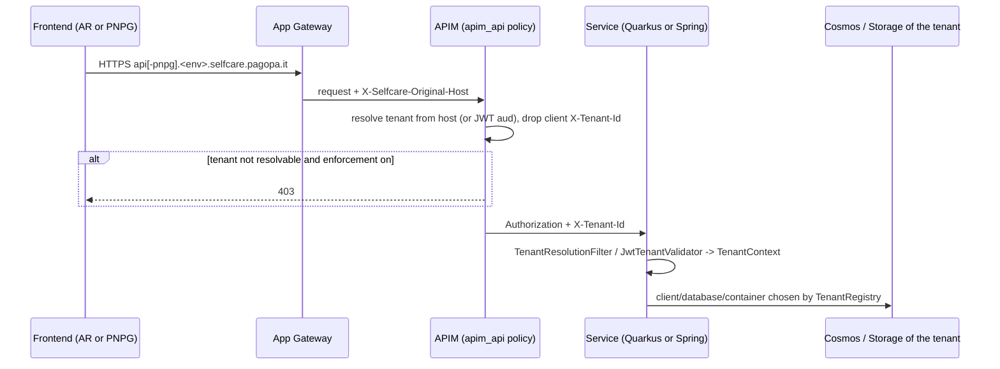

# Multitenancy

SelfCare serves two tenants:

| Tenant | Id | Frontend | API host | Login |
|--------|----|----------|----------|-------|
| Area Riservata | `AR` | `selfcare.pagopa.it` | `api.<env>.selfcare.pagopa.it` | OneIdentity → [auth](./apps/auth.md) |
| Piattaforma Notifiche PG | `PNPG` | `imprese.notifichedigitali.it` (dev: `pnpg.dev.selfcare.pagopa.it`) | `api-pnpg.<env>.selfcare.pagopa.it` | hub-spid-login (`/spid/v1`) |

Today each tenant has its own deployment (`-ar` / `-pnpg` Terraform environments). The multitenant
initiative aims at **one backend per environment** serving both tenants, with a verifiable tenant on
every request and isolated data. Specs: [specs/README.md](./specs/README.md#multitenant-one-backend-for-ar-and-pnpg).
Sources for this page: the specs under `docs/specs/MULTITENANT/`, the libraries in `libs/`, the
Terraform in `infra/resources/` and the per-app configuration cited below.

## Roadmap (from the specs)

| Step | Goal | Main requirements |
|------|------|-------------------|
| [Step 0](./specs/MULTITENANT/Step_0/REQUIREMENTS.md) | Tenant identity: `X-Tenant-Id` header plus `tenant_id` JWT claim, resolved by APIM and validated by every service. Claim-less hub-spid-login tokens default to PNPG. Follow-up auth work in [SELC-9170](./specs/MULTITENANT/Step_0/SELC-9170/REQUIREMENTS.md). | SELC-1..7 |
| [Step 1](./specs/MULTITENANT/Step_1/REQUIREMENTS.md) | Data isolation: `tenantId` discriminator (or database per tenant) in Cosmos, storage per tenant, PDV, email sender. Legacy documents are tagged by the [backfill script](./specs/MULTITENANT/Step_1/scripts/README.md); until then reads accept `tenantId = T OR tenantId IS NULL`. | SELC-8..11 |
| [Step 2](./specs/MULTITENANT/Step_2/REQUIREMENTS.md) | Strict isolation: trusted runtime `TenantContext`, a tenant resource registry that routes Mongo and storage, strict mode, cutover gates and a single ingress. | SELC-12..19 |

The overall design (in Italian) is in [DESIGN_REVIEW.md](./specs/MULTITENANT/DESIGN_REVIEW.md).

## Request flow (target design)

## Shared building blocks

### Quarkus: `libs/selfcare-sdk-security`

Package `it.pagopa.selfcare.security`. See [libs/selfcare-sdk-security.md](./libs/selfcare-sdk-security.md).

| Class | Behaviour |
|-------|-----------|
| `tenant/TenantResolutionFilter` | Reads the tenant from `X-Tenant-Id` (and from the `tenantId` query param unless `selfcare.tenant.resolution-filter.query-param-enabled=false`) and sets `TenantContext`. Rejects conflicting, unknown or missing tenants with 400 `application/problem+json` and writes an `AUDIT_TENANT` log entry. Turned on at build time with `selfcare.tenant.resolution-filter.enabled=true` (default off). With `tenant.enforcement.enabled=false` a missing tenant falls back to `tenant.default` (default `AR`). Skips `/q/`. |
| `tenant/EffectiveTenant` | Reconciles an optional `tenantId` parameter with the header context and the JWT `tenant_id` claim; returns 400 on conflict. |
| `JwtTenantValidator` + `JwtTenantValidationFilter` | For SPID-issued tokens: a token without a claim gets `DEFAULT_TENANT` unless `JWT_TENANT_CLAIM_REQUIRED=true`; the claim must match the header (otherwise 401). Disable with `selfcare.security.tenant-validation.enabled=false`. |
| `JWTCallerPrincipalFactory` | Accepts issuers `SPID` and `PAGOPA`. Verification keys come from the registry `jwt.publicKeyEnvVar` (synthetic kid `tenant:<ID>`), falling back to `mp.jwt.verify.publickey`. With several keys and no `kid`, every key is tried, so a key is not yet bound to a tenant. |

### Quarkus: `libs/selfcare-sdk-tenant` and `libs/selfcare-sdk-tenant-mongodb`

- `TenantRegistry` is loaded from `tenant.registry.json` / `tenant.resources.registry.json`. Each
  `TenantDefinition` may declare `mongo`, `jwt`, `storages`, `oneIdentity`, `userRegistry` and
  `signature`. Validation is driven by `tenant.supported-tenants`, `tenant.mongo.mandatory`,
  `tenant.storage.mandatory-keys`, `tenant.one-identity.mandatory-tenants` and
  `tenant.user-registry.mandatory-tenants`.
- `TenantContext` is `@RequestScoped`. Failures raise unknown/unresolved tenant or unknown storage exceptions.
- `TenantMongoClientProducer` replaces the default Panache reactive Mongo client (`@Alternative`), and
  `TenantMongoDatabaseResolver` picks the database of the current tenant.

See [libs/selfcare-sdk-tenant.md](./libs/selfcare-sdk-tenant.md) and [libs/selfcare-sdk-tenant-mongodb.md](./libs/selfcare-sdk-tenant-mongodb.md).

### Spring: `libs/selfcare-commons` (`selc-commons-tenant`)

The same concepts for Spring apps: a `ThreadLocal` `TenantContext`, `TenantRegistry`,
`TenantMongoDatabaseFactory` and `TenantBlobClientProvider`. `selc-commons-web` adds
`SpidJwtAuthenticationStrategy` and `TenantValidationException`. See [libs/selfcare-commons.md](./libs/selfcare-commons.md).

### Environment variables

| Variable | Used by | Meaning |
|----------|---------|---------|
| `SUPPORTED_TENANTS` | `JwtTenantValidator` (default `AR,PNPG`), onboarding-functions, onboarding-cdc | Accepted tenant ids |
| `DEFAULT_TENANT` | `JwtTenantValidator` (default `PNPG`), iam, onboarding-functions, onboarding-cdc | Tenant assumed for claim-less SPID tokens |
| `JWT_TENANT_CLAIM_REQUIRED` | `JwtTenantValidator` (default `false`), external-api (set to `"false"` in Terraform) | Reject tokens without `tenant_id` |
| `TENANT_SUPPORTED_TENANTS` | document-ms, external-api, iam, institution-ms, onboarding-ms, product, product-cdc, registry-proxy, user-group-ms | `tenant.supported-tenants` of the registry |
| `TENANT_REGISTRY_JSON` | auth, iam, onboarding-ms, product, product-cdc | Tenant resource registry (Quarkus) |
| `SELFCARE_TENANT_DATA_ISOLATION` | external-api, institution-ms, user-group-ms | Tenant resource registry (Spring) |
| `SELFCARE_TENANT_STRICT_DATA_ISOLATION` | auth, document-ms, iam, onboarding-functions | Strict mode (no `tenantId IS NULL` fallback) |

Terraform wiring is in `infra/resources/<app>/*.tf`.

## Infrastructure

**Application APIs** (`infra/resources/_modules/apim_api/variables.tf`, policy in `main.tf`):

| Variable | Default | Meaning |
|----------|---------|---------|
| `tenant_hosts` | `[]` | Maps the gateway hostname to a tenant id. The hostname is bound to DNS and TLS, so the caller cannot choose it. |
| `tenant_enforcement_enabled` | `false` | Fail-closed gate: an unattributable request gets 403. When disabled, any client `X-Tenant-Id` is stripped. |
| `tenant_jwt_audiences` | `[]` | Maps the token `aud` to a tenant and to the APIM certificate that verifies it. |
| `jwt_tenant_resolution_enabled` | `false` | Resolve the tenant from the JWT `aud` (401 for an invalid token, 403 for a mismatch), falling back to the host. |
| `tenant_ids` | — | Allowed frontend origins and their tenant ids. |

Enforcement is on, with JWT resolution off, for auth (dev/uat/prod AR), dashboard-bff and
onboarding-bff (all six environments) and registry-proxy (three environments).

**Per-environment registries** live in `infra/resources/_modules/local-env/locals.tf`:

- `tenant_registries` define `frontend_uri`, `api_uri`, `allowed_origins`, `authentication_provider`
  (`ONE_IDENTITY` for AR, `HUB_SPID_LOGIN` for PNPG), `auth_enabled` (AR `true`, PNPG `false`) and `jwt_audience`.
- `strict_tenant_data_isolation` is `false` in dev, uat and prod.
- Per-tenant credential secrets: `TENANT_<ID>_ONE_IDENTITY_CLIENT_ID/SECRET` and `USER_REGISTRY_API_KEY_<ID>`.

**External APIs** (`infra/resources/_modules/apim_external_api`): the `tenant_registry` variable
gives `tenant_id_ar` / `tenant_id_pnpg`. `api/jwt_base_policy.xml.tpl` mints an RS256 JWT (issuer
`SPID`, `tenant_id` from the product or the app tenant, 30-minute expiry) and overwrites
`Authorization` and `X-Tenant-Id` before calling the backend.

## Status per app (from code and config)

Only verifiable evidence is listed. Absence from the table means no tenant-specific code was found,
not that the app is out of scope.

| App | Tenant identity (Step 0) | Tenant-routed data (Step 1/2) | Evidence |
|-----|--------------------------|-------------------------------|----------|
| [auth](./apps/auth.md) | Own `filter/TenantResolutionFilter` on `X-Tenant-Id` | Registry with per-tenant OneIdentity, user registry and mail sender; Mongo via `sdk-tenant-mongodb` | `apps/auth/src/main/java/it/pagopa/selfcare/auth/{filter,conf,client}/Tenant*.java`, `application.properties` |
| [iam](./apps/iam.md) | Resolution filter on, `AR,PNPG` | Registry, strict flag | `apps/iam/src/main/resources/application.properties`, `apps/iam/Readme.md` "Multitenancy" |
| [document-ms](./apps/document-ms.md) | Security SDK, enforcement | Registry with mongo/jwt/signature; storage keys `contracts`, `user-attachments` | `apps/document-ms/src/main/resources/application.properties` |
| [onboarding-ms](./apps/onboarding-ms.md) | Resolution filter on (query param off) | Registry with several storages | `apps/onboarding-ms/src/main/resources/application.properties` |
| [product](./apps/product.md) | Resolution filter on | Registry, storage `contracts` | `apps/product/src/main/resources/application.properties` |
| [product-cdc](./apps/product-cdc.md) | — | Registry, storage `products` | `apps/product-cdc/src/main/resources/application.properties` |
| [webhook](./apps/webhook.md) | JWT tenant validation on, resolution filter off | Registry `{"AR":{},"PNPG":{}}`, `tenant.mongo.mandatory=false` | `apps/webhook/src/main/resources/application.properties` |
| [onboarding-functions](./apps/onboarding-functions.md) | Own JWT validation (`JWT_PUBLIC_KEY_AR/PNPG`, default tenant PNPG) | Per-tenant contract storage | `apps/onboarding-functions/src/main/resources/application.properties` |
| [onboarding-cdc](./apps/onboarding-cdc.md) | `SUPPORTED_TENANTS` / `DEFAULT_TENANT` | — | `apps/onboarding-cdc/src/main/resources/application.properties` |
| [external-api](./apps/external-api.md) | `jwt.tenant-audience-resolution-enabled=true` | `selc-commons-tenant` registry | `apps/external-api/README.md` "Tenant isolation", `config/tenant-config.properties` |
| [registry-proxy](./apps/registry-proxy.md) | — | `selc-commons-tenant` | `apps/registry-proxy/README.md` "Multitenancy (Step 2)" |
| [user-group-ms](./apps/user-group-ms.md) | — | Registry, strict default `true` | `config/core-config.properties` |
| [institution-ms](./apps/institution-ms.md) | — | Registry, strict default `true`, storage keys `products`, `mail-templates` | `connector/dao/src/main/resources/config/dao-config.properties`, OpenSpec change (all tasks checked) |
| [dashboard-bff](./apps/dashboard-bff.md) | Forwards `X-Tenant-Id` on Feign calls | — | `interceptor/TenantHeaderInterceptor` |
| [user-ms](./apps/user-ms.md), [user-cdc](./apps/user-cdc.md), [delegation-cdc](./apps/delegation-cdc.md) | Tenant id on webhook notifications (default `AR`) | — | `USER_MS_WEBHOOK_TENANT_ID` and webhook tenant-id properties |

Legacy data is tagged per database and collection by the
[backfill script](./specs/MULTITENANT/Step_1/scripts/README.md). It covers `selcAuth`,
`selcDocument`, `selcMsCore`, `selcOnboarding`, `selcUser`, `selcUserGroup` and `selcWebhook`.
Product definitions and `selcIam.userClaims` are excluded by design.

## Single ingress and open decisions

[Ingress_unification.md](./specs/MULTITENANT/Step_2/Ingress_unification.md) plans one App Gateway
listener and one APIM API per BFF. APIM would trust the JWT `tenant_id` first, then the product
`tenantId`, then `Origin` for pre-login calls. The `jwt_tenant_resolution_enabled` policy exists but
is still off by default. Still open: PNPG login, the pre-login tenant source, Terraform ownership,
a compatibility window for `api-pnpg`, the dev PNPG domain and the migration of PNPG product data.

The strategy is being discussed in the Confluence RFC
[RFC - Multitenancy Strategia Unico Backend](https://pagopa.atlassian.net/wiki/spaces/SCP/pages/3456303148).

Related: [architecture.md](./architecture.md), [infrastructure.md](./infrastructure.md).
