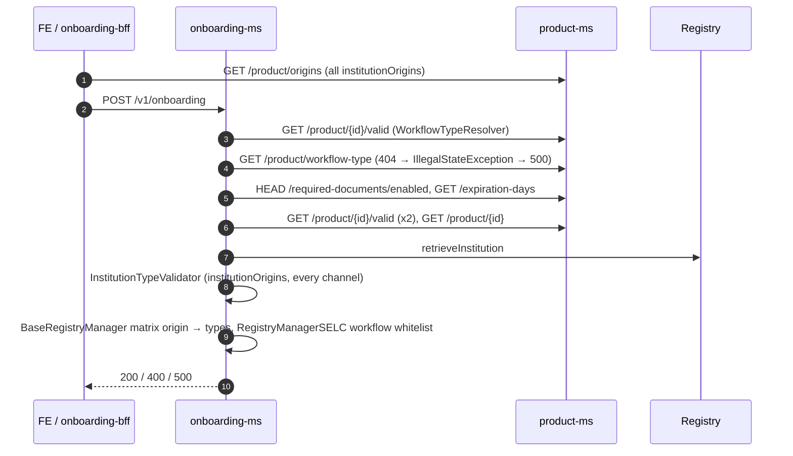
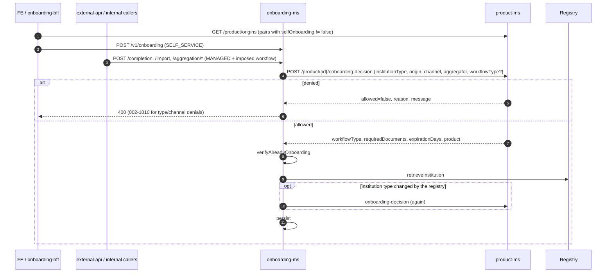

# ONBOARDING_ADMISSION_RULES — Architecture

See [REQUIREMENTS.md](REQUIREMENTS.md) for the rules. This document covers:
- the previous design;
- the alternatives considered;
- the chosen design;
- the rollout.

## Previous design (before SELC-9538)



Rule inventory and issues:

| Rule | Where | Issue |
|---|---|---|
| Pairs shown to the FE | product-ms `institutionOrigins` → `/origins` | Same list as the BE check: the FE and the BE could not be separated |
| Pairs admitted (every channel) | onboarding-ms `InstitutionTypeValidator` | No channel. The `product == null` branch was dead |
| Origin → institution types matrix | onboarding-ms `BaseRegistryManager` (code) | Duplicated, evaluated after the product check, not validated when a product is saved |
| Workflow per pair | product-ms `workflowRules` + `/workflow-type` | Separate list with no coherence check. A missing rule gave a 500 |
| Workflow priorities (PT, aggregator, signatures, parent) | onboarding-ms `WorkflowTypeResolver` (code) | Product logic outside product-ms. Used the `ProductId` enum, so a new product needed a code change |
| Workflows allowed for SELC | onboarding-ms `RegistryManagerSELC` (code) | Hidden domain rule |

## Alternatives considered

| Option | Summary | Why not chosen |
|---|---|---|
| A. `selfOnboarding` flag + checks in onboarding-ms | Flag on `OriginEntry`, channel check in onboarding-ms | Rules stay split across two services |
| B. Unified admission rules (`channels`, `workflowType` per entry) | Replace `institutionOrigins` + `workflowRules` with one structure | Data migration on every product, larger API change |
| C. product-ms decision endpoint | onboarding-ms asks a single decision | **Chosen**, combined with A's flag |
| D. Shared library evaluated locally | Rules in an SDK | Every rule change needs a release of every consumer |
| E. External policy engine | OPA or similar | New infrastructure, out of proportion for the problem |

On the flag type, a Boolean `selfOnboarding` was chosen over a `channels` set:
- there are only two channels;
- "absent = allowed" keeps every existing product unchanged;
- a set would allow meaningless values, such as an empty set.

## Chosen design



### product-ms

- `OriginEntry.selfOnboarding` (Boolean, optional).
- `OnboardingRules`: the single rule engine. It is used both by the decision and by the save-time validation, so a product that passes `STRICT` validation cannot produce an inconsistent decision.
- `OnboardingRulesConfig` (`product-ms.onboarding-rules.*`):
  - origin → admitted institution types;
  - origin → admitted workflows;
  - validation mode.
- `POST /product/{productId}/onboarding-decision` (`OnboardingDecisionRequest` / `OnboardingDecisionResponse`, `OnboardingChannel`, `OnboardingDecisionReason`).
- `GET /product/origins`: same shape, filters out `selfOnboarding=false`.

### onboarding-ms

- `OnboardingAdmissionHelper.admit(onboarding, channel, workflowType, onAdmitted)`:
  - builds the request;
  - maps denials to exceptions;
  - sets the workflow type;
  - applies the required documents and expiration from the decision.
- `OnboardingAdmissionHelper.confirm(...)` re-decides only if the registry changed the institution type.
- Removed:
  - `InstitutionTypeValidator`;
  - `WorkflowTypeResolver`;
  - the `BaseRegistryManager` matrix and `validateInstitutionType*`;
  - the `RegistryManagerSELC` workflow whitelist;
  - `ProductService.getWorkflowType` / `isRequiredDocuments` / `getProduct`;
  - the silent fallback on required documents.
- `RegistryResourceFactory.effectiveOrigin`: `null`, `SELC`, `MOCK` and `UNKNOWN` map to SELC.

## Example: prod-pagopa, GPU only through managed flows

```json
{
  "productId": "prod-pagopa",
  "institutionOrigins": [
    { "institutionType": "PA",  "origin": "IPA",  "labelKey": "pa" },
    { "institutionType": "GSP", "origin": "SELC", "labelKey": "gsp" },
    { "institutionType": "PSP", "origin": "SELC", "labelKey": "psp" },
    { "institutionType": "PT",  "origin": "SELC", "labelKey": "pt" },
    { "institutionType": "GPU", "origin": "SELC", "labelKey": "gpu", "selfOnboarding": false }
  ],
  "workflowRules": [
    { "institutionType": "PA",  "origin": "IPA",  "workflowType": "CONTRACT_REGISTRATION" },
    { "institutionType": "GSP", "origin": "SELC", "workflowType": "FOR_APPROVE" },
    { "institutionType": "PSP", "origin": "SELC", "workflowType": "FOR_APPROVE" },
    { "institutionType": "GPU", "origin": "SELC", "workflowType": "FOR_APPROVE_GPU" }
  ]
}
```

Results:
- GPU is not returned by `/origins`;
- `POST /onboarding` for GPU → 400 `002-1010`;
- `/completion`, `/aggregation/completion` and `/import` → allowed with the imposed workflow.

## Rollout

1. **product-ms** first. All changes are additive:
   - with `selfOnboarding` absent, behaviour is unchanged;
   - validation runs in `WARN` mode.
2. **onboarding-ms**. It depends on the decision endpoint, so it must be deployed after product-ms in each environment.
3. **Configuration**, per environment and tenant (AR, PNPG):
   - set `selfOnboarding: false` where needed (prod-pagopa GPU/SELC);
   - fix the problems logged by the `WARN` validation;
   - then set `ONBOARDING_RULES_VALIDATION_MODE=STRICT`.
4. **Cleanup** (follow-up):
   - deprecate `GET /product/workflow-type` and `HEAD /required-documents/enabled` once APIM logs show no consumers;
   - propagate `selfOnboarding` in the product-cdc `OriginEntry` copy if blob consumers need it.

Rollback: redeploy the previous onboarding-ms. product-ms changes are backward compatible.

## Testing

- product-ms:
  - unit tests on `OnboardingRules` and the decision;
  - Cucumber `onboarding_decision.feature` (decision, `/origins` filter, save-time validation).
- onboarding-ms:
  - unit tests on `OnboardingAdmissionHelper` and the entry points;
  - Cucumber scenarios: GPU self-service 400, GPU `/completion` 200, SA/IPA 400, missing workflow rule 400. GPU on the aggregation, import and increment flows has no dedicated test: it relies on the generic MANAGED-channel unit tests (product-ms `ProductServiceImplTest`, onboarding-ms `OnboardingAdmissionHelperTest`).
- The onboarding-ms product-ms mock (`src/test/resources/mock/product-api.json`) emulates the decision with one Velocity template per product and tenant. It was verified against the product-ms rules on every type × origin × channel × workflow combination.
